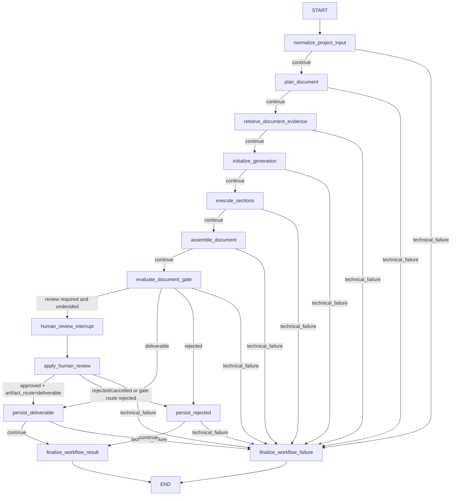
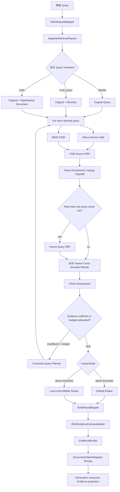
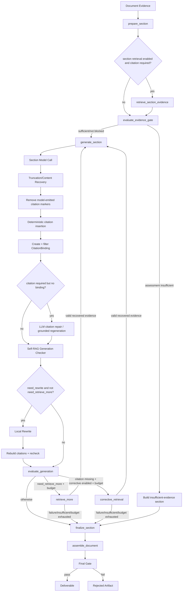
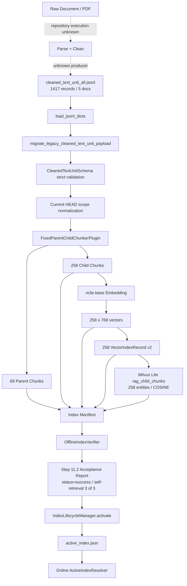

# Agent-RAG Code Walkthrough

## 0. 文档说明

### 0.1 调查基线

| 项目 | 结果 |
|---|---|
| 调查时间 | 2026-07-26 |
| Repository | `D:\MyCode\rag-agent` |
| Branch | `main` |
| Commit | `07dda2e80645cac67f8b5f5e30002d21c2ab01eb` |
| Worktree | **dirty**；调查开始前已存在大量 modified/untracked 文件 |
| 基线含义 | 本文绑定到 `HEAD + 调查时工作区内容`，不能仅凭 commit 复现全部被调查字节 |
| 本轮允许修改 | 仅创建 `docs/CODE_WALKTHROUGH.md` |
| 生产部署边界 | 只确认当前仓库入口、装配和受控运行；仓库外 HTTP/API/部署入口与真实生产配置均未确认 |

### 0.2 状态分类

本文不用含义模糊的 `active/inactive` 作为最终结论，统一使用：

- `mainline-required`：当前仓库主链必经。
- `mainline-conditional`：已接入当前仓库主链，但满足条件才执行。
- `controlled-runtime-confirmed`：受控测试或测试资源已实际执行。
- `resource-conditional`：依赖模型、Milvus、Embedding、Reranker、配置或外部服务。
- `compatibility`：兼容旧接口、旧数据或旧调用方式。
- `legacy`：当前仓库主链已绕过。
- `experimental`：实验、评测或候选配置。
- `unknown`：当前证据不足。
- `production-runtime-unknown`：仓库主链已确认，但真实部署环境未确认。

### 0.3 证据等级

本次结论按以下顺序取证：

1. 本轮测试与仓库内历史 Trace/验收产物；
2. Composition Root 的构造、注册和注入；
3. LangGraph 节点、边、条件边及直接函数调用；
4. 状态写入、持久化和 Contract 校验；
5. 配置与依赖注入；
6. 类/函数存在；
7. 注释、README、既有调查报告。

既有 `docs/team/ANALYSIS/`、`HANDOFFS/` 和 `REVIEWS/` 只作为调查线索；关键结论已回到代码、配置、测试或数据产物复核。

### 0.4 本轮验证

本轮实际执行：

```text
./.venv/Scripts/python.exe -m pytest -q \
  backend/tests/test_mainline_closure_acceptance.py \
  backend/tests/test_phase1_langgraph_serializable_state.py \
  backend/tests/test_langchain_rag_integration.py \
  backend/tests/test_rag_config_driven_query_transformers.py \
  backend/tests/test_rag_config_driven_retrieval_stack.py \
  backend/tests/test_rag_corrective_retrieval_loop.py \
  backend/tests/test_rag_config_driven_context_packer.py \
  backend/tests/test_step_12_evidence_contract.py \
  backend/tests/test_citation_binding_regression.py \
  backend/tests/test_grounded_generation_budget.py \
  backend/tests/test_phase3_section_execution_subgraph.py \
  backend/tests/test_phase4_durable_resume_hitl.py \
  backend/tests/test_step_15_graph_state_workflow_engine.py \
  backend/tests/test_workflow_budget_exhaustion_semantics.py \
  backend/tests/test_step_13_trace_v2.py
```

结果：

```text
113 passed in 49.92s
```

隔离复现：

```text
./.venv/Scripts/python.exe -m pytest -q \
  backend/tests/test_p1_security_durability_identity_closure.py
```

结果：测试在 collection 阶段失败，导入链为：

```text
test_p1_security_durability_identity_closure.py
  -> document_gate
  -> scheme_writer.citation_integrity_service
  -> scheme_writer.__init__
  -> SchemeGenerationUseCase
  -> SchemeGenerationStageService
  -> document_gate (partially initialized)
```

异常：`ImportError: cannot import name 'evaluate_scheme_draft' from partially initialized module`。

当前 `.venv` 能导入 `langgraph`，不能导入 `pymilvus` 和 `sentence_transformers`。因此真实 Milvus + 本地 Embedding/Reranker 的本轮端到端运行未执行。

---

## 1. Executive Summary

### 1.1 系统一句话说明

这是一个以 `MainlineApplicationService` 为应用边界、以 `SupervisorAgent` 为运行入口、以显式 LangGraph 为业务控制面、以独立 Parent/Child RAG Pipeline 为证据生产面、以章节子图和强制引用/事实门禁为生成质量控制面的企业文档生成系统。

### 1.2 两条核心链

**在线链：**

```text
ProjectInput
-> Task
-> SupervisorAgent
-> EnterpriseDocumentWorkflowEngine
-> 文档规划
-> 文档级/章节级 RAG
-> 章节生成与反馈循环
-> 文档组装
-> Hard Gate
-> Deliverable 或 Rejected Artifact
```

**离线链：**

```text
CleanedTextUnit JSONL
-> Parent/Child Chunk
-> Child Embedding
-> VectorIndexRecord
-> Milvus Lite
-> Manifest + Verification Report
-> Lifecycle Activation
-> active_index.json
-> 在线 RetrievalRuntime
```

### 1.3 关键架构事实

1. `scripts/run_pipeline.py` 是当前最严格的仓库级非交互入口；它要求 caller-controlled `ProjectInput` 与独立的 trusted `RetrievalAccessScope` 两份 JSON。
2. 当前主链没有按 `WorkflowDefinitionSchema.steps` 逐个调用注册 Agent；`SupervisorFactory` 直接注入 `EnterpriseDocumentWorkflowEngine`，显式图节点直接调用 use case/stage service。
3. `SchemeWriterAgent` 被构造，用来组装其依赖和暴露 `stage_service`；当前主链不调用 `SchemeWriterAgent.run()`。
4. 在线 RAG 的 canonical 输出是 `EvidenceBundleSchema`；`context/chunks/citations` 是由 contract 派生的投影，不是并列事实源。
5. CRAG 位于检索 Pipeline 内；Self-RAG 位于章节生成后和章节子图内；两者不是同一层。
6. Citation marker 不是模型输出的可信事实。系统会清除模型 marker，再根据 Evidence 生成、校验并重建 `CitationBinding` 和可见 marker。
7. Final Gate 同时检查章节完整性、截断、Evidence 边界、marker-binding occurrence 一一对应、citation lineage、grounding、高风险项目事实和 workflow completion。
8. 当前 active index 的产物与当前 HEAD builder 在 scope 字段上存在版本差异：active child/vector 记录没有 `tenant_id/kb_id/file_id`，当前 builder 已会补齐。
9. Task 持久化事实源是 append-only JSONL event log；GraphState 节点间事实源是 checkpoint 中的序列化 state；二者不是同一状态对象。
10. 默认顶层业务节点 `max_retries=0`，即每个节点默认只尝试一次；章节质量循环默认最多 1 次补检索、1 次局部改写。

### 1.4 当前最重要的未知项

- 仓库外真实 HTTP/API/消息队列/部署入口。
- 真实部署环境变量、模型服务、认证边界和 trusted retrieval scope。
- 当前 active Milvus 数据在 trusted tenant/KB/file 过滤下的真实行为。
- active index 的原始构建命令、构建 commit 和完整不可变 provenance。
- dirty worktree 的不可变内容标识；当前 commit 不能单独复现本文基线。

---

## 2. Repository Map

| 目录 | 当前真实职责 | 备注 |
|---|---|---|
| `scripts/` | CLI、demo、workflow control、离线构建/验收/生命周期入口 | 仓库级入口，不等于已部署 API |
| `backend/application/` | 应用边界、RunWorkspace、ProjectInput/Task 构造、mainline service | 负责把外部输入映射到运行对象 |
| `backend/bootstrap/` | Composition Root、RuntimeOptions、Supervisor/RAG/Observability/质量组件装配 | 判断“是否进入主链”的高等级证据 |
| `backend/agent/` | Supervisor、GraphState、状态读写、workflow runtime、安全提交 | 不负责具体文档业务算法 |
| `backend/apps/enterprise_document/` | 企业文档业务 Schema、Stage Service、显式顶层图、章节子图、生成、引用和门禁 | 当前核心业务实现 |
| `backend/rag/` | 在线 Retrieval Runtime/Pipeline、插件、Evidence Contract、离线索引 | 生成答案不在 RAG Engine 内 |
| `backend/model_gateway/` | 模型路由、调用边界、provider fallback、ModelUsageLedger | 实际调用统计事实源 |
| `backend/task/` | Task append-only event log 和状态投影 | 持久化任务状态事实源 |
| `backend/data_capture/` | Run Trace、训练/评测数据 capture | Trace 与业务 state 分离 |
| `backend/schemas/` | 跨模块 Contract：Task、Evidence、Citation、Status、Trace 等 | Schema 存在不等于主链启用 |
| `backend/tests/` | 受控运行、回归和架构闭环测试 | 本轮 113 项通过 |
| `data/processed/indexes/` | 版本化离线索引、manifest、Milvus Lite、active pointer、lifecycle history | 当前 active artifact 的运行证据 |
| `docs/team/` | 任务治理、调查、Handoff、QA Review | 只能作为线索，不能替代代码证据 |

---

## 3. Confirmed Entrypoints

### 3.1 仓库级入口

| 入口 | 输入 | 直接下游 | 分类 |
|---|---|---|---|
| `scripts/run_pipeline.py::main` | `ProjectInput` JSON + 独立 `RetrievalAccessScope` JSON | `mainline_runtime.run_mainline` | `mainline-required` 的严格 CLI 入口；`production-runtime-unknown` |
| `scripts/run_demo.py::main` | 交互输入、demo seed、可选显式 ProjectInput | `run_mainline` | demo/人工验收入口；允许显式 demo defaults |
| `scripts/workflow_control.py::main` | stream/inspect/resume/cancel 等命令 | `MainlineApplicationService` 对应方法 | 初始 stream 与 continuation 控制入口 |
| `backend/application/mainline_service.py::MainlineApplicationService.run` | user input、ProjectInput、trusted scope、运行参数 | Task/Supervisor/Workflow | 应用服务同步入口 |
| `MainlineApplicationService.stream_run` | 同上 | Supervisor stream | 流式入口 |
| `MainlineApplicationService.resume/inspect/cancel/...` | task/run/checkpoint/review/cancel 信息 | workflow engine continuation | continuation；不是新的初始业务入口 |

仓库搜索未确认 FastAPI/Flask/Django 路由或已部署 server composition root。真实外部入口状态为 `unknown` / `production-runtime-unknown`。

### 3.2 从用户输入到顶层 Workflow 的函数级调用链

```text
scripts.run_pipeline.main
  -> load_project_input
  -> load_retrieval_access_scope
  -> scripts.mainline_runtime.run_mainline
  -> MainlineApplicationService.run
     -> RunWorkspace(...)
     -> TaskFactory.build
        -> ProjectInputFactory.build
           -> ProjectInputSchema.model_validate(strict=True)
        -> TaskSchema(...)
     -> JsonlTaskManager.create_task
     -> build_scheme_generation_workflow
     -> RuntimeOptions.resolve
     -> SupervisorFactory.build
        -> ObservabilityFactory.build
        -> ModelGatewayFactory.build
        -> RAGServiceFactory.build
        -> AgentQualityFactory.build
        -> AgentRegistry.register(ProjectInputNormalizerAgent)
        -> SchemeWriterAgent(...)
        -> create_sqlite_checkpoint_resource
        -> EnterpriseDocumentWorkflowEngine(
             stage_service=scheme_writer.stage_service,
             checkpointer=official SqliteSaver,
             ...)
        -> SupervisorAgent(...)
     -> SupervisorAgent.run(task)
        -> WorkflowRouter.route
        -> JsonlTaskManager.mark_running
        -> ContextBundleFactory.create
        -> GraphStateSchema(...)
        -> EnterpriseDocumentWorkflowEngine.execute
        -> 显式 LangGraph
```

### 3.3 谁创建什么

| 问题 | 结论 |
|---|---|
| 谁创建 `ProjectInput`？ | `ProjectInputFactory.build`；生产路径严格验证 caller 提供的 canonical contract，demo 路径通过版本化 seed adapter 补默认值 |
| 谁创建 `Task`？ | `TaskFactory.build` |
| 谁创建 `SupervisorAgent`？ | `SupervisorFactory.build` |
| 谁选择 Workflow Engine？ | `SupervisorFactory.build` 对 enterprise document mainline 显式构造并注入 `EnterpriseDocumentWorkflowEngine` |
| 谁创建初始 `GraphState`？ | `SupervisorAgent.run/stream` |
| 谁创建 checkpoint saver？ | `SupervisorFactory.build -> create_sqlite_checkpoint_resource` |

### 3.4 Composition Root 的重要事实

- AgentRegistry 只注册 `ProjectInputNormalizerAgent`。
- `SchemeWriterAgent` 被构造但不注册；当前 engine 只取其 `stage_service`。
- `EnterpriseDocumentWorkflowEngine.__init__` 创建 `SectionExecutionGraph` 并调用 `stage_service.attach_section_execution_graph`。
- `WorkflowDefinitionSchema` 的两个 coarse step 仍提供 workflow identity、metadata 和 compatibility contract，但当前 engine 不按 `target_name` 逐步 dispatch Agent。
- 默认环境值（当前 shell 变量均 unset）由代码解析为：
  - `USE_REAL_RAG_TOOL=true`
  - `ENABLE_AGENT_SELF_RAG=true`
  - `ENABLE_SEMANTIC_GATE=false`
  - `SECTION_MAX_CONCURRENCY=1`

---

## 4. Online Agent / Workflow Chain

### 4.1 顶层 Mermaid 图



### 4.2 节点表

| 节点 | 实际执行函数 | 上游 | 下游/分支 | 主要输入 | 主要输出/状态变化 | 异常与状态分类 |
|---|---|---|---|---|---|---|
| `normalize_project_input` | `EnterpriseDocumentWorkflowEngine._normalize_project_input -> ProjectInputNormalizationUseCase.execute` | START | plan / failure | GraphState 中 ProjectInput candidates | typed `payload.project_input`、table analysis、structured facts；canonical business context 写入 | `mainline-required`; 失败转 technical failure |
| `plan_document` | `SchemeGenerationStageService.prepare_document_plan` | normalize | retrieve / failure | project input、structured facts | scheme input、required sections、document plan | `mainline-required` |
| `retrieve_document_evidence` | `SchemeGenerationStageService.retrieve_document_evidence` | plan | initialize / failure | project input、document query、trusted scope | document Evidence、RAG output、citation registry、assessment | `mainline-required`; real RAG 为 `resource-conditional` |
| `initialize_generation` | `SchemeGenerationStageService.initialize_generation` | retrieve | execute / failure | plan、document evidence | document id、generation options、section execution payload | `mainline-required` |
| `execute_sections` | `SchemeGenerationStageService.execute_sections` | initialize | assemble / failure | section plans、Evidence、budget policy | sections、section evidence、all chunks/citations/RAG outputs | `mainline-required`; section retrieval/repair/parallelism conditional |
| `assemble_document` | `SchemeGenerationStageService.assemble_document -> DocumentAssembler.assemble` | execute | gate / failure | sections、section evidence、canonical citations/chunks | `SchemeDraft`、dedup chunks、Evidence requirement summary | `mainline-required`; pure deterministic aggregation |
| `evaluate_document_gate` | `SchemeGenerationStageService.evaluate_document_gate -> evaluate_scheme_draft` | assemble | human review / deliverable / rejected / failure | draft、ProjectInput、canonical citations、known chunks | HardGate、output status/error/warnings、artifact route | `mainline-required`; business reject != technical failure |
| `human_review_interrupt` | `_human_review_interrupt -> langgraph.interrupt` | gate | apply review | review request | checkpointed pause payload | `mainline-conditional` |
| `apply_human_review` | `_apply_human_review` | interrupt/resume | deliverable / rejected / failure | human response | approved/rejected/cancelled decision、feedback、status | `mainline-conditional` |
| `persist_deliverable` | `SchemeGenerationStageService.persist_deliverable` | gate/review | final result / failure | passed draft | `DeliverableFinalResult`、state projections、capture | `mainline-conditional` |
| `persist_rejected` | `SchemeGenerationStageService.persist_rejected` | gate/review | final result / failure | failed/rejected draft | `RejectedDraftArtifact`；不生成 deliverable | `mainline-conditional` |
| `finalize_workflow_result` | `SchemeGenerationStageService.finalize_workflow_result` | persist | END | persisted business output | terminal `AgentResultSchema`、GraphState final result/status | `mainline-required` for business-complete route |
| `finalize_workflow_failure` | `SchemeGenerationStageService.finalize_workflow_failure` | any technical failure | END | structured error | failed/retryable-failed AgentResult；无伪造 artifact route | `mainline-conditional` |

### 4.3 节点事务与状态写入

每个显式业务节点由 engine 的 node runner 包装：

```text
restore checkpoint state
-> deep-copy GraphState + business payload
-> 调用 stage function
-> GraphStateDiffer.diff
-> 校验 BusinessNodeContract 声明的 read/write paths
-> GraphStateApplier.apply
-> append execution record
-> serialize graph_state_payload + scheme_generation_payload
-> checkpoint
```

关键约束：

- `graph_revision` 只在通过校验的 business delta commit 后增加；它不是完整 runtime mutation 版本号。
- 节点运行状态、attempt history、node history 与 business graph revision 是不同语义。
- `SharedStateWriter` 负责 canonical context 与 compatibility projections；新代码不应直接把 `contexts.*` 当 authority。
- 当前默认 `BusinessNodeContract.max_retries=0`，`max_attempts=1`。框架存在 retry policy 和 attempt history，但默认顶层节点不自动重试。

### 4.4 Supervisor 的职责

`SupervisorAgent.run` 负责：

1. 开启 run trace；
2. 根据 task type 选择 workflow；
3. 把 Task 标记为 RUNNING；
4. 创建 ContextBundle 和 GraphState；
5. 调用 workflow engine；
6. 将 workflow terminal result、shared state、artifact、usage、review 信息组装为 Supervisor 级 AgentResult；
7. 按终态写回 JsonlTaskManager；
8. 关闭 trace/span/resource。

它不直接执行 Dense Retrieval、CRAG、章节生成或引用绑定。

### 4.5 Workflow、Agent、Stage Service 的边界

- **Supervisor**：任务生命周期、入口 GraphState、终态投影、Task 持久化。
- **Workflow Engine**：节点、边、条件、checkpoint、pause/resume/cancel、节点事务。
- **Stage Service**：每个顶层业务阶段的 canonical 实现。
- **SchemeWriterAgent**：当前主要承担依赖组装和 compatibility facade；其 `.run()` 不是当前主链调用点。
- **SectionExecutionGraph**：单章节内的检索、Evidence gate、生成、Self-RAG/补检索、finalize。

---

## 5. Online RAG Chain

### 5.1 从 Workflow 触发点开始的完整链

```text
EnterpriseDocumentWorkflowEngine.retrieve_document_evidence node
-> SchemeGenerationStageService.retrieve_document_evidence
-> SchemeEvidenceService.retrieve
-> LangChainRAGServiceFacade / RunnableLambda
-> ObservedRAGService.retrieve
-> RAGService.retrieve
-> RAGRequestMapper.map
-> RetrievalRuntime.retrieve
-> ParentChildRAGEngine.run
-> ParentChildRetrievalPipeline.run
-> ContextGate.pack
-> RAGResultMapper.map
-> RAGEvidenceContractBuilder.build
-> EvidenceBundleSchema
-> SchemeEvidenceService.extract_rag_output
-> DocumentCitationRegistry.remap_bundle
-> SchemeGenerationGraphPayloadSchema
```

章节级检索、Self-RAG retrieve-more 和 section corrective retrieval 最终也复用 `SchemeEvidenceService.retrieve`，因此进入同一 RAG Service/Pipeline。

### 5.2 在线 RAG Mermaid 图



### 5.3 Request Mapper 与授权边界

`RAGRequestMapper.map` 的关键行为：

- Query 不能为空。
- caller `extra` 保持嵌套，不能冒充 trusted authorization fields。
- 非 demo 的 real-RAG 路径必须提供 `RetrievalAccessScopeSchema`。
- `tenant_id` 和 authorized KB 是 trusted truth；ProjectInput 只能请求更窄范围，不能扩大权限。
- 生成 Milvus `filter_expr` 和 BM25 keyword scope。
- `tenant_id/kb_id/file_id/doc_id` 过滤字段从 trusted scope 与 caller narrowing 共同形成。

### 5.4 Query Transform

| 模式 | 触发 | 是否每次执行 | 模型调用 | 输出 |
|---|---|---|---|---|
| Identity | planner 选择普通直接查询 | 三选一，恰好一个 transform | 否 | 原 query |
| Multi-Query | short/ambiguous/multi-aspect/formal，或 request override | 条件执行 | 默认尝试 LLM，失败可 deterministic fallback | 原 query + 最多 3 rewrites |
| HyDE | abstract/mechanism/architecture，且未命中更高优先级 Multi-Query，或 override | 条件执行 | 默认尝试 LLM，失败可 deterministic fallback | 原 query + hypothetical document query |

Multi-Query 与 HyDE 不是串行叠加；`QueryTransformSelector` 保证互斥。

### 5.5 Dense、BM25、Fusion、Parent Enrichment

当前 static spec 默认同时构造：

- `MilvusDenseChildRetrieverPlugin`；
- `BM25ChildRetrieverPlugin`；
- `ChildRRFFusionPlugin(rrf_k=60)`；
- `ParentChildCandidateEnricher(top_k=5)`；
- `ParentRRFFusionPlugin(rrf_k=60, top_k=5)`。

每个 retrieval query 都执行 Dense 和 BM25，随后 source RRF，再按 `parent_chunk_id` enrich、dedup、backfill parent context。仅当 query result set 数量大于 1 时执行 parent-level query RRF。

旧的 `HybridParentChildRetriever` 单体类没有当前 runtime factory 或业务调用者；当前 Hybrid 是插件化组合，不是旧类。

### 5.6 Rerank

`BGEParentCrossEncoderRerankerPlugin` 在当前 static spec 中被构造并由 pipeline 在 query fusion 后调用。它对 parent candidates 重排，top_k=5。

分类：

- composition/path：`mainline-required`（real retrieval pipeline 内）；
- 实际资源：`resource-conditional`；
- 受控测试：`controlled-runtime-confirmed`；
- 本轮真实模型：`production-runtime-unknown`。

### 5.7 CRAG 与 Corrective Retrieval

`ParentChildRetrievalPipeline._assess` 在初次 rerank 后执行 `CRAGEvidenceAssessorPlugin`。默认配置：

- confidence threshold `0.55`；
- minimum relevant chunks `1`；
- max judged chunks `8`；
- LLM assessment + deterministic fallback。

当 assessment insufficient 且 correction budget 尚未耗尽：

```text
EvidenceSufficiencyCorrectionGate.decide
-> SectionGapCorrectiveQueryPlanner.plan
-> 每个 corrective query 重跑完整 Dense + BM25 + RRF + Parent + Rerank
-> 与原 candidates 合并/融合
-> 重新 assessment
```

默认 correction budget 为 1 round，planner 每轮最多 2 个 corrective queries；request override 可在 0..3 范围调整。

CRAG 的输出会进入 `EvidenceBundle.assessment` 和 `correction_trace`，后续 Evidence gate 实际消费该 assessment。

### 5.8 Context Packing 与 Lost-in-the-Middle

`ParentChildRAGEngine.run` 在 retrieval pipeline 结束后调用 `ContextGate.pack`。它根据：

- model context window；
- prompt reserved tokens；
- section evidence token budget；
- max evidence items；
- 当前候选估算 token；

选择 default packer 或 lost-in-the-middle packer。默认切换阈值是 evidence token budget 的 `0.65`。

Lost-in-the-Middle 不是召回算法；它只重排/打包已经完成 rerank/CRAG 的候选，并记录 selected/dropped/truncated items。

### 5.9 Evidence Contract 创建

真实 RAG 成功路径的 canonical 创建点：

```text
RAGResultMapper.map
-> EvidenceMapper.chunks/citations
-> RAGEvidenceContractBuilder.build
-> EvidenceBundleSchema.model_copy(
     task/run/status/retrieval_trace/correction_trace/assessment/budget_usage/...)
```

Contract invariants 包括：

- `evidence_id` 唯一；
- selected/dropped 互斥；
- item 引用的 citation 必须存在；
- dropped evidence 不能暴露 prompt citation ids；
- rendered context chars/token 不得超预算；
- context item count 必须等于 selected evidence count。

`SchemeEvidenceService.extract_rag_output` 用 `RAGEvidenceContractReader.projections` 派生 context/chunks/citations；`DocumentCitationRegistry.remap_bundle` 再把每次 RAG 局部 `C1...Cn` 映射为文档级稳定 citation id。

### 5.10 失败和空结果

- 模型 budget/cancellation 异常沿调用链上抛，由 workflow budget/cancel 语义处理。
- 其他 RAG 异常由 `RAGService.retrieve` 转为 FAILED `EvidenceBundleSchema`。
- section retrieval 失败时可以回退到 document evidence。
- citation-required section 的最终 assessment 为 `insufficient` 时，Evidence Gate 阻止普通生成并生成明确的“证据不足” partial section。
- 空 context/citation 的 recovery 不会被当作成功补检索，也不会循环生成。

---

## 6. Generation and Feedback Loop

### 6.1 Mermaid 图



### 6.2 谁生成章节正文

`SectionGenerationService.generate_section`：

1. `SectionPromptService.render_section_prompt` 组装 ProjectInput、Evidence、历史章节和章节边界；
2. `SectionModelService.call_model` 调用 ModelGateway；
3. `SectionContentRecovery` 处理截断、续写/压缩等恢复；
4. 可选 advisory semantic judge；
5. Citation/CitationBinding 处理；
6. Self-RAG checker 与局部 repair；
7. deterministic high-risk claim gate；
8. `SectionQualityEvaluator` 生成 status/error/warnings/eval。

### 6.3 Citation marker 与 CitationBinding

Canonical 规则：

1. 模型输出中的所有 marker-like token 先删除；
2. `CitationService.insert_deterministic_citations` 只在 claim 与 Evidence 达到 strict lexical support 时插 marker；
3. `CitationService.bind_citations` 为每个 marker occurrence 创建 `CitationBindingSchema`，记录 paragraph/claim/marker offset/source lineage；
4. `supported_bindings` 过滤 unsupported binding，并写入：
   - `grounding_verified=true`
   - `grounding_score`
   - `grounding_policy=lexical_strict_v2`
5. citation-required 但无 binding 时，LLM repair 或 evidence-only regeneration 只是候选；仍必须重新走 deterministic binding 和 truncation 检查；
6. `reconcile_citation_markers` 根据最终 verified bindings 重建可见 marker，删除 orphan marker。

`DocumentAssembler` 聚合章节 binding；`evaluate_scheme_draft` 再验证：

- 文档 marker count = document binding count；
- section marker = section binding = document aggregate binding；
- binding id 唯一且非空；
- occurrence 与 binding 一一对应；
- source citation 存在且 lineage 一致；
- source chunk 与 target section 存在；
- 每个 binding 已 grounding verified。

### 6.4 Self-RAG 的两个反馈动作

#### A. Local Rewrite

触发：

```text
need_rewrite=true
and need_retrieve_more=false
and rewrite budget available
```

动作：

```text
LocalRewriteRepairStrategyPlugin.repair
-> 清除候选 marker
-> deterministic citation insertion
-> rebuild supported bindings
-> truncation check
-> generation checker post-check
-> 仅当 supported 且无需继续 rewrite 时接受
```

默认最多 1 round。

#### B. Retrieve More

触发：`generation_check.need_retrieve_more=true` 且 retrieval budget 可用。

动作：

```text
SectionExecutionGraph._evaluate_generation
-> _retrieve_more
-> _retrieve_recovery(corrective=False)
-> SchemeEvidenceService.retrieve(scope=self_rag_recovery)
-> DocumentCitationRegistry.remap_bundle
-> generation_attempt += 1
-> generate_section
-> generation checker 再检查
```

默认最多 1 retrieval round。每轮 query、before/after check、chunk/citation count、success/error 都写入 section metadata。

### 6.5 Section Corrective Retrieval

这条分支不是 RAG Pipeline 内的 CRAG correction。

触发：

```text
citation_required
and evidence not blocked
and final section citation_bound=false
and corrective_section_retrieval_enabled
and retrieval budget available
```

它使用 `scope=recovery` 补检索，再回到 generation。补检索内部仍会执行 Adaptive/Hybrid/Rerank/CRAG，因此两层 correction 可以嵌套，但控制原因不同：

- CRAG：检索证据质量不足；
- section corrective retrieval：生成后缺少有效 citation binding。

### 6.6 Evidence Gate

`SectionExecutionGraph._evaluate_evidence_gate` 在 citation-required section 上检查 canonical assessment：

- `status=insufficient`：禁止普通模型生成，调用 `build_insufficient_evidence_section`；
- 该 section status 为 `partial_success`，正文明确要求补充资料；
- `generation_blocked=true`、reason=`evidence_insufficient`；
- Final Gate 只在这种明确 fail-closed branch 下允许“证据不足但仍有输出”，不会通过关键词猜测安全拒答。

### 6.7 Final Gate 与输出决定

`evaluate_scheme_draft` 是最终业务完整性判断，检查：

- required sections present；
- not truncated；
- tool success；
- key fields/output schema；
- citations present；
- marker-binding integrity/bijection/occurrence；
- citation required sections bound；
- citation target/source lineage；
- grounding verified；
- high-risk project facts grounded by ProjectInput 或 verified Evidence；
- evidence boundary respected；
- workflow complete；
- section status 只能 success/partial_success。

决定：

- gate pass + 无 partial/warnings -> `SUCCESS`；
- gate pass + partial/warnings -> `PARTIAL_SUCCESS`；
- gate fail -> `FAILED`，写 `RejectedDraftArtifact`，不写 deliverable；
- technical exception -> `FAILED` 或 `RETRYABLE_FAILED`，不伪造 rejected/deliverable artifact route。

---

## 7. Offline Index Chain

### 7.1 证据边界

当前仓库能高置信确认的离线链从 `cleaned_text_unit_v1` JSONL 开始，而不是从 PDF/Raw Document 开始。`source_uri` 可追溯到外部文档，但 Raw Document -> parse -> clean 的真实生产入口、执行命令和历史实现为 `unknown`。

### 7.2 Mermaid 图



### 7.3 候选入口与证据等级

| 入口 | 作用 | 结论 |
|---|---|---|
| `scripts/run_step_11_2_acceptance.py::main` | build + verify + 写 exact Step 11.2 report | 与 active artifact 中 report schema/stage/值高度一致；最高仓库证据，但原始历史 argv/commit 仍 unknown |
| `scripts/build_offline_index.py::main` | 通用 builder CLI | 当前可执行入口；不能证明 active artifact 一定由它直接启动 |
| `scripts/manage_index_lifecycle.py::main` | discover/status/activate/rollback/history | 独立生命周期入口；不负责 chunk/embedding/Milvus build |
| `backend/rag/init_mini_rag.py::main` | Mini-RAG scaffold | `legacy` |
| 测试 builder | fake embedding/Milvus/temp path | `experimental` / controlled test only |

### 7.4 当前 active index

```text
index_version:
idx_fixed_parent_child_v1_m3e_base_local_m3e_base_v1_869c349c871f
```

Manifest/验收确认：

| 指标 | 值 |
|---|---:|
| Source records | 1,417 |
| Source documents | 5 |
| Parent chunks | 69 |
| Child chunks | 258 |
| Vector records | 258 |
| Vector matrix | 258 x 768 |
| Embedding | `D:\models\huggingface\embedding\m3e-base` |
| Embedding version | `local_m3e_base_v1` |
| Device | `cuda`（历史 manifest 记录） |
| Collection | `rag_child_chunks` |
| Backend | `milvus_lite` |
| Metric | `COSINE` |
| Milvus entities | 258 |
| Self-retrieval | 3/3，hit rate 1.0 |
| Acceptance status | `success` |
| Lifecycle activation | `success`，2026-07-17T07:34:02.878333+00:00 |

### 7.5 当前 builder 函数级链

```text
OfflineIndexBuilder.build
-> validate / resolve paths
-> load_jsonl_dicts(source_path)
-> migrate_legacy_cleaned_text_unit_payload(each record)
-> CleanedTextUnitSchema.model_validate(strict boundary)
-> normalize tenant_id/kb_id/file_id in current HEAD
-> registry.build(chunker=fixed_parent_child:v1)
-> FixedParentChildChunkerPlugin.chunk_records
-> ChildParentChunker.chunk_records / chunk_units_for_doc
-> build_parent_chunk_v1 + build_child_chunk_v1
-> write parent_chunks.jsonl + child_chunks.jsonl
-> encode_texts_with_model
-> TextEmbedder.encode_texts
-> child_vectors.npy
-> build_vector_index_record_v2
-> vector_index_records.jsonl
-> MilvusClient
-> create_or_reset_child_chunk_collection
-> build_milvus_child_chunk_record
-> insert_child_chunk_records
-> reopen client + get_collection_stats
-> IndexManifest write
```

### 7.6 Metadata 与在线对齐

在线过滤需要 `tenant_id/kb_id/file_id/doc_id`。当前 active artifact 统计：

| 字段 | child_chunks 258 行 | vector records 258 行 |
|---|---:|---:|
| `tenant_id` | 0 | 0 |
| `kb_id` | 0 | 0 |
| `file_id` | 0 | 0 |
| `doc_id` | 258 | 258 |
| `parent_chunk_id` | 258 | 258 |
| `child_chunk_id` | 258 | 258 |

当前 HEAD `OfflineIndexBuilder.build` 已在 strict validation 后补：

```text
tenant_id = record.tenant_id or config.source.tenant_id or "default"
kb_id     = record.kb_id or config.source.kb_id or "default"
file_id   = record.file_id or source_name or doc_id
```

结论：

- 在线 runtime 的 active pointer、manifest、collection、embedding dim 对应同一 index lineage；
- 但历史 active records 不满足当前 trusted-scope 字段契约；
- 在真实 trusted filters 下是否返回 0 行或出现兼容行为，本轮不能用当前 `.venv` 验证，状态 `unknown` / `production-runtime-unknown`。

### 7.7 Manifest 与 Active Pointer

- builder 生成版本目录和 `index_manifest.json`；Step 11.2 明确不激活 pointer。
- `IndexLifecycleManager.activate` 校验后原子更新 `active_index.json` 并写 lifecycle history。
- online `ActiveIndexResolver` 读取 pointer -> manifest，校验 backend、artifact 路径、embedding/index lineage，再构造 runtime resources。
- 原始构建命令、CLI override 来源、构建时 Git commit 未被 artifact 记录，必须保留 `unknown`。

---

## 8. State and Contract Ownership

### 8.1 总表

| 对象 | 定义位置 | 创建者 | 合法写入者 | 主要读取者 | 生命周期 | 唯一事实源 | 投影/副本 | 主要风险 |
|---|---|---|---|---|---|---|---|---|
| `ProjectInputSchema` | `backend/apps/enterprise_document/schemas/project_input_schema.py` | `ProjectInputFactory.build`；normalize node 再建立 typed business payload | ingress factory；normalization use case/SharedStateWriter | planner、RAG、section generation、gate | 请求 -> task -> graph -> section checkpoint | ingress 时 canonical model；normalize 后 `payload.project_input` / canonical business context | Task dict、requirements、contexts、section payload | 多候选按优先级取第一个，不做全候选一致性比较 |
| `TaskSchema` | `backend/schemas/task.py` | `TaskFactory.build` | 创建后视为 immutable request；状态另存 TaskState event | Supervisor、TaskManager、router | 单次 task/run | canonical request hash + Task object | GraphState.task、TaskState snapshot identity fields | 重复 task_id 依赖 hash 防冲突 |
| `GraphStateSchema` | `backend/agent/runtime/graph_state.py` | `SupervisorAgent.run/stream` | engine node transaction + `SharedStateWriter` + runtime lifecycle methods | engine、stage、Supervisor terminal projection | 一次 workflow run；节点间 checkpoint | 节点内 validated object；节点间 serialized checkpoint state | original Supervisor object、final shared_state、section payload copy | compatibility views、runtime fields、business revision语义不同 |
| `EvidenceBundleSchema` | `backend/schemas/rag.py` | real: `RAGResultMapper -> RAGEvidenceContractBuilder`；fake/compat paths另有 creator | RAG boundary；document registry 只做 canonical remap copy | EvidenceService、section graph、generation、capture | 每次 RAG 调用 | remapped contract under normalized RAG output | context/chunks/citations、context.extra contract、legacy tool output | 把投影视为并列事实源；fake/legacy creator混入主链描述 |
| `CitationBindingSchema` | `backend/schemas/citation.py` | `CitationService.bind_citations` | `supported_bindings` 增加 verification metadata；repair 后重建 | section quality、assembler、Final Gate | section generation -> document final gate | final `SchemeSection.citation_bindings` | marker text、citation_ids、draft aggregate | marker 与 binding 漂移；来源 lineage/offset 不一致 |
| `ExecutionStatus` | `backend/schemas/status.py` | Enum | 各层 owner 只能写本层状态 | TaskManager、Supervisor、engine、gate、UI/summary | 多层生命周期 | 持久化 Task：event log；workflow terminal：engine/result；node：node record | GraphState.status、payload output status、stream event | 技术执行成功与业务 gate 成功混淆 |
| `WorkflowBudget` | `backend/apps/enterprise_document/quality/budget.py` | section prepare from policy；节点间 from snapshot | 节点内激活的 section quality loop | section graph、model call boundary、repair/retrieval | 单 section；节点间序列化 | 节点内 mutable budget；节点间 `budget_state` snapshot | section extra、result budget_usage | 与 actual model usage 或 RAG budget_usage 混淆 |
| `ModelUsageLedger` | `backend/model_gateway/usage_ledger.py` | `ModelGateway` | model boundary/provider attempts | MainlineService、artifact/summary | 一个 runtime session，可与 prior snapshot merge | ledger snapshot | persisted usage artifact、final summary | 逻辑调用数与 provider attempts 不同 |
| Run `Trace` | `backend/schemas/trace.py` + `data_capture/run_trace_recorder.py` | `JsonlRunTraceRecorder.record` | recorder | trace reader/validator、QA、capture | one run_id JSONL | append-only Trace v2 events（在有序 writer 条件下） | validation report、embedded RAG trace、retrieval_trace_id | sequence 分配与 append 非同一锁临界区；并发文件顺序风险 |
| checkpoint state | official LangGraph SQLite saver + runtime/business codecs | engine compile/runtime | LangGraph saver | execute/resume/inspect/section graph | node/interrupt boundaries | official saver rows + namespace/thread config | original GraphState projection、inspection output | checkpoint、原始内存对象、Task event 三者为不同事实源 |
| human review state | `backend/schemas/human_review.py` + graph payload | graph interrupt/apply node | workflow engine resume input | gate routing、Supervisor、TaskManager | request -> PAUSED -> decision -> terminal | checkpointed review request/response + payload decision | final metadata、Task status | 外部 reviewer identity/authentication boundary未确认 |

### 8.2 ProjectInput 多副本与 authority 迁移

候选读取优先级：

1. `context_bundle.business.project_input`
2. `requirements.project_input`
3. `task.project_input`
4. `contexts.project_input`

normalize 前通常选择 requirements/task candidate；normalize 后 canonical business context 和 typed payload 成为下游 authority。Reader 只返回第一个有效 candidate，不比较所有非空 candidate 的 hash/value。

`contexts.project_input` 是明确标注的 one-way compatibility projection，不应反向覆盖 canonical business context。

### 8.3 GraphState 写入者

- Supervisor 创建 initial state。
- stage methods 在 deep-copy working state 上调用 `SharedStateWriter`。
- engine 用 differ + declared write contract 检查 mutation。
- applier 原子提交允许的 delta。
- runtime lifecycle 维护 current node、history、status、attempt 等。
- terminal/resume path 把 checkpoint-restored state 投影回 Supervisor-owned original GraphState。

### 8.4 Evidence authority 与投影

```text
EvidenceBundle.items + selected/dropped IDs + citations + assessment + lineage
    = canonical evidence contract

EvidenceBundle.context
RetrievedChunk list
Citation list
contexts.rag_tool_output
context_bundle.evidence projections
    = deterministic/compatibility projections
```

文档级 citation remap 后的 contract 是当前业务 payload 使用的 authority；remap 前局部 `C1...Cn` 不能跨 RAG 调用直接合并。

### 8.5 ExecutionStatus 分层

| 层 | authority | 示例 |
|---|---|---|
| Task persistence | `JsonlTaskManager` append-only event log | PENDING -> RUNNING -> PAUSED/SUCCESS/PARTIAL/FAILED/RETRYABLE_FAILED/CANCELLED |
| Workflow terminal | `WorkflowEngineResult` / terminal `AgentResult` | 技术执行与业务 artifact route 的最终结果 |
| Business document | `SchemeWriterOutput.status` + HardGate | success/partial/failed |
| Section | `SchemeSection.status` | success/partial/failed/retryable_failed |
| Node | `GraphNodeExecutionRecord.status` | 本节点 attempt/commit 状态 |
| Stream event | event status | 展示/可观测投影，不是持久化 Task authority |

### 8.6 Task 事件日志

`JsonlTaskManager`：

- 每个 task 一份 `{task_id}_state.jsonl`；
- revision 必须连续；
- event snapshot status/identity/hash 必须一致；
- transition 必须在 `_ALLOWED` 中；
- **event append 是 commit point，memory projection 在 append 成功后更新**；
- terminal 状态不可再转移；PAUSED 可回 RUNNING/FAILED/RETRYABLE_FAILED/CANCELLED。

### 8.7 Checkpoint

Composition root 使用官方 `langgraph-checkpoint-sqlite`：

- `create_sqlite_checkpoint_resource` 显式持有 connection 生命周期；
- 禁止 pickle fallback；
- 检测 legacy/unknown checkpoint schema，要求先迁移；
- top graph 与 section graph 通过 namespace wrapper 共用 saver，但使用不同 namespace/thread config；
- pause/resume 依赖 checkpoint，不依赖进程内 Python 对象继续存活。

如果 engine 未注入 saver，其类默认会退到 `InMemorySaver`；当前 SupervisorFactory 主链注入 SQLite official saver，因此该 fallback 不是正常 composition path。

---

## 9. Algorithm Activation Matrix

| 算法/策略 | 解决的问题 | 实现位置 | 注入位置 | 调用位置 | 启用条件 | 输入 -> 输出 | 当前状态 | 证据 |
|---|---|---|---|---|---|---|---|---|
| Dense Retrieval | 语义召回 child chunks | `MilvusDenseChildRetrieverPlugin` | static spec + runtime factory | `_retrieve_one_query` | real RAG + Milvus/embedding resources | query/filter -> child CandidateSet | `mainline-required` inside real pipeline; `resource-conditional`; `controlled-runtime-confirmed`; `production-runtime-unknown` | factory、pipeline、tests |
| BM25 | 关键词召回 | `BM25ChildRetrieverPlugin` | static spec | `_retrieve_one_query` | real RAG + keyword index | query/scope -> child CandidateSet | 同上 | config、pipeline、tests |
| Hybrid Retrieval | 组合 Dense/BM25 | decomposed retrievers + Child RRF + parent enrich | runtime factory registry | 每个 retrieval query | real RAG | two source sets -> parent candidates | `mainline-required` inside real pipeline; resource conditional | direct calls + tests |
| Source RRF | 融合 Dense/BM25 排名 | `ChildRRFFusionPlugin` | static spec | `_retrieve_one_query` | 至少配置两个 source；当前默认两个 | child sets -> fused child set | `mainline-required` | direct call + tests |
| RAG-Fusion / Query RRF | 融合多个 retrieval query 结果 | `MultiQueryTransformer` + `ParentRRFFusionPlugin` | planner/selector + runtime factory | `_fuse_query_sets` | Multi-Query 或 HyDE 产生多个结果集，且结果集 >1 | parent sets -> fused parents | `mainline-conditional`; controlled confirmed | planner、selector、tests |
| Multi-Query | 消除表达歧义/覆盖多方面 | `MultiQueryTransformer` | QueryTransformSelector | pipeline.run | planner/override 选择 | original -> original + rewrites | `mainline-conditional`; model resource/fallback | config、direct call、tests |
| HyDE | 抽象查询转 hypothetical document | `HyDEQueryTransformer` | QueryTransformSelector | pipeline.run | planner/override 选择 | original -> original + HyDE query | `mainline-conditional`; model resource/fallback | config、direct call、tests |
| Parent Enrichment | child hit 回填 parent context、dedup | `ParentChildCandidateEnricher` | static spec | `_retrieve_one_query` | 每个 query | fused child -> parent candidates | `mainline-required` inside real pipeline | direct call + tests |
| Rerank | 对 parent candidates 做语义重排 | `BGEParentCrossEncoderRerankerPlugin` | static spec | pipeline.run | real resources | parent candidates -> top ranked parents | `mainline-required` inside real pipeline; resource conditional | direct call + tests |
| CRAG Assessment | 判断检索 Evidence 是否足够 | `CRAGEvidenceAssessorPlugin` | static spec | `_assess` | 每次 retrieval run | reranked results -> assessment | `mainline-required`; LLM resource + deterministic fallback | direct call + tests |
| CRAG Corrective Retrieval | Evidence 不足时补查询重检索 | gate + `SectionGapCorrectiveQueryPlanner` | gate policy/static spec | `_run_correction` | insufficient + budget | assessment -> corrective queries -> reassessment | `mainline-conditional`; default max 1 round | direct loop + tests |
| Adaptive-RAG-style planning | 为请求选择 query transform 和 correction budget | `AdaptiveRetrievalPlanner` | runtime factory | pipeline.run first step | 每个非空 query | query/context -> RetrievalPlan | `mainline-required` | direct call + tests |
| Lost-in-the-Middle | 缓解长上下文中间证据弱化 | `ContextGate` + `LostInMiddleContextPacker` | runtime factory | engine.run after retrieval | estimated tokens > threshold | candidates -> reordered packed context | `mainline-conditional`; controlled confirmed | config、direct call、tests |
| Self-RAG checker | 生成后判断支持性/改写/补检索 | `SelfRAGLiteGenerationCheckerPlugin` | AgentQualityFactory | `SectionGenerationService.generate_section` | default enabled，可 env/CLI disable | answer/context/bindings -> check | `mainline-conditional`; controlled confirmed; model resource/fallback | config、factory、tests |
| Local Rewrite | 不需补检索时局部改写 | `LocalRewriteRepairStrategyPlugin` | quality registry | generation service | need_rewrite & !need_retrieve_more & budget | answer/check -> candidate answer -> recheck | `mainline-conditional`; max 1 | direct branch + tests |
| Self-RAG Retrieve More | 生成后证据不足时补检索再生成 | SectionExecutionGraph retrieve_more | section graph | evaluate_generation branch | need_retrieve_more & budget | check -> new evidence -> regenerated section | `mainline-conditional`; max 1 | graph edges + tests |
| Section Corrective Retrieval | citation-required section 无有效 binding | SectionExecutionGraph corrective_retrieval | section graph | evaluate_generation branch | citation missing + enabled + budget | section -> recovery evidence -> regenerate | `mainline-conditional` | graph edges + tests |
| Evidence Gate | Evidence insufficient 时 fail closed | `_evaluate_evidence_gate` | section graph | before generation | citation required + assessment insufficient | assessment -> blocked partial section | `mainline-conditional` but required when condition true | code + tests |
| Citation/Evidence Final Gate | 防 orphan citation、虚假事实、缺章/截断 | CitationService + `evaluate_scheme_draft` | business services | generation + final gate | 每个 section/final document | content/evidence -> bindings/gate result | `mainline-required` | code + tests |

### 9.1 不应混淆的启用层次

```text
class exists
!= registry has builder
!= factory constructs object
!= pipeline holds object
!= current branch condition executes object
!= controlled test executes object
!= real deployed environment executes object
```

本文只对前五项给仓库证据；最后一项仍为 `production-runtime-unknown`。

---

## 10. Legacy and Compatibility Paths

| 路径/对象 | 原用途 | 当前调用者 | 当前状态 | 保留原因 | 删除前需确认 |
|---|---|---|---|---|---|
| `SchemeWriterAgent.run -> SchemeGenerationUseCase.run -> stage_service.run_compat` | coarse Agent orchestration | 当前业务主链无调用；compat callers/tests 可调用 | `compatibility` + current mainline `legacy` | 稳定旧公开接口、测试迁移 | 仓库外 caller、CLI/服务依赖 |
| `SchemeWriterAgent` constructor | 组装 writer 依赖 | `SupervisorFactory` | constructor `mainline-required`；`.run` legacy | 暴露 canonical `stage_service` | 是否改由独立 factory 组装（本轮不设计） |
| `ProjectInputNormalizerAgent.run` | 旧 Agent step | AgentRegistry 注册，但显式图直接调用 use case | current mainline `legacy`；constructor/registry 存在 | workflow contract/compat | 仓库外 generic engine caller |
| `WorkflowDefinitionSchema.steps` 两 coarse steps | generic Agent dispatch | Supervisor/router/engine 读取 workflow identity；显式图不按 target dispatch | `compatibility` metadata，不是执行事实 | task type、workflow id、旧 contract | generic engine 是否仍使用 |
| `HybridParentChildRetriever` | 单体 Hybrid + parent backfill | 无当前生产 caller | `legacy` | 历史测试/对照 | 外部 import/caller |
| `LegacyEvidenceAdapter` | `ToolResultSchema` 升级为 canonical Evidence | 只在 `extract_rag_output` 非 EvidenceBundle fallback 分支 | `compatibility`; current mainline execution 未确认 | 旧工具结果迁移 | 仓库外/历史 ToolResult caller |
| `SectionExecutionCoordinator.execute` coarse loop | 旧章节编排/Self-RAG loop | 只有 section graph 未 attach 时 fallback | 当前 composition `legacy` fallback | compatibility / defensive fallback | 是否有外部构造 stage service 未 attach graph |
| `scheme_generation_v1` prompt | 旧 prompt id | prompt redirect 到 `scheme_section_generation_v1` | `compatibility` | 旧配置/调用方 | 外部 prompt id 使用情况 |
| `FakeRAGService` | demo/受控测试 | `USE_REAL_RAG_TOOL=false` 或 acceptance scripts | `mainline-conditional` demo/test；非真实 Evidence runtime | deterministic tests/demo | production 是否允许 fake |
| `NoOpGenerationChecker/Repair` | 禁用 Self-RAG baseline | factory 在显式 disable 时构造 | `mainline-conditional` disabled mode / controlled baseline | A/B、关闭功能 | 外部配置依赖 |
| `NoOpEvidenceAssessorPlugin` | 禁用 CRAG assessment | 仅显式 alternate spec | 当前默认 `experimental/inactive` | baseline/test | external spec usage |
| `ContextPacker` compatibility facade | 旧 packer surface | concrete plugin 继承算法 body | facade `compatibility`; Lost-in-Middle body仍被新 plugin 使用 | API稳定 | 外部 subclass/import |
| `backend/rag/init_mini_rag.py` | Mini-RAG scaffold | 当前 index chain 无 caller | `legacy` | 示例/历史资产 | 文档或外部脚本依赖 |
| online strategy matrix | 算法比较 | experiment runner | `experimental` | 评测 | 不应误写生产默认 |

本轮只记录，不提出删除方案。

---

## 11. Failure, Retry and Status Semantics

### 11.1 技术失败与业务失败

| 情况 | 路由 | 状态 | Artifact |
|---|---|---|---|
| Python/依赖/节点异常，retry policy 判定不可重试 | `finalize_workflow_failure` | FAILED | 无 deliverable；不伪造 rejected route |
| 技术异常可重试但本层未恢复 | same | RETRYABLE_FAILED | 无 deliverable |
| 文档完成但 Hard Gate 不通过 | `persist_rejected -> finalize_workflow_result` | FAILED | `RejectedDraftArtifact`，无 deliverable |
| Evidence insufficient 且 fail-closed section 被允许 | gate 可 pass | PARTIAL_SUCCESS | deliverable 可存在，但明确带 warning/blocked section |
| 业务全部通过，无 warnings | deliverable | SUCCESS | `DeliverableFinalResult` |
| 人工 reject | persist rejected | FAILED | rejected artifact |
| 人工 cancel | persist rejected | CANCELLED | rejected/cancelled lifecycle，无正式 deliverable |
| workflow pause awaiting review | checkpoint interrupt | PAUSED | 尚未 terminal |

### 11.2 顶层 Retry

- `BusinessNodeContract` 有 `max_retries` 和 timeout。
- 默认所有顶层节点 `max_retries=0`，所以 `max_attempts=1`。
- RetryDecisionPolicy 仍记录 category/retryable/attempt history，便于特定 contract 将来配置重试。
- 不应因为框架含 retry loop 就写“当前每个节点会重试”。

### 11.3 RAG 失败

- budget/cancel 直接上抛；
- 普通异常转 FAILED EvidenceBundle；
- document retrieval 失败如何影响后续由 stage service 和 evidence requirement 决定；
- section retrieval 失败可保留 document evidence；
- corrective/self-rag recovery 失败会 finalize 当前 section，不无限循环。

### 11.4 Section 失败

- model call failure：根据 error.retryable 返回 FAILED 或 RETRYABLE_FAILED section；
- truncation/grounding/citation/quality failure 进入 section eval 和 final gate；
- budget exhaustion 生成 budget fallback section，并根据 policy 标记 human review；
- Evidence insufficient 是明确 PARTIAL_SUCCESS fail-closed，不是伪造成功正文。

### 11.5 Task 持久化状态机

```text
PENDING -> RUNNING
RUNNING -> PAUSED | SUCCESS | PARTIAL_SUCCESS | FAILED | RETRYABLE_FAILED | CANCELLED
PAUSED -> RUNNING | FAILED | RETRYABLE_FAILED | CANCELLED
terminal -> no transition
```

`CREATED/QUEUED/SKIPPED` 在 enum/generic manager 中存在，但当前 MainlineApplicationService 直接创建 PENDING event。

### 11.6 execution_integrity 与 business_gate

- **execution_integrity**：节点是否完整执行、状态写入是否合法、checkpoint 是否成功、workflow 是否到达 terminal。
- **business_gate**：生成内容是否满足 required sections、Evidence、Citation、事实、截断等业务完整性。

Workflow 技术执行结束不等于业务 gate 通过；反之，business rejected 是一个完整执行出的合法终态，不应写成“系统崩溃”。

---

## 12. Trace, Checkpoint and Budget

### 12.1 Run Trace

`JsonlRunTraceRecorder`：

- one `run_id` -> one `{run_id}_trace.jsonl`；
- 每行一个 `RunTraceEventSchema`；
- span context 维护 trace/span/parent hierarchy；
- input/output 使用 bounded summary，同时可保留结构化 payload/lineage；
- trace reader 检查 sequence contiguous、span/event structure 等。

### 12.2 已确认的 Trace 顺序风险

代码顺序：

```text
_next_sequence(run_id)  # lock A 内分配 sequence
release lock
构造 event
record append           # 再次获取 lock B 后写文件
```

因此两个线程可能先分配 1、2，再按 2、1 写入文件。当前默认 `SECTION_MAX_CONCURRENCY=1` 避免默认串行路径触发，但仓库允许 1..32 并行 section，且共享 recorder，因此：

- serial writer：当前证据支持；
- same-process concurrent writer 文件顺序：存在可达风险；
- cross-process same-run writer：未提供全局锁，`unknown/unsafe`；
- Trace authority 必须限定在有序 writer 条件下。

### 12.3 Trace 不是一个对象

需区分：

- run Trace v2 JSONL：跨组件运行事件；
- `RAGTraceSchema`：嵌入 Evidence 的检索 lineage/统计；
- `retrieval_trace_id`：关联标识；
- LangGraph checkpoint history：状态历史；
- Task event log：任务状态事实；
- capture records：后训练/评测数据。

它们不能统一称为同一个“Trace source of truth”。

### 12.4 Checkpoint / Resume / Inspect / Cancel

- engine capabilities 声明 `resume/inspect/cancel/stream_events=true`，async stream false；
- initial execute 与 section graph 使用官方 saver；
- human review 通过 `interrupt()` 写 checkpoint 并返回 PAUSED；
- resume 时带 decision 恢复到 `apply_human_review` 后继续；
- cancel 会产生 CANCELLED 语义并终止 active workers；
- side-effect commit store 用于节点副作用幂等/提交状态；
- original in-memory GraphState 在终态由 checkpoint state 投影更新，不是 durable authority。

### 12.5 WorkflowBudget

默认 `grounded_generation_v1.yaml`：

| 项目 | 默认 |
|---|---:|
| max retrieval rounds | 1 |
| max rewrite rounds | 1 |
| max logical LLM calls | 35 |
| max reserved output tokens | 24,000 |
| human review on exhaustion | true |
| scope | section |

节点内通过 ContextVar 激活 mutable budget；节点结束写 `budget_state`；下一节点 `from_snapshot` 恢复已消费 counters，不重置。

### 12.6 ModelUsageLedger

记录：

- logical calls；
- unique logical call ids；
- provider attempts；
- calls by model/profile/provider；
- prompt/completion/total tokens；
- latency；
- failures/cancelled/incomplete usage；
- availability fallback count；
- quality escalation count；
- 可用时 cost。

`WorkflowBudget.llm_calls` 是 business call fuse；provider fallback 可能让 `provider_attempts > logical_calls`。

### 12.7 RAG budget_usage

`EvidenceBundle.budget_usage` 当前记录该次 retrieval 的：

- retrieval rounds；
- queries executed；
- rerank calls。

它不是 WorkflowBudget snapshot，也不是 ModelUsageLedger。三类对象有不同 owner、单位和生命周期。

---

## 13. Known Unknowns

1. **真实部署入口**：仓库外 HTTP/API、RPC、消息队列、定时任务、容器启动命令未确认。
2. **真实生产配置**：环境变量、外部模型 provider、VPN/API、认证、trusted scope 来源未确认。
3. **真实 real-RAG E2E**：当前 `.venv` 缺 `pymilvus` 和 `sentence_transformers`，本轮没有执行 active Milvus + 本地模型端到端。
4. **trusted filter 行为**：active records 缺 tenant/kb/file 字段，真实过滤结果未确认。
5. **历史 index provenance**：精确 CLI argv、构建 commit、builder bytes、调用者身份未记录。
6. **dirty baseline reproducibility**：commit 不包含工作区改动；没有 patch hash/content archive。
7. **Raw Document 生产链**：PDF parse/clean -> `cleaned_text_unit_all.jsonl` 的真实入口与历史执行未知。
8. **Trace concurrency**：并行 section 下 file-order sequence 不安全；cross-process writer 更未确认。
9. **隔离测试 collection**：security/durability/identity closure 测试当前因循环导入不能单独执行。
10. **仓库外 compatibility callers**：`SchemeWriterAgent.run`、LegacyEvidenceAdapter、old prompt/old Hybrid 是否被外部代码调用未知。
11. **人工审核身份边界**：reviewer authentication/authorization、审计归属、外部 UI 未确认。
12. **真实模型质量模式**：LLM judge、fallback、reranker、provider escalation 在部署环境实际使用比例未知。

---

## 14. Problem Backlog

本节只记录问题，不修改代码。

| 问题 | 证据 | 影响 | 建议后续调查 | 本轮不处理原因 |
|---|---|---|---|---|
| 基线不可复现 | dirty worktree；commit 不含改动 | 各报告无法证明绑定同一字节集 | 冻结 clean commit/worktree commit/content-addressed archive 后重跑 load-bearing tests | 本轮禁止修改治理/业务代码 |
| active index 缺 trusted scope 字段 | 258 child/vector 行 tenant/kb/file 均 0 | production real-RAG 过滤可能失配 | 在冻结基线上用真实 Milvus 执行 authorized scope acceptance | 本轮不写/重建索引 |
| isolated closure test 循环导入 | 本轮稳定复现 collection error | 高风险 identity/durability test 无法独立收集 | 单独 implementation task 修复 import boundary 后 QA 重跑 | 本轮禁止修代码/测试 |
| Trace sequence 与 append 非原子 | recorder 两次独立锁区；并行可达 | JSONL file order 可能 2,1，validator 失败 | 加并发回归并由 runtime owner评估 atomic record transaction | 本轮只调查 |
| ProjectInput candidates 不做一致性校验 | Reader first-valid priority | diverged copy 可被静默遮蔽 | 构造 adversarial checkpoint/candidate test，明确 pre/post normalize invariant | 本轮不重构 contract |
| LegacyEvidenceAdapter 状态易误判 | current service 返回 EvidenceBundle；fallback 无当前 caller | 文档可能把 callable 写成 mainline | 搜索仓库外 adapter/caller；冻结后增加 no-current-caller assertion | 本轮只记录 |
| “production/active”措辞过强 | 仅仓库 wiring + controlled tests | 误导已部署运行状态 | 所有架构文档统一 repository-mainline/resource/production qualifiers | 本轮只更新 walkthrough |
| offline producer attribution不完整 | exact report 与脚本匹配，但 argv/commit 缺失 | 不能证明历史 producer identity | build report 写入 source commit、argv、config snapshot/hash | 本轮不改 builder |
| 多状态事实源容易混淆 | Task event、checkpoint、GraphState、result、stream | 恢复/审计可能引用错误对象 | 以故障注入验证 append/checkpoint/terminal projection 一致性 | 本轮不改运行时 |
| 模型/预算三套统计容易混加 | WorkflowBudget、Evidence budget、UsageLedger | 错误成本/限额判断 | 定义报表层清晰维度，不改变底层 owner | 本轮不做产品报表设计 |

---

## 15. Recommended Reading Order

### 15.1 第一轮：先建立主链

| 顺序 | 文件 | 类/函数 | 阅读目的 | 读完应能回答 |
|---:|---|---|---|---|
| 1 | `scripts/run_pipeline.py` | `main` | 看严格入口与 trusted scope 分离 | 外部输入从哪里进入？ |
| 2 | `backend/application/mainline_service.py` | `MainlineApplicationService.run` | 看应用边界完整装配顺序 | Task、workspace、Supervisor 何时创建？ |
| 3 | `backend/application/project_input_factory.py` | `ProjectInputFactory.build` | 看生产 strict contract 与 demo adapter | 哪些默认值只属于 demo？ |
| 4 | `backend/application/task_factory.py` | `TaskFactory.build` | 看 ProjectInput 到 Task 的投影 | file/doc/kb IDs 从哪里来？ |
| 5 | `backend/bootstrap/supervisor_factory.py` | `SupervisorFactory.build` | 看真实 composition root | 哪些对象被构造、注册、注入？ |
| 6 | `backend/agent/supervisor_agent.py` | `SupervisorAgent.run` | 看 GraphState 创建和 Task 状态 | Supervisor 负责什么，不负责什么？ |
| 7 | `backend/apps/enterprise_document/workflows/top_level_business_graph.py` | `EnterpriseDocumentWorkflowEngine.build_graph` | 看顶层节点、边、HITL、失败路由 | 系统真正怎样执行，而非 workflow step 名称怎样写？ |

### 15.2 第二轮：读在线 RAG

| 顺序 | 文件 | 重点 |
|---:|---|---|
| 8 | `backend/apps/enterprise_document/services/scheme_writer/evidence_service.py` | Workflow 如何发起 RAG、trusted scope 如何进入 request、contract 如何投影 |
| 9 | `backend/rag/services/rag_service.py` | service boundary、Observed/Fake/real 分支和错误转换 |
| 10 | `backend/rag/mapping/request_mapper.py` | trusted authorization、filter_expr、runtime context |
| 11 | `backend/rag/runtime/parent_child_runtime_factory.py` | active manifest、插件和资源如何构造 |
| 12 | `backend/rag/application/parent_child_retrieval.py` | Adaptive -> transform -> Hybrid -> RRF -> rerank -> CRAG correction |
| 13 | `backend/rag/rag_engine/parent_child_rag_engine.py` | Retrieval Pipeline 与 ContextGate 的边界 |
| 14 | `backend/rag/mapping/result_mapper.py` | retrieval dict 怎样成为 EvidenceBundle |
| 15 | `backend/rag/evidence/contract.py` | canonical Evidence invariants 和 projections |

### 15.3 第三轮：读生成、Self-RAG 和引用

| 顺序 | 文件 | 重点 |
|---:|---|---|
| 16 | `backend/apps/enterprise_document/workflows/section_execution_graph.py` | section graph 条件边和 retrieve-more loop |
| 17 | `backend/apps/enterprise_document/services/scheme_writer/section_generation_service.py` | 模型、恢复、citation、Self-RAG、repair 的真实顺序 |
| 18 | `backend/apps/enterprise_document/services/scheme_writer/citation_service.py` | marker、binding、grounding 的确定性规则 |
| 19 | `backend/apps/enterprise_document/services/scheme_writer/document_citation_registry.py` | 多次 RAG citation id 如何稳定合并 |
| 20 | `backend/apps/enterprise_document/services/scheme_writer/document_assembler.py` | sections/evidence 如何成为 draft |
| 21 | `backend/apps/enterprise_document/services/document_gate.py` | 最终什么条件允许交付 |

### 15.4 第四轮：读状态、持久化、离线索引

| 顺序 | 文件 | 重点 |
|---:|---|---|
| 22 | `backend/agent/runtime/shared_state_schema.py` + `graph_state.py` | canonical/compatibility state |
| 23 | `backend/agent/runtime/graph_state_ops.py` + `state_access.py` | diff/write contract/candidate selection |
| 24 | `backend/task/task_manager.py` | append-only Task state authority |
| 25 | `backend/agent/runtime/official_checkpoint_saver.py` | official SQLite checkpoint 与生命周期 |
| 26 | `backend/apps/enterprise_document/quality/budget.py` | section quality fuse |
| 27 | `backend/model_gateway/usage_ledger.py` | actual model accounting |
| 28 | `backend/data_capture/run_trace_recorder.py` | Trace append、span、sequence 风险 |
| 29 | `scripts/run_step_11_2_acceptance.py` | offline build/verify entry evidence |
| 30 | `backend/rag/offline/builder.py` | CleanedTextUnit -> index 的真实实现 |
| 31 | `data/processed/indexes/.../index_manifest.json` | 当前 active artifact 的事实数据 |

### 15.5 首先必须读的五个文件

1. `backend/application/mainline_service.py`
2. `backend/bootstrap/supervisor_factory.py`
3. `backend/apps/enterprise_document/workflows/top_level_business_graph.py`
4. `backend/rag/application/parent_child_retrieval.py`
5. `backend/apps/enterprise_document/workflows/section_execution_graph.py`

---

## 16. Glossary

### Agent

具有输入/输出 contract 的运行角色。当前项目中“类名含 Agent”不自动表示它在当前主链被调用；必须看 composition 和 direct call。

### Supervisor

任务级运行协调者。创建 GraphState、调用 workflow engine、维护 Task 状态并组装终态；不直接实现业务算法。

### Workflow

带 identity/version/steps metadata 的业务流程定义，以及由具体 engine 执行的节点控制结构。当前 enterprise document 的真实执行结构是显式 LangGraph。

### Node

LangGraph 中一个可 checkpoint、可记录 attempt、受 read/write contract 约束的执行单元。

### GraphState

一次 workflow run 的共享状态。节点内是 validated Python object；节点间以序列化 payload 写入 checkpoint。

### RAG

Retrieval-Augmented Generation。本项目的 RAG Engine 只负责检索、评估和上下文打包；章节生成在 enterprise document generation service 中完成。

### Evidence

可审计的检索证据。canonical object 是 `EvidenceBundleSchema`，包含 items、selected/dropped IDs、citations、context、lineage、assessment 和 correction trace。

### CRAG

检索层的 Evidence assessment 与 corrective retrieval。判断“当前检索证据是否足够”，不足时重写补查询并重跑检索。

### Self-RAG

生成层的 post-generation feedback。判断成文是否被 Evidence 支撑，并选择局部改写或补检索后重新生成。

### CitationBinding

把一个 canonical source citation 绑定到具体 document/section/paragraph/claim/marker occurrence 的结构化 contract。

### Contract

跨模块传递且由 Schema/invariant 明确约束的数据对象。Contract 存在不等于它在当前主链被创建或消费。

### Checkpoint

LangGraph 在节点/interrupt 边界保存的 durable state，用于 inspect/resume；不是 Task event log，也不是 run Trace。

### Trace

运行可观测事件。本文主要指 Trace v2 JSONL；RAG embedded trace、checkpoint history、Task event log 是不同 contract。

### Budget

限制运行行为的安全熔断器。`WorkflowBudget` 控制章节质量循环；`ModelUsageLedger` 记录真实 provider usage；Evidence budget 记录单次 retrieval 操作统计。

### Deliverable

Hard Gate 通过并走 `persist_deliverable` 后生成的正式 `DeliverableFinalResult`。

### Rejected Artifact

流程完整执行但业务 Hard Gate 或人工审核不通过时保留的草稿与拒绝原因；它不是正式交付物，也不同于技术失败。
