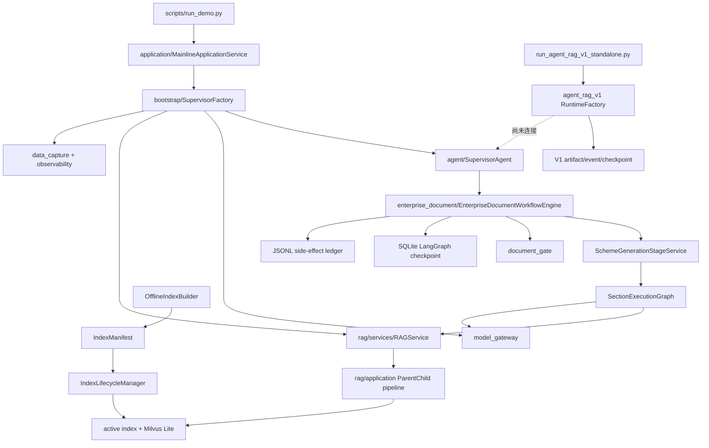

# 00 仓库全景地图

## 本文范围

本篇回答“代码在哪里、由谁装配、谁调用谁”。扫描范围为 `rg --files -g '*.py'` 返回的 550 个 Python 文件；排除了 Git 忽略的 `.venv` 等非仓库源码。职责由代码导入、构造和调用确认，不仅依据目录名。

## 当前事实结论

- [PRODUCTION] 组合根不是一个文件：CLI 在 `scripts/run_demo.py`，应用边界在 `backend/application/mainline_service.py`，依赖注入在 `backend/bootstrap/supervisor_factory.py`。
- [PRODUCTION] 业务顶层图位于 `backend/apps/enterprise_document/workflows/top_level_business_graph.py`；通用 `backend/agent/runtime/langgraph_workflow_engine.py` 是后备/兼容引擎，不是 Factory 当前注入。
- [REAL_PROVIDER] RAG 的在线、离线、生命周期和评测分布在 `backend/rag/`；业务侧只通过 `RAGToolPort`/`RAGService` 投影证据。
- [STANDALONE] 新 V1 代码分散在 enterprise_document 下的 `runtime/agent_rag_v1`、`agents/agent_rag_v1`、`services/agent_rag_v1`、`schemas/agent_rag_v1`。
- [BROKEN] 生产、质量和大量 RAG 模块受四类导入错误影响，详见测试篇。

## 入口

| 入口 | 文件与行 | 用途 | 状态 |
|---|---|---|---|
| 本地主运行 | `scripts/run_demo.py:892-1161` | 参数、preflight、mainline、输出归档 | [DEMO] [PRODUCTION] [BROKEN] |
| 稳定 façade | `scripts/mainline_runtime.py:75-226` | ProjectInput/Task/Supervisor 工厂和 `run_mainline` | [PRODUCTION] |
| 工作流控制 | `scripts/workflow_control.py` | inspect/resume/cancel/stream | [DEMO] |
| 离线索引 | `scripts/build_offline_index.py:23-55` | validate/build 索引 | [IMPLEMENTED_ONLY] [BROKEN] |
| 索引生命周期 | `scripts/manage_index_lifecycle.py:39-110` | discover/register/activate/rollback | [IMPLEMENTED_ONLY] |
| V1 独立入口 | `scripts/run_agent_rag_v1_standalone.py` | Scenario CLI | [STANDALONE] [FAKE] |
| 真实 Provider 验收 | `scripts/run_real_provider_acceptance.py` | 显式 opt-in 外部调用 | [TEST_ONLY] [REAL_PROVIDER] |

## 目录职责表

| 目录 | 主要职责 | 核心入口 | 主要依赖 | 被谁调用 | 当前状态 |
|---|---|---|---|---|---|
| `scripts/` | CLI、验收、诊断 | `run_demo.main` | application/bootstrap/eval | 人工/CI | 混合 |
| `backend/application/` | 用例编排、工作区、输入/任务工厂 | `MainlineApplicationService` | bootstrap/task/schemas | scripts/API | [PRODUCTION] |
| `backend/bootstrap/` | 组合根、Provider/质量/观测工厂 | `SupervisorFactory.build` | agent/model/rag/apps | application | [PRODUCTION] [BROKEN] |
| `backend/agent/` | Supervisor、Registry、通用图运行时 | `SupervisorAgent.run` | contracts/schemas/langgraph | bootstrap/tests | [PRODUCTION] |
| `backend/apps/enterprise_document/` | 企业方案业务、顶层图、Section 图、质量、V1 | `EnterpriseDocumentWorkflowEngine` | agent/rag/model/context | Supervisor | [PRODUCTION] [BROKEN] |
| `backend/rag/` | 在线检索、离线索引、组件插件、Schema | `RetrievalRuntime`、`OfflineIndexBuilder` | model/Milvus/YAML | RAGService/scripts/eval | [REAL_PROVIDER] [BROKEN] |
| `backend/model_gateway/` | 模型路由、调用、Provider、usage | `ModelGateway.generate` | contracts/observability | bootstrap/业务/RAG | [INTEGRATED] |
| `backend/context_manager/` | LLM 输入投影、预算、压缩 | `LLMContextManager.build` | schemas | 生成/验收 | [INTEGRATED] |
| `backend/eval/` | Agent/RAG/策略离线评测 | runners | rag/schemas | scripts/tests | [IMPLEMENTED_ONLY] |
| `backend/schemas/` | 跨域 Canonical 契约 | `SchemaBase` 子类 | pydantic | 全仓库 | [INTEGRATED] |
| `backend/contracts/` | Ports/Protocols | `WorkflowEnginePort` 等 | schemas | bootstrap/runtime | [INTEGRATED] |
| `backend/core/` | 配置、错误、重试、原子 JSONL、副作用控制 | `get_settings` | stdlib | 全仓库 | [INTEGRATED] |
| `backend/task/` | 任务事件聚合 | `JsonlTaskManager` | crash-safe JSONL | application | [PRODUCTION] |
| `backend/data_capture/` | Trace、raw/SFT/eval capture | `JsonlRunTraceRecorder` | schemas/core | observability | [PRODUCTION] |
| `backend/tests/` | 68 个测试文件，unit 到 acceptance | pytest | 全仓库 | CI/开发者 | 部分 [BROKEN] |
| `prompts/` | Prompt 版本文件 | PromptManager | 无 | bootstrap/agents | [INTEGRATED] |
| `data/` | 默认运行数据、索引、产物 | `DATA_ROOT` | 文件系统 | 运行时 | 运行数据 |
| `docs/` | 架构与团队文档 | 本手册 | 代码证据 | 开发者 | 文档 |
| `frontend/` | 前端资源 | 独立 | API | 用户界面 | 本手册不深挖 |
| `deploy/` | 部署配置 | 独立 | runtime | 运维 | 本手册不深挖 |

仓库没有名为 backend/config 的目录，配置核心实际在 `backend/core/config.py`、`backend/rag/config/` 和 `backend/apps/enterprise_document/config/`。

## 仓库组件图



## Python 包依赖与循环风险

理想依赖方向是 `scripts/api → application → bootstrap → agent/apps → contracts/schemas/core`，但当前存在以下反向或 `__init__` 聚合风险：

1. `backend/apps/enterprise_document/services/document_gate.py` 导入 `scheme_writer.citation_integrity_service`，加载 `backend/apps/enterprise_document/services/scheme_writer/__init__.py` 后又导入 `use_case → stage_service → document_gate`，在特定导入顺序下形成 partially initialized module。
2. `apps.enterprise_document.quality.__init__` 主动导出 plugins；任何只想导入 `quality.budget` 的代码也会触发缺失 `SelfRAGJudge`。
3. `rag.ports.__init__` 主动导入 `chunking`；任何 RAG Port 子模块都可能被缺失 `ParentChildChunkResult` 阻塞。

这些是实际收集错误，不是仅凭静态环图推断。

## 生产、Demo 与测试路径

```text
[PRODUCTION/DEMO]
scripts/run_demo.py:main()
→ scripts/mainline_runtime.py:run_mainline()
→ application/MainlineApplicationService.run()
→ bootstrap/SupervisorFactory.build()
→ agent/SupervisorAgent.run()
→ enterprise_document/EnterpriseDocumentWorkflowEngine.execute()

[STANDALONE/FAKE]
scripts/run_agent_rag_v1_standalone.py
→ runtime.agent_rag_v1.MultiAgentApplicationService.run()
→ RuntimeFactory.create_session()
→ WorkflowOrchestrator.run()

[TEST_ONLY]
pytest
→ 单元构造通用 LangGraphWorkflowEngine/FakeLLM/FakeRAG
→ 或走 mainline acceptance（当前被 import 阻塞）
```

## 新旧架构共存

| 概念 | 当前生产 | 并存实现 | 关系 |
|---|---|---|---|
| 顶层工作流 | `EnterpriseDocumentWorkflowEngine` | `LangGraphWorkflowEngine` | 生产专用图 vs 通用兼容图 |
| Section 执行 | `SectionExecutionGraph` | `SectionExecutionCoordinator.execute` | 子图接管；复用 coordinator 的服务 |
| SchemeWriter | Stage Service 节点 | `SchemeWriterAgent`/UseCase | 前者为生产实际，Agent 仍被构造并供兼容 |
| RAG | `RAGService` | `FakeRAGTool`、旧 retrieval result | real service vs fake/legacy projection |
| Supervisor | `SupervisorAgent` | V1 的 Orchestrator/Adapter | V1 没有第二个生产 Supervisor |
| Shared State | `GraphStateSchema` | V1 `MultiAgentSharedStateSchema` | 两套独立 Canonical State |

## Composition Roots

1. `backend/bootstrap/supervisor_factory.py:56-175`：生产最重要组合根，注入模型、RAG、质量插件、Trace、SQLite saver、side-effect store 和业务图。
2. `backend/rag/runtime/parent_child_runtime_factory.py:87-327`：在线 RAG 组件组合根。
3. `backend/apps/enterprise_document/runtime/agent_rag_v1/runtime_factory.py:168-284`：Standalone 单一组合根。
4. `backend/rag/registry/default_registrations.py:40-172`：RAG 插件默认注册表。

## 最复杂的 20 个 Python 文件

行数由 `.NET File.ReadAllLines` 在证据提交上重新统计。

| 排名 | 行数 | 文件 | 核心职责 |
|---:|---:|---|---|
| 1 | 2108 | `top_level_business_graph.py` | 生产顶层 LangGraph、路由、恢复、流事件 |
| 2 | 1816 | `test_stage1_acceptance.py` | Stage 1 大型验收 |
| 3 | 1738 | `stage_service.py` | 业务阶段、并行 Section、装配/门禁 |
| 4 | 1589 | `test_day2_architecture_closure.py` | Day2 架构/安全闭环 |
| 5 | 1433 | `test_step_15_graph_state_workflow_engine.py` | 通用图状态/重试/超时 |
| 6 | 1326 | `test_p1_trust_semantic_payload_closure.py` | 信任与语义闭环 |
| 7 | 1274 | `supervisor_agent.py` | 路由、生命周期、执行/恢复 |
| 8 | 1162 | `agent_rag_v1/workflow_orchestrator.py` | Standalone DAG、四 Agent、闭环 |
| 9 | 1161 | `scripts/run_demo.py` | CLI/preflight/归档 |
| 10 | 1139 | `section_execution_graph.py` | Section LangGraph |
| 11 | 1094 | `rag/offline/lifecycle.py` | Index 注册、激活、回滚 |
| 12 | 1027 | `langgraph_workflow_engine.py` | 通用工作流图 |
| 13 | 949 | `test_architecture_hardening.py` | 架构强固验收 |
| 14 | 933 | `rag/offline/verification.py` | 索引深度验证 |
| 15 | 899 | `stage1/test_advisory_policies.py` | advisory policy |
| 16 | 886 | `mainline_service.py` | 应用运行/流/恢复/控制 |
| 17 | 859 | `test_root_cause_closure.py` | 根因和副作用闭环 |
| 18 | 807 | `section_execution_coordinator.py` | 旧手写 Section 调度 |
| 19 | 803 | `test_step_11_2_offline_index_verification.py` | 离线索引验证 |
| 20 | 778 | `section_generation_service.py` | 生成、引用、语义检查、修复 |

## Schema 流转与状态修改

目录间最关键的数据边界是：

```text
schemas.project.ProjectInputSchema
→ schemas.task.TaskSchema
→ agent.runtime.GraphStateSchema
↔ apps.enterprise_document.schemas.*（业务输入/输出投影）
↔ schemas.rag.EvidenceBundleSchema
→ schemas.agent.AgentResultSchema
→ application 返回 dict
```

`backend/apps/enterprise_document/schemas/agent_rag_v1` 不在这条箭头上，它属于 Standalone。

## 失败、重试与恢复

目录层面的故障扩散点是包 `__init__.py`：一个缺失符号会让大量本来无关的测试无法收集。运行期重试和恢复则分别由 `core/retry_policy.py`、顶层/通用 LangGraph 引擎、official SQLite saver、side-effect ledger 与 Standalone Event/Checkpoint 实现。

## 配置来源

- 通用：`backend/core/config.py` + `.env`/process env。
- 业务运行选项：`backend/bootstrap/runtime_options.py`。
- RAG：`backend/rag/config/*.yaml`、offline build config、active pointer/manifest。
- 生成质量：`backend/apps/enterprise_document/config/grounded_generation_v1.yaml`。
- 包/测试：`pyproject.toml`、`pytest.ini`。

## 对应测试

目录边界由 `test_decoupled_architecture.py`、`test_phase5_langchain_takeover_and_legacy_retirement.py`、`test_agent_rag_v1_runtime_contracts.py` 等验证。但前者当前有一个 FixedSizeChunker 参数失败，后者中的生产接管测试当前受 `SelfRAGJudge` 导入阻塞。

## 尚未实现或无法确认

- 未找到名为 backend/config 的目录，也未找到名为 `NativeWorkflowEngine`、`WorkflowExecutor`、`RealRAGTool` 的当前符号。
- `frontend/` 和部署细节不是三条主链的代码证据核心，本手册只保留地图位置。
- 因导入错误，不能通过一次真实生产运行动态证明所有静态调用关系；文档明确区分了静态接线与实跑结果。

## 常见误解

- 文件大不代表生产使用；`LangGraphWorkflowEngine` 和 coordinator 很大，但生产注入的是专用业务图与 Section 子图。
- `backend/apps` 数量多不代表多个生产应用；当前 mainline 的领域应用是 enterprise_document。
- `backend/eval` 不应被生产 runtime 导入；其职责是离线验证。

## 推荐下一篇

[01_PRODUCTION_ENTRY_AND_BOOTSTRAP.md](01_PRODUCTION_ENTRY_AND_BOOTSTRAP.md)。
