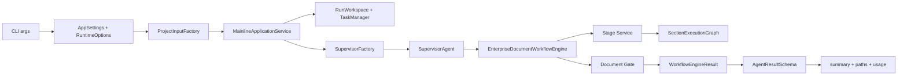

# 01 生产入口与装配

## 本文范围

从 CLI 参数开始，追到最终 summary、artifact 和状态返回；区分 Demo façade、真实组合根、Fake/Real Provider、生产专用图和兼容引擎。

## 当前事实结论

- `run_demo.py` 同时是 [DEMO] 文件和当前 [PRODUCTION] 本地 CLI。默认不传 `--fake-runtime` 时，`_configure_runtime()` 设置真实 RAG 与本地 Qwen（`scripts/run_demo.py:226-246`）。
- `mainline_runtime.py` 是稳定兼容 façade；它没有第二套运行逻辑，`run_mainline()` 委托 `MainlineApplicationService.run()`（`scripts/mainline_runtime.py:183-226`）。
- Factory 注入 `EnterpriseDocumentWorkflowEngine`；通用 `LangGraphWorkflowEngine` 仅是 `SupervisorAgent` 未注入 engine 时的 fallback。
- [BROKEN] 当前 CLI 在 import `SupervisorFactory → AgentQualityFactory → quality.plugins` 时遇到缺失 `SelfRAGJudge`，因此“已接线”不等于“当前可启动”。

## 入口

### CLI 层

`scripts/run_demo.py:892-1161` 解析项目名称、模板、来源材料、输出目录、模型/RAG 模式、strict 等参数。核心点：

- `_configure_runtime()`：`226-246`；
- `_preflight_real_runtime()`：`264-314`，验证本地 Qwen 路径、active index pointer 和静态 RAG spec；
- `run_demo()`：`860-888`，只委托 `run_mainline`；
- 实际调用：`1031-1040`；
- Demo 输出归档：`1055-1062`；
- strict 非成功退出：`1148-1152`；
- finally 释放锁：`1155-1161`。

### 稳定 façade

| 方法 | 行号 | 输入 | 输出 | 说明 |
|---|---:|---|---|---|
| `build_project_input()` | `mainline_runtime.py:75-101` | CLI 字段 | `ProjectInputSchema` | 委托 `ProjectInputFactory` |
| `build_task()` | `105-137` | ProjectInput/身份 | `TaskSchema` | 委托 `TaskFactory` |
| `build_supervisor()` | `141-179` | settings/options/workspace | `SupervisorAgent` | 委托 `SupervisorFactory` |
| `run_mainline()` | `183-226` | ProjectInput + options | summary dict | 委托应用服务 |

## 完整调用链

```text
scripts/run_demo.py:main()
→ scripts/run_demo.py:_configure_runtime()
→ scripts/run_demo.py:_preflight_real_runtime()
→ scripts/mainline_runtime.py:build_project_input()
→ backend/application/project_input_factory.py:ProjectInputFactory.build()
→ scripts/mainline_runtime.py:run_mainline()
→ backend/application/mainline_service.py:MainlineApplicationService.run()
→ backend/application/run_workspace.py:RunWorkspace
→ backend/application/task_factory.py:TaskFactory.build()
→ backend/task/task_manager.py:JsonlTaskManager.create_task()/transition
→ backend/apps/enterprise_document/workflows/scheme_generation.py:build_scheme_generation_workflow()
→ backend/bootstrap/supervisor_factory.py:SupervisorFactory.build()
→ backend/agent/supervisor_agent.py:SupervisorAgent.run()
→ backend/apps/enterprise_document/workflows/top_level_business_graph.py:EnterpriseDocumentWorkflowEngine.execute()
→ backend/apps/enterprise_document/services/scheme_writer/stage_service.py:各业务阶段
→ backend/apps/enterprise_document/workflows/section_execution_graph.py:SectionExecutionGraph.execute()
→ backend/apps/enterprise_document/services/document_gate.py:evaluate_scheme_draft()
→ WorkflowEngineResult
→ AgentResultSchema
→ MainlineApplicationService summary dict
→ scripts/run_demo.py:persist_end_to_end_artifacts()
```



## 分层装配表

| 层 | 文件 | 类/方法 | 输入 | 输出 | 生命周期 | 真实/模拟 |
|---|---|---|---|---|---|---|
| CLI | `scripts/run_demo.py` | `main()` | argv/env | exit code + JSON | 进程 | [DEMO] 默认 real |
| façade | `scripts/mainline_runtime.py` | `run_mainline()` | ProjectInput/options | dict | 单调用 | [PRODUCTION] |
| 输入 | `application/project_input_factory.py` | `build()` `88-183` | raw dict | ProjectInput | 单调用 | production/demo 严格区分 |
| 应用 | `application/mainline_service.py` | `run()` `57-254` | ProjectInput/options | summary | 单 run | [PRODUCTION] |
| 工作区 | `application/run_workspace.py` | `RunWorkspace` `17-170` | output/task/run | 路径映射 | 单 run | 文件系统 |
| 任务 | `application/task_factory.py` | `build()` `33-126` | ProjectInput | TaskSchema | 单 task | Canonical projection |
| 组合根 | `bootstrap/supervisor_factory.py` | `build()` `56-175` | settings/options | SupervisorAgent | 单 run | real/fake 可选 |
| Supervisor | `agent/supervisor_agent.py` | `run()` `1044-1274` | Task/Workflow | AgentResult | 单 run | [PRODUCTION] |
| Workflow | `top_level_business_graph.py` | `execute()` `1644-1678` | Workflow + GraphState | EngineResult | 可恢复 | [PRODUCTION] LangGraph |
| Section | `section_execution_graph.py` | `execute()` `1071-1120` | section payload/state | SectionResult | 每 section | [PRODUCTION] LangGraph |
| 持久化 | `MainlineApplicationService`/Factory | task/trace/usage/checkpoint | 状态/事件 | 文件 | 跨进程 | [INTEGRATED] |

## `MainlineApplicationService.run()` 逐段

`backend/application/mainline_service.py:57-254`：

1. 解析/生成 task_id、run_id，构造 `RunWorkspace`。
2. 将 `ProjectInputSchema` 投影为 `TaskSchema`，由 `JsonlTaskManager` 写入 task 事件流。
3. 构造逻辑 `WorkflowDefinitionSchema`。注意：生产业务图明确忽略它的 step topology，但用其 identity/version/checkpoint namespace。
4. 生成 `RuntimeOptions`；真实 RAG 时要求 trusted access scope。
5. 通过 `SupervisorFactory.build()` 创建 run-scoped Supervisor。
6. `SupervisorAgent.run(task, workflow)`。
7. 聚合 `model_usage_snapshot()`，用 `RunWorkspace.write_model_usage()` 原子写入；若仍有活动 worker，先写未 finalized 快照并延迟最终写。
8. 解析 AgentResult 内的 success/rejected/failure payload，返回 status、summary、warnings/errors、artifacts、trace/task/usage 路径。
9. finally 关闭 Supervisor 资源。

同一服务还提供 `stream()`（`280-435`）、`inspect()`（`536-579`）、`resume()`（`773-837`）和 `cancel()`（`839-886`），它们复用原 task/run identity 与持久 checkpoint。

## `SupervisorFactory.build()` 的真实依赖

`backend/bootstrap/supervisor_factory.py:56-175` 的装配顺序：

1. real RAG 时验证 `RuntimeOptions.trusted_access_scope`（`69-88`）。
2. `ObservabilityFactory` 创建 trace/capture（`89-92`）。
3. `ModelGatewayFactory` 创建 Gateway，包装为 LangChain chat model（`93-98`）。
4. `RAGServiceFactory` 创建 real/fake RAG，再包装为 LangChain runnable（`99-114`）。
5. `AgentQualityFactory` 从 grounded-generation YAML 建 checker/repair（`115-127`）。
6. `AgentRegistry` 只注册 `ProjectInputNormalizerAgent`（`129-147`）；`SchemeWriterAgent` 会被构造，但顶层图通过其 Stage Service 执行业务阶段。
7. 创建 `JsonlSideEffectCommitStore` 和 official SQLite checkpoint resource（`148-153`）。
8. 返回注入 `EnterpriseDocumentWorkflowEngine` 的 `SupervisorAgent`（`154-175`）。

因此：

- Model Gateway：[INTEGRATED]
- RAG Service：[INTEGRATED]，但当前 RAG import 另有缺陷
- Trace/Capture：[INTEGRATED]
- Quality plugins：[INTEGRATED] 设计，但 [BROKEN]
- SQLite Checkpointer：[INTEGRATED]
- 通用 `LangGraphWorkflowEngine`：未被此 Factory 注入

## Supervisor 输入输出

`SupervisorAgent.run()` 接收 `TaskSchema` 和 `WorkflowDefinitionSchema`，构造 `GraphStateSchema`；`SupervisorAgent.stream()` 的构造发生在 `974-1042`，同步执行在 `1044-1274`。

输出为 `AgentResultSchema`：

- success/partial：`result` 携带业务图 payload、artifacts、warnings、checkpoint metadata；
- paused：映射 human-review interrupt；
- technical failure：`ErrorSchema`/结构化 failure；
- retryable exception：分类为 `retryable_failed`；
- cancellation 不会伪装成可重试业务失败。

Supervisor 不逐个选择业务节点；具体下一节点由 `EnterpriseDocumentWorkflowEngine` 的 LangGraph conditional edge 决定。Supervisor 负责任务路由、上下文、生命周期、trace 和结果映射。

## Workflow Engine 到底是哪一个

| 实现 | 定义 | 当前生产实例化 | 用途 |
|---|---|---|---|
| `EnterpriseDocumentWorkflowEngine` | `top_level_business_graph.py:358-2108` | 是，Factory `162-167` | 生产业务拓扑 |
| `LangGraphWorkflowEngine` | `agent/runtime/langgraph_workflow_engine.py:53-1027` | 否；Supervisor 未注入时 fallback | 通用 workflow steps、测试/兼容 |
| `NativeWorkflowEngine` | 未找到符号 | 否 | 名称只存在于需求/历史叙事，不应当作实现 |
| `WorkflowExecutor` | 未找到符号 | 否 | 同上 |
| `SectionExecutionGraph` | `backend/apps/enterprise_document/workflows/section_execution_graph.py:64-1139` | 是 | 生产 Section 子图 |
| `SectionExecutionCoordinator.execute` | `section_execution_coordinator.py:201-803` | 生产不走 | [LEGACY] 回退 |

## Schema 流转

| 边界 | 输入 | 转换位置 | 输出 |
|---|---|---|---|
| CLI → domain | raw args/dict | `ProjectInputFactory.build()` | `ProjectInputSchema` |
| domain → task | ProjectInput | `TaskFactory.build()` | `TaskSchema` |
| task → graph | Task/workflow | `SupervisorAgent` | `GraphStateSchema` |
| graph → LangGraph | GraphState | `LangGraphRuntimeStateCodec` | JSON-safe TypedDict |
| business node | `GraphNodeInputSchema` | Stage Service | `GraphNodeOutputSchema`/candidate |
| graph → supervisor | `WorkflowEngineResult` | Supervisor | `AgentResultSchema` |
| supervisor → CLI | AgentResult | Mainline service | summary dict |

## 状态修改与持久化

- Task 状态：`JsonlTaskManager` 追加 `tasks/{task_id}_state.jsonl`。
- Graph 状态：LangGraph SQLite saver 位于 run 的 `langgraph_checkpoints.sqlite3`；namespace 绑定 run/workflow id/version。
- 副作用：`side_effect_commits.jsonl` 记录 claim/acquire/commit/release，防止重放重复写。
- Trace：`runs/{run_id}_trace.jsonl`。
- Model usage：`runs/{run_id}_model_usage.json`，临时文件 + `os.replace`。
- 业务输出：Stage Service 写入 state/output artifact；`run_demo.py` 额外归档演示报告。

并非“每个 Domain Event 后都存 LangGraph checkpoint”。生产 Task Event、LangGraph channel checkpoint、side-effect ledger 和 Trace 是不同机制；LangGraph 在图更新边界持久化，V1 才是每个 State Patch 后显式保存完整 checkpoint。

## 失败、重试与恢复

- preflight 缺模型/active index/spec：CLI 在构造业务对象前失败。
- import 缺失：当前更早失败于 `SelfRAGJudge`。
- 节点失败：顶层 `_run_stage()`（`974-1141`）执行 retry loop，依据 contract、failure category、预算、取消和活动 worker 决定。
- timeout：通过 tracked worker + cooperative cancellation；live worker 时禁止重叠 retry，late result 不得提交 canonical state。
- resume：从同 run/workflow namespace 读取 SQLite checkpoint，用 `Command(resume=...)`。
- cancel：取消活动 worker，并以 cancellation resume 图。

## 配置来源

`get_settings()` 的优先级是进程 env → 仓库 `.env` → 代码默认。`run_demo.py` 会基于 `--fake-runtime` 再覆盖 `DEFAULT_MODEL_NAME` 与 real/fake RAG 选项。`RuntimeOptions.from_environment()` 读取 section concurrency、semantic gate 和 RAG spec/index 路径。

## 对应测试

- `test_mainline_closure_acceptance.py`
- `test_phase2_top_level_business_graph.py`
- `test_phase4_durable_resume_hitl.py`
- `test_phase5_langchain_takeover_and_legacy_retirement.py`
- `test_model_usage_artifact.py`
- `stage1/test_contracts.py::test_production_entry_does_not_import_demo_module`

这些生产相关文件当前均未能完整收集，主要因 `SelfRAGJudge`；测试定义仍可作为预期约束，不能当作本次通过证据。

## 尚未实现或无法确认

- 无法在当前提交实际启动生产 mainline，因此真实 Qwen/Milvus 的运行成功未确认。
- 没有独立的 `WorkflowExecutor`/`NativeWorkflowEngine` 对象。
- `SchemeWriterAgent` 的存在不表示 Agent 节点直接被顶层图调用；生产节点调用的是其共享 Stage Service。

## 常见误解

- CLI “默认 real”只说明选择路径，不保证依赖、模型、索引和导入都可用。
- Supervisor 不等同于 LangGraph；它是图外的生命周期/路由/结果 façade。
- logical workflow definition 仍参与身份和 checkpoint，即使业务图忽略其 step topology。

## 推荐下一篇

[02_AGENT_WORKFLOW_MAINLINE.md](02_AGENT_WORKFLOW_MAINLINE.md)。
