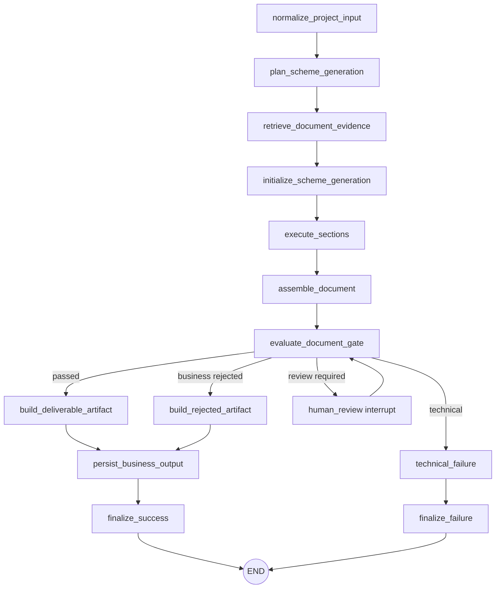
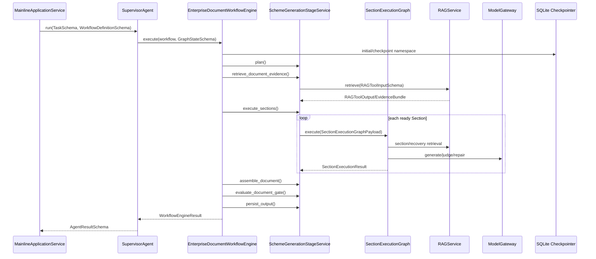
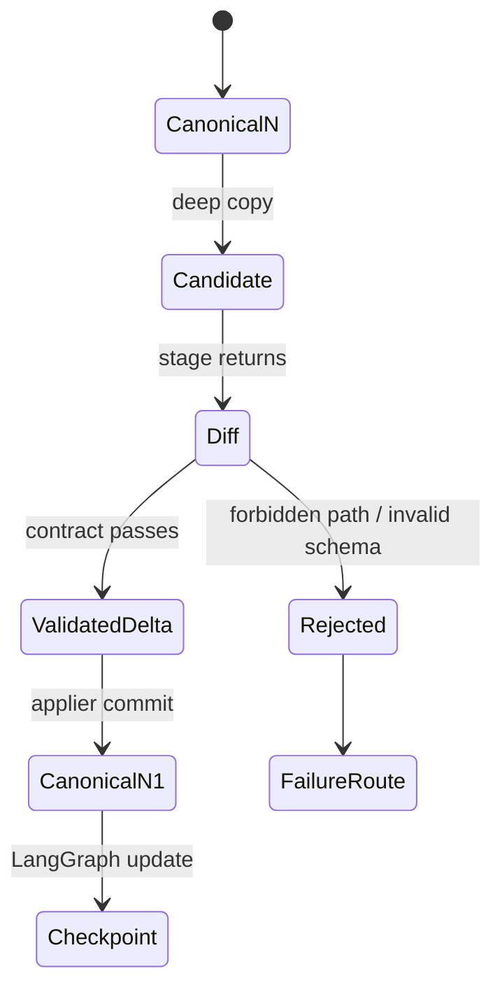
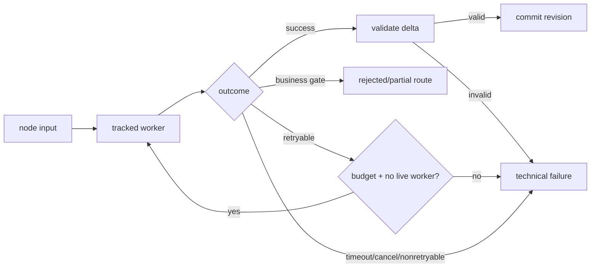

# 02 Agent / Workflow 生产主链

## 本文范围

本篇逐节点解释 `ProjectInput → Task → Supervisor → Graph State → 顶层 LangGraph → Scheme Generation → Section → Document Gate → Final Result`，是手册主篇。

## 当前事实结论

- [PRODUCTION] 业务图的 source of truth 是 `EnterpriseDocumentWorkflowEngine.build_graph()`（`top_level_business_graph.py:1309-1458`）。
- [PRODUCTION] 节点返回 LangGraph state update；业务 service 可在 candidate `GraphStateSchema` 上工作，但只有经过 diff/write-contract/applier 的 delta 才进入 canonical state。
- [PRODUCTION] Agent 不直接互相调用。顶层图调用 Stage Service；Section 图调用 coordinator 持有的 evidence/generation/corrective 服务。
- [BROKEN] 当前生产导入失败，因此本篇是“当前静态接线 + 对可独立运行的底层机制实测”，不是一次成功生产 E2E 的日志。

## 入口

```text
backend/agent/supervisor_agent.py:SupervisorAgent.run() [1044-1274]
→ backend/apps/enterprise_document/workflows/top_level_business_graph.py:
  EnterpriseDocumentWorkflowEngine.execute() [1644-1678]
```

`SupervisorAgent.__init__()` 在 `48-91` 建 catalog/router/context/lifecycle/trace；有注入 engine 时使用注入对象（`73-77`），否则构造通用 `LangGraphWorkflowEngine`。

## 完整调用链

```text
ProjectInputFactory.build()
→ TaskFactory.build()
→ SupervisorAgent.run()
→ LangGraphRuntimeStateCodec.build_initial_state()
→ EnterpriseDocumentWorkflowEngine.build_graph()
→ normalize_project_input
→ plan_scheme_generation
→ retrieve_document_evidence
→ initialize_scheme_generation
→ execute_sections
  → SectionExecutionGraph.execute() × N
→ assemble_document
→ evaluate_document_gate
→ [deliverable | rejected | human_review | technical_failure]
→ persist_business_output（仅 business artifact 路由）
→ finalize_success/finalize_failure
→ WorkflowEngineResult
→ AgentResultSchema
```

## 顶层节点表

节点常量在 `top_level_business_graph.py:74-103`，读写契约在 `151-355`。

| 节点 | Stage 方法 | 主要读取 | 主要写入 | 输入/输出 | 成功路由 | 失败路由 |
|---|---|---|---|---|---|---|
| normalize | `_normalize_project_input` `1143-1156` | project input candidates | normalized project input | GraphNodeInput/Output | plan | technical failure |
| plan | `stage_service.plan` `178-255` | project/task | document plan, scheme input | Plan schemas | retrieve document | technical failure |
| document retrieval | `retrieve_document_evidence` `257-390` | plan/query/options | EvidenceBundle, citations | RAG input/output | initialize | technical failure |
| initialize | `initialize_generation` `392-423` | plan/evidence | generation runtime fields | shared state | execute sections | technical failure |
| sections | `execute_sections` `785-1170` | section plan/evidence | sections/citations/subgraph metadata | SectionResult | assemble | technical failure |
| assemble | `assemble_document` `1172-1228` | generated sections | SchemeDraft | draft | gate | technical failure |
| document gate | `evaluate_document_gate` `1230-1329` | draft/citations/evidence | hard gate/status/error | HardGateResult | conditional | technical failure |
| deliverable artifact | `build_deliverable_artifact` `1464-1490` | passed draft | deliverable payload | output projection | persist | failure |
| rejected artifact | `build_rejected_artifact` `1492-1520` | failed business gate | rejected payload | output projection | persist | failure |
| human review | graph methods `1183-1302` | interrupt payload | reviewed delta | Command/resume | gate/persist | failure |
| persist | `persist_output` `1331-1462` | chosen artifact | SchemeWriterOutput/artifact state | output | final success | failure |
| final success | `build_final_result` `1522-1602` | output/state | final result | EngineResult | END | — |
| technical failure | `build_technical_failure` `1604-1666` | error/state | technical failure | EngineResult | final failure | — |

## 顶层 LangGraph 拓扑



`build_graph()` 使用 `StateGraph(LangGraphRuntimeState)`，加节点、普通 edge、document gate conditional edge，并用 workflow-scoped checkpointer compile（`1309-1458`）。`_invoke_config()` 用 run_id 作为 thread identity、workflow namespace 作为 checkpoint namespace（`1460-1477`）。

## Sequence Diagram



## Graph State 的真实定义

### Canonical business state

`backend/agent/runtime/graph_state.py:18-49`：

```text
GraphStateSchema extends SharedStateSchema
+ graph_revision
+ last_committed_node
+ committed_node_revisions
+ validated_business_deltas
```

`SharedStateSchema` 在 `backend/agent/runtime/shared_state_schema.py:19-...` 组合 task、project input、context、agent/tool results、errors、evidence、generation、final result 等业务域。

### LangGraph runtime state

`backend/agent/runtime/langgraph_state.py:29-53` 的 `LangGraphRuntimeState` 是 `TypedDict(total=False)`，保存 runtime schema version、run/workflow identity、序列化 graph state、payload、node inputs/outputs/results、execution records、next node、terminal/interrupt 信息。它是 Persistence/Transport projection，不是另一个业务 source of truth。

### Section state

Section 子图使用 `apps/enterprise_document/schemas/section_execution_graph.py:50-175` 的 `SectionExecutionGraphPayloadSchema` 和 TypedDict `SectionExecutionGraphState`；payload 中嵌入可恢复的 graph state 序列化投影。

## Candidate、Delta、Commit、Revision

`EnterpriseDocumentWorkflowEngine._validate_stage()`（从 `621` 起）：

1. 从 canonical state 深拷贝 before/candidate。
2. Stage Service 在 candidate 上执行。
3. `GraphStateDiffer.diff()` 计算业务 delta。
4. `GraphStateWriteContract` 根据节点 contract 校验 changed paths。
5. `GraphStateApplier.apply()` 将允许的 delta 应用到新 canonical state。
6. commit 后才增加 `graph_revision`、记录 node/revision/hash。

节点并非直接返回任意“完整 state 覆盖”。LangGraph update 中可带完整序列化 state，但其业务内容来自已验证 commit。失败 attempt 的 candidate 不提交；节点可返回结构化 failure payload 和 execution record，但不能偷偷留下半成品业务写。



## `_run_stage()` 执行边界

`top_level_business_graph.py:974-1141`：

- 构造 node input 和 trace；
- 由 `WorkflowNodeExecutionRunner` 分配 execution id、commit scope、input hash；
- 最多执行 `contract.max_retries + 1` 次；
- 每次有 timeout/cancellation control；
- 仅当错误 retryable、未取消、重试预算尚存且没有活动 late worker 时重试；
- 失败时保持提交前 graph state，写 failure payload/execution record；
- side-effecting 操作通过 claim/commit ledger 做 exactly-once 防重。

## 正常、失败、重试路径



状态来源：

- `success`：文档硬门通过，业务输出持久化成功。
- `partial_success`：文档门允许可交付但有部分章节/警告，或 Standalone 的聚合规则；不是任意异常的兜底。
- `failed`：技术故障或硬业务门失败的最终映射，需看 artifact route 区分。
- `retryable_failed`：Supervisor 捕获可重试异常并映射到 Agent status；节点内部已经耗尽/抑制 retry。

## Supervisor 如何决定下一步

Supervisor 先通过 router 选 workflow/agent 能力，但进入 `EnterpriseDocumentWorkflowEngine` 后，具体节点由 LangGraph edges 决定。document gate 的 `_route_after_document_gate()`（`1166-1181`）选择 deliverable/rejected/technical/human-review；不是 Agent 直接调用下一个 Agent。

AgentRegistry 当前生产只注册 ProjectInput Normalizer。Scheme Writer 能力通过注入 Engine 的 Stage Service 运行，RAG/Model 作为服务/port 进入生成节点。

## 状态何时持久化

- Task aggregate：每次 `JsonlTaskManager` 状态事件后追加并重放。
- Graph：LangGraph 在 channel update/checkpoint 边界写 SQLite；顶层还可通过 `checkpoint_history()`（`1479-1519`）读历史。
- Side effect：claim、commit、release 是独立 JSONL 状态机。
- Trace：每个观察事件追加。
- 不是“每个 Domain Event + 每个 State Patch 后统一保存同一个快照”；生产没有 V1 那种单一 Domain Event + full snapshot 协议。

## 与 Standalone V1 的差异

| 维度 | 生产主链 | agent_rag_v1 |
|---|---|---|
| 调度 | 两级 LangGraph | 手写 DAG/Router 循环 |
| Canonical state | `GraphStateSchema` | `MultiAgentSharedStateSchema` |
| 写入控制 | node contract + diff/applier | field patch + owner/domain version |
| checkpoint | official SQLite LangGraph | 哈希 envelope JSON full snapshots |
| event | task/trace/stream/side-effect 分离 | Domain Event 对应每次 state commit |
| agents | Normalizer + Stage Services | Planner/Research/Writer/Verifier |
| Provider | ModelGateway/RAGService | 默认 Scenario/Fixture |
| 生产接入 | 是（当前导入坏） | 否 |

## 配置来源

- node retry/timeout/write paths：`BusinessNodeContract` 默认表（`151-355`）；
- workflow identity：`build_scheme_generation_workflow()`；
- section concurrency/semantic/RAG options：`RuntimeOptions`；
- Provider/model/RAG：bootstrap 工厂；
- checkpoint/trace 路径：`RunWorkspace` 与 `SupervisorFactory`。

## 对应测试

- 顶层拓扑/节点：`test_phase2_top_level_business_graph.py`
- Section 接管：`test_phase3_section_execution_subgraph.py`
- durable resume/HITL：`test_phase4_durable_resume_hitl.py`
- legacy retirement：`test_phase5_langchain_takeover_and_legacy_retirement.py`
- 通用 graph state：`test_phase1_langgraph_serializable_state.py`、`test_step_15_graph_state_workflow_engine.py`
- timeout/side effect：`test_phase2_runtime_safety_closure.py`、`test_side_effect_state_machine_closure.py`

本次独立可执行集合覆盖通用 graph/side-effect 并通过；生产图测试本身受 import 错误阻塞。

## 尚未实现或无法确认

- 当前无法动态确认真实生产每个节点的 trace/checkpoint 内容。
- logical two-step workflow 并不是生产业务拓扑；它只提供 identity/兼容 metadata。
- V1 连接点尚未实现，不能把其 field-level event sourcing 套到生产 state。

## 常见误解

- LangGraph update 看似带完整 state，不代表允许任意覆盖；业务 commit 前有 delta contract。
- 节点错误 metadata 被持久化，不等于失败业务 candidate 被部分提交。
- `SchemeWriterAgent` 仍存在，不等于 Agent-to-Agent choreography。

## 推荐下一篇

[03_SECTION_EXECUTION_SUBGRAPH.md](03_SECTION_EXECUTION_SUBGRAPH.md)。
