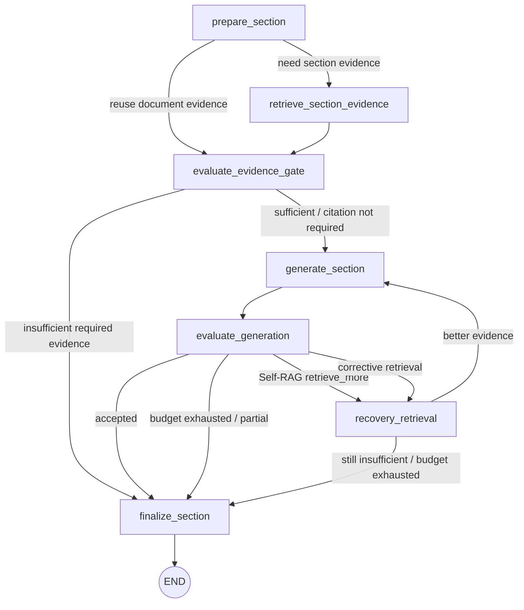

# 03 单章节执行子图

## 本文范围

完整追踪 `SectionExecutionGraph`，解释它与 `SchemeGenerationStageService.execute_sections()`、旧 `SectionExecutionCoordinator.execute()` 的真实关系，以及检索、证据门、生成、Self-RAG/纠正、引用与收敛。

## 当前事实结论

- [PRODUCTION] `SectionExecutionGraph` 已接管生产单章节调度，文件 docstring 明确声明替换 coordinator 的手写循环（`backend/apps/enterprise_document/workflows/section_execution_graph.py:1-6`）。
- [LEGACY] `SectionExecutionCoordinator` 仍被构造，因为子图复用其 evidence/generation/query/quality 服务；只有 Stage Service 没挂 graph 时才调用 coordinator 的 `execute()`。
- [PRODUCTION] Section 并行由 Stage Service 负责，单 Section 内部重检索/生成/评价由子图负责。
- [BROKEN] `quality` 包缺失 `SelfRAGJudge` 使此生产子图当前无法导入。

## 入口

```text
backend/apps/enterprise_document/services/scheme_writer/stage_service.py:
SchemeGenerationStageService.execute_sections() [785-1170]
→ backend/apps/enterprise_document/workflows/section_execution_graph.py:
SectionExecutionGraph.execute() [1071-1120]
```

`EnterpriseDocumentWorkflowEngine.__init__()` 在 `top_level_business_graph.py:371-431` 创建子图并通过 `stage_service.attach_section_execution_graph()` 挂接（`stage_service.py:119-125`）。

## 完整调用链

```text
SchemeGenerationStageService.execute_sections()
→ 计算 ready sections / parallel batch
→ 为每个 section 深拷贝隔离 GraphState
→ SectionExecutionGraph.execute()
→ prepare_section
→ [retrieve_section_evidence | evaluate_evidence_gate]
→ evaluate_evidence_gate
→ [generate_section | finalize_section]
→ generate_section
→ evaluate_generation
→ [retrieve_more | corrective_retrieval | finalize_section]
→ recovery_retrieval
→ [generate_section | finalize_section]
→ finalize_section
→ SectionExecutionResultSchema
→ Stage Service 校验每个 branch delta
→ 按 section_order 确定性 fan-in
```

## 子图拓扑

节点常量在 `backend/apps/enterprise_document/workflows/section_execution_graph.py:52-61`，`build_graph()` 在 `1019-1069`。



## 节点逐读

| 节点 | 方法行号 | 输入 | 主要调用 | 写入/输出 | 路由 |
|---|---:|---|---|---|---|
| prepare | `203-298` | section plan、document evidence、options | citation requirement、budget init | active evidence、query scope、budget state | retrieve/gate |
| retrieve | `300-424` | section query/context | query builder → SchemeEvidenceService | section evidence、citation registry、retrieval trace | gate |
| evidence gate | `426-474` | active assessment | sufficiency/citation rule | insufficient partial section 或 route | generate/final |
| generate | `476-537` | active evidence、budget | `SectionGenerationService.generate_section()` | candidate section、model calls、budget | evaluate |
| evaluate | `539-623` | generation check | Self-RAG-lite decision、citation/quality | route/reason | retrieve_more/corrective/final |
| recovery | `625-853` | gaps/round/budget | recovery query builder → evidence service | merged/replaced active evidence、round metadata | generate/final |
| finalize | `882-1017` | generated/partial state | evidence bundle、citation registry | `SectionExecutionResultSchema` | END |

## Graph State 与 Schema

`SectionExecutionGraphPayloadSchema` 保存：

- section plan/identity；
- `graph_state_payload`（业务 GraphState 的 JSON-safe 副本）；
- document/section active evidence；
- citation requirement/registry；
- budget state、recovery scope/round；
- candidate generated section；
- execution metadata/error。

子图的 LangGraph TypedDict 只包 payload/state update。`SectionExecutionGraphStateCodec` 在 `apps/enterprise_document/schemas/section_execution_graph.py:128-175` dump/restore，并验证 run/workflow/section identity。

典型 Schema 流转：

```text
SectionPlanSchema + GraphStateSchema
→ SectionExecutionGraphPayloadSchema
→ RAGToolInputSchema
→ EvidenceBundleSchema/CitationSchema
→ GenerationRequest/ModelResponse
→ GeneratedSectionSchema + CitationBindingSchema + SectionQuality
→ SectionExecutionResultSchema
→ GraphState delta
```

## `execute_sections()` 与并行

`stage_service.py:785-1170`：

1. 根据 `DocumentPlanSchema.sections` 排序（`826-829`）。
2. ready 条件要求依赖 section 已 terminal/accepted（`980-990`）。
3. 同批并行还要求 `max_concurrency > 1`、`can_run_in_parallel=True`、不需要 global context、无依赖、execution_group 相同（`992-1007`）。
4. 为每个 branch 深拷贝 state，调用 `run_one`。
5. `run_one` 优先调用挂接的 `SectionExecutionGraph`（`939-945`）；没有图才回退 coordinator（`946-953`）。
6. 每个 branch 只允许 section-scoped delta，先校验后按 plan order fan-in（`1036-1137`）。
7. 单 Section 失败封装为该 section 结果，不让并行 branch 直接污染其他章节；依赖章节可因此被阻塞。

并行不是“线程里共享同一 state”。共享基线被深拷贝，delta 再确定性合并；citation IDs 在合并前通过 `_remap_parallel_citations()`（`426-596`）稳定化。

## 典型 Section 真正调用序列

以一个要求引用、文档级证据不足、允许 corrective 的普通章节为例：

```text
stage_service.execute_sections(run_one)
→ SectionExecutionGraph.execute()
→ _prepare_section()
  → WorkflowBudget.from_policy_metadata()
  → 判断 citation_required=True
→ _retrieve_section_evidence()
  → SectionQueryBuilder.build()
  → SchemeEvidenceService.retrieve()
  → RAGService.retrieve()
  → EvidenceContract extraction + CitationRegistry
→ _evaluate_evidence_gate()
→ _generate_section()
  → SectionGenerationService.generate_section()
  → ModelCallBoundary/ModelGateway
  → truncation recovery
  → deterministic citation insertion/binding
  → generation checker
→ _evaluate_generation()
  → need_retrieve_more / citation bound / quality
→ _recovery_retrieval()
  → recovery query + RAG + reassessment
→ _generate_section()（新证据）
→ _finalize_section()
→ SectionExecutionResultSchema
→ stage_service._validate_section_delta()
→ deterministic fan-in
```

## Evidence、Context、Citation

- section retrieval 成功且有 citations/context 时替换 active evidence；失败会回退文档级 evidence（`300-424`）。
- Context 压缩不是子图手拼字符串：RAG 在线链先经 Context Gate/Packer，生成侧还使用 `LLMContextManager` 的预算投影。
- `SectionGenerationService` 先做截断恢复，再确定性插 citation marker、构造 supported bindings；必要时调用 grounding repair，并在正文非 marker 内容变化后重跑 semantic judge（`section_generation_service.py:267-765`）。
- 最终 `CitationOccurrenceIntegrityGate` 按 marker occurrence 与 binding 做一一映射，不能用一个 binding 支持多个同 ID 出现位置。
- 并行时临时 citation IDs 在 fan-in 前映射到共享 registry 稳定 ID。

## Writer 截断、Rewrite、Research More、Partial

- 截断：`detect_truncation()` 检查 finish reason、结构完整性等；generation recovery 使用 compact full retry，不是简单续写。
- Research more：generation checker 输出 `need_retrieve_more` 且 retrieval round 有预算。
- Corrective：citation 未绑定/质量不足且 corrective enabled，进入 recovery scope。
- Rewrite：本地 repair strategy 在 checker 不通过且 rewrite budget 可用时重写，再重建引用并复查。
- Partial acceptance：证据硬门不足、预算耗尽或无法收敛时构建显式 insufficient/partial section；最终能否 `partial_success` 由 document gate 聚合，不由 writer 自行宣布。

## State 修改

子图内部 node update 修改 payload；最终仅通过 `SectionExecutionResultSchema` 返回。Stage Service 对 branch before/after 做 section-scoped delta 校验。禁止一个 section 修改别的 section 或全局 engine-owned path。成功 fan-in 后顶层业务节点再执行一次 node write contract，形成顶层 graph revision。

## 失败、重试与恢复

- section retrieval failure：优先回退 document evidence，不自动成为技术失败。
- evidence required 且不足：构造 insufficient section，走业务部分/拒绝路径。
- budget exhausted：记录 resource/limit，finalize 成 budget-exhausted partial。
- 子图 checkpoint namespace 为 `workflow namespace/sections/{section_id}`（`93-124`），各章节隔离。
- Section 图自身 recovery loop 受 `WorkflowBudget` 限制；顶层 `_run_stage()` 的技术 retry 是外一层，二者不能混称。
- coordinator 的手写循环仍能在无 graph 挂接时提供兼容，但生产工厂不会走。

## 配置来源

- section 并发：`SECTION_MAX_CONCURRENCY`，1..32；
- grounded generation/checker/repair/budget：`backend/apps/enterprise_document/config/grounded_generation_v1.yaml`；
- semantic gate：`ENABLE_SEMANTIC_GATE`、`SEMANTIC_GATE_MODEL_NAME`；
- RAG static/intent/gate：`backend/rag/config/*.yaml`；
- node timeout/retry/write contract：顶层 `BusinessNodeContract`。

## 对应测试

- `test_phase3_section_execution_subgraph.py`
- `test_section_execution_contracts.py`
- `test_section_generation_subservices.py`
- `test_section_aware_evidence_retrieval.py`
- `test_workflow_budget_exhaustion_semantics.py`
- `stage1/test_generation_recovery.py`
- `test_citation_binding_regression.py`

当前多数依赖 `quality`/production package 的文件受 `SelfRAGJudge` 导入阻塞；`test_section_execution_contracts.py` 在本次安全集合中可执行。

## 尚未实现或无法确认

- 当前无法实跑一次真实 Section Graph + real RAG + real model。
- Self-RAG 在此处不是独立 Agent；是 generation checker 的决策语义。
- “Parent Fill”不是子图节点；它发生在 RAG Parent-Child enrich/packer 链。

## 常见误解

- coordinator 被注入 ≠ coordinator.execute 被生产调用。
- Section 并行 ≠ 无依赖检查的并发。
- retrieval failure 回退旧证据 ≠ 证据自动合格；后面仍有 hard evidence/citation gate。

## 推荐下一篇

[04_RAG_ONLINE_RETRIEVAL.md](04_RAG_ONLINE_RETRIEVAL.md)。
