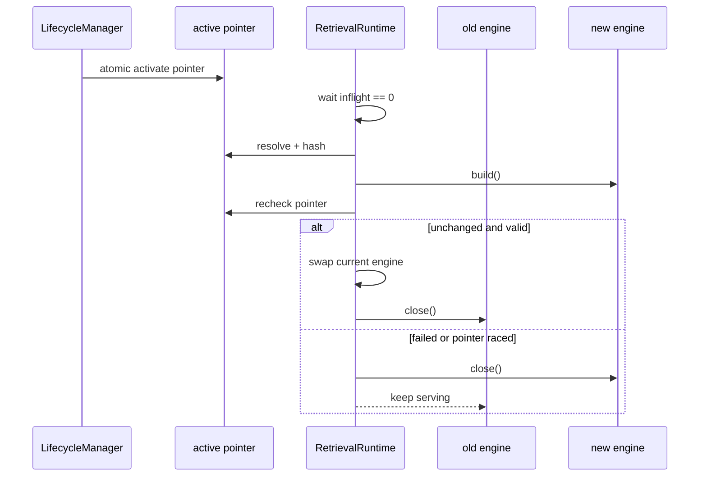

# 04 RAG 在线检索链

## 本文范围

从 Scheme Writer 的检索请求追到 active index、Milvus/BM25、查询变换、Parent-Child、重排、CRAG 纠正、Context packing 和业务 `EvidenceBundleSchema`。

## 当前事实结论

- 当前仓库没有 `RealRAGTool` 类。真实业务边界是 [REAL_PROVIDER] `RAGService`，fake 边界才是 `FakeRAGTool`。
- [INTEGRATED] 真实组合根路径为 `RAGServiceFactory → RAGService → RetrievalRuntime → ParentChildRAGRuntimeFactory → ParentChildRAGEngine`。
- Adaptive-RAG 是 planner/profile 选择；CRAG 是 evidence assessor + corrective gate/planner；Self-RAG-lite 位于生成质量检查，不是在线检索独立 Agent。
- [BROKEN] 当前在线链会被 `ParentChildChunkResult` 或 `RETRIEVAL_RESULT_TEMPLATE` 导入问题阻断，且生产更早受 `SelfRAGJudge` 阻断。

## 入口

业务侧：

```text
backend/apps/enterprise_document/services/scheme_writer/evidence_service.py:
SchemeEvidenceService.retrieve()
→ backend/rag/services/rag_service.py:RAGService.retrieve() [162-215]
```

组合根：

```text
backend/bootstrap/rag_service_factory.py:RAGServiceFactory.build() [14-39]
```

## 完整真实顺序

```text
SchemeEvidenceService.retrieve()
→ RAGToolInputSchema
→ RAGRequestMapper
→ RAGService.retrieve()
→ RetrievalRuntime.retrieve()
→ RetrievalRuntime._engine_session()
→ ParentChildRAGEngine.run()
→ ParentChildRetrievalPipeline.run()
→ AdaptiveRetrievalPlanner.plan()
→ QueryTransformSelector.transform()（exactly one: identity/multi_query/hyde）
→ for each transformed query:
   MilvusDenseChildRetriever.retrieve()
   + BM25ChildRetriever.retrieve()
   → RRF child source fusion
   → ParentChildCandidateEnricher（child → parent）
→ RRF parent query fusion
→ BGE parent cross-encoder rerank
→ CRAG evidence assessment
→ EvidenceSufficiencyCorrectiveGate
→ optional SectionGapCorrectiveQueryPlanner
→ optional corrective retrieve/fuse/rerank/reassess
→ ContextGate.select_packer()
→ default/lost-in-middle packer
→ raw engine result
→ RAGResultMapper
→ RAGToolOutputSchema/EvidenceBundleSchema
→ SchemeEvidenceService 规范化 CitationRegistry
→ GraphState evidence context
```

## 在线检索 Sequence Diagram

```mermaid
sequenceDiagram
  participant SW as SchemeEvidenceService
  participant RS as RAGService
  participant RT as RetrievalRuntime
  participant PL as AdaptivePlanner
  participant QS as QueryTransformSelector
  participant D as Milvus Dense Child
  participant B as BM25 Child
  participant PC as ParentChild Enricher
  participant RR as Reranker
  participant C as CRAG/Corrective
  participant CT as ContextGate

  SW->>RS: RAGToolInputSchema
  RS->>RT: canonical request
  RT->>PL: query + intent overrides
  PL-->>QS: one transform mode
  QS-->>RT: one or many transformed queries
  loop query
    RT->>D: dense child top_k
    RT->>B: sparse child top_k
    D-->>PC: child candidates
    B-->>PC: child candidates
    PC-->>RT: parent candidates
  end
  RT->>RR: fused parents
  RR->>C: reranked parents
  C->>C: assess; optional corrective round
  C->>CT: final candidates + assessment
  CT-->>RS: packed context/result
  RS-->>SW: EvidenceBundle + citations + lineage
```

## 组件表

| 组件 | 入口 | 输入 Schema | 输出 Schema | 配置来源 | Provider | 状态 |
|---|---|---|---|---|---|---|
| `RAGService` | `retrieve` `162-215` | `RAGToolInputSchema` | `RAGToolOutputSchema` | RuntimeOptions | runtime | [REAL_PROVIDER] [INTEGRATED] |
| `FakeRAGService` | `retrieve` `218-246` | 同上 | 同上 | fake switch | `FakeRAGTool` | [FAKE] |
| `ObservedRAGService` | wrapper `249+` | 同上 | 同上 | trace | inner | [INTEGRATED] |
| `RetrievalRuntime` | `retrieve` `300-348` | canonical request | raw result | runtime config/index | factory engine | [REAL_PROVIDER] |
| Adaptive Planner | `backend/rag/planning/retrieval_planner.py:AdaptiveRetrievalPlanner.plan()` `58-155` | query/intent | RetrievalPlan | request context + constructor defaults | deterministic | [INTEGRATED] |
| Query Selector | `transform` `query_transform_selector.py:12-82` | query + mode | transformed queries | static spec | optional ModelGateway | [INTEGRATED] |
| Dense retriever | plugin | query/vector | child candidates | manifest/static spec | Milvus Lite | [REAL_PROVIDER] [BROKEN] |
| Sparse retriever | plugin | query | child candidates | child JSONL/spec | BM25 | [REAL_PROVIDER] |
| Source fusion | RRF child | two source lists | child list | `rrf_k=60` | local | [INTEGRATED] |
| Parent enricher | plugin | child list | parent list | parent JSONL | local | [BROKEN] |
| Query fusion | RRF parent | multi-query parents | parent list | top_k=5 | local | [INTEGRATED] |
| Reranker | plugin | parents | scored parents | BGE path/spec | sentence-transformers | [REAL_PROVIDER] |
| CRAG assessor | plugin | query/candidates | `EvidenceAssessment` | gate YAML/spec | optional ModelGateway | [INTEGRATED] |
| Corrective gate | plugin | assessment | bool/route | spec | local | [INTEGRATED] |
| Corrective planner | plugin | gaps/query | max 2 queries | spec | optional ModelGateway | [INTEGRATED] |
| Context Gate | `pack` | candidates/model limits | packed context | static spec | local | [INTEGRATED] |
| Evidence mapper | RAGResultMapper | raw result | canonical bundle | code contract | local | [INTEGRATED] |

## Query Transformation 与 Adaptive-RAG

`AdaptiveRetrievalPlanner.plan()` 根据短查询（默认 16 chars）、歧义、多问题、formal/abstract intent 和显式 override 选择模式。`QueryTransformSelector` 要求 identity/multi-query/hyde 三种 transformer 都注册，但一次只执行一个：

- short/ambiguous/multi/formal 倾向 `multi_query`；
- abstract 倾向 `hyde`；
- 其余 `identity`；
- YAML 中 multi-query/hyde 可用 LLM，失败时 deterministic fallback。

这就是当前 Adaptive-RAG 的实际位置，不存在独立 Adaptive Agent。

## Hybrid 与 Parent-Child 的真实次序

`ParentChildRetrievalPipeline._retrieve_one_query()`（`parent_child_retrieval.py:83-127`）先分别调稠密/稀疏 retriever，再做 child-level source fusion，然后立刻 enrich 到 parent。多 query 的 parent lists 再做 query fusion（`129-136`），之后统一 rerank。

因此实际次序不是“所有 child 全局融合 → rerank child → 最后 parent fill”，而是：

```text
每 query: dense child + sparse child → child RRF → parent enrich
所有 query: parent RRF → parent rerank
```

Parent/Child 恢复依赖 child 的 `parent_chunk_id` 查 parent store；parent 保留较完整上下文，child 用于检索定位。最终 context granularity 配置为 parent。

## Reranker 加载

`ParentChildRAGRuntimeFactory.build()`（`parent_child_runtime_factory.py:87-327`）从 registry 构建 `bge_parent_cross_encoder@v1`，参数来自 `static_retrieval_v1.yaml`：`top_k=5`、`text_field=parent_text`。模型/资源通过 Runtime Resource Pool 延迟获取。是否能运行取决于模型路径和 optional dependency；代码存在不等于本次已成功加载。

## CRAG 与纠正

`ParentChildRetrievalPipeline.run()`（`276-392`）在初次 rerank 后 assess；`_correct()`（`176-274`）仅在 gate 决定需要纠正且 correction budget 未耗尽时：

1. `SectionGapCorrectiveQueryPlanner` 生成最多 2 个 gap query；
2. 重新 hybrid retrieve；
3. 可与原 candidates 合并；
4. fuse/rerank；
5. 再 assess；
6. budget 默认 1，停止。

CRAG 是一组策略插件，不是 Agent。Self-RAG-lite 在 Section 生成后检查 answer，需要更多证据时才把控制流送回 Section recovery。

## Evidence Contract 与旧 Retrieval Result

当前业务 Canonical 输出是 `schemas.rag.EvidenceBundleSchema`/相关 evidence/citation/context 类型。RAG raw `Retrieval_Result_Schema.py` 是在线引擎内部/兼容结构，经 `RAGResultMapper` 投影后才进入业务。

当前 [BROKEN] `Retrieval_Result_Schema.py:12` 从 `rag/configs/SchemaConfig.py` 导入 `RETRIEVAL_RESULT_TEMPLATE` 等常量；至少一个测试已复现该常量不可导入。不要绕过 mapper 把旧 dict 直接塞入 GraphState。

## Context Packer 与 token

静态 spec：

- `max_context_chars=12000`
- `max_items=5`
- `model_context_window=8192`
- `prompt_reserved_tokens=1536`
- `section_token_budget=4096`
- long-context threshold `0.65`

Context Gate 根据长度/窗口选择 default 或 lost-in-middle packer，先去重 parent、截 item/char，再输出带 metadata 的上下文。字符上限和 token/window 预算同时存在，不能把 `12000 chars` 误称 `12000 tokens`。

## Citation Lineage 与 Index Resolver

`RetrievalRuntimeConfig` 默认持有 active pointer、Milvus/parent/child/model 配置（`retrieval_runtime.py:54-109`）。`ActiveIndexResolver` 校验 pointer → manifest hash/version → required artifacts，输出 index_version、dataset_version、config/reproducibility hash、parent/child/Milvus path、embedding identity（`resolver.py:67-207`）。

RetrievalRuntime 将这些 lineage 写入结果 metadata；`SchemeEvidenceService` 生成/规范化 citation，Stage Service 在 document/section/parallel fan-in 时维护 registry；最终 binding 回指 doc/parent/child 与 claim occurrence。

## Reload

`RetrievalRuntime.reload()`（`192-253`）：

1. 等待当前 inflight sessions 归零；
2. 构建新 engine；
3. 再次检查 active pointer 防 race；
4. 成功后原子交换 engine；
5. 关闭旧 engine；
6. 构建/验证失败则保留旧 engine。



## State 修改

RAG engine 本身不修改 `GraphStateSchema`；它返回结果。`SchemeEvidenceService`/Stage Service 才把 canonical bundle、active context、citations、retrieval artifacts 和 budget metadata写入 candidate state，随后由节点 write contract commit。

## 失败、重试与恢复

- `RAGService.retrieve()` 捕获异常并映射 canonical failed EvidenceBundle，而不是泄漏 Provider exception（`162-215`）。
- Section 层可回退 document evidence 或触发 corrective retrieval。
- Retrieval Runtime reload 失败保留旧 engine。
- active pointer/manifest/hash 不匹配 fail closed。
- 当前 import 缺陷是启动期硬失败，不会进入上述 runtime fallback。

## 配置来源

- `backend/rag/config/static_retrieval_v1.yaml`
- `backend/rag/config/intent_policy_v1.yaml`
- `backend/rag/config/retrieval_gate_policy_v1.yaml`
- RuntimeOptions 的 spec/pointer 覆盖
- active `IndexManifest`
- Model Gateway（query transform/assess/planner 的可选 text generator）

## 对应测试

- `test_rag_config_driven_*`
- `test_rag_corrective_retrieval_loop.py`
- `test_rag_evidence_pipeline.py`
- `test_parent_child_generation_runtime.py`
- `test_langchain_rag_integration.py`
- `test_section_aware_evidence_retrieval.py`
- `test_step_12_evidence_contract.py`

当前全量收集中在线 RAG 文件分别被三类 RAG import error 阻塞；`test_langchain_rag_integration.py` 和 retrieval-only contract 在安全集合中执行。

## 尚未实现或无法确认

- 没有 `RealRAGTool` 实现；只有诊断/test fixture 字符串使用该名称。
- 当前无法动态证明本机 Milvus/BGE 模型可用。
- `ParentChildChunkResult` 缺失使默认 component registry 与很多 ports 无法导入。

## 常见误解

- Self-RAG、CRAG、Adaptive-RAG 不是三个生产 Agent。
- `hash_embedding` 是烟测模式，不是真实语义 embedding。
- packed context 是选择后的证据投影，不替代 canonical EvidenceBundle。

## 推荐下一篇

[05_RAG_OFFLINE_INDEXING.md](05_RAG_OFFLINE_INDEXING.md)。
