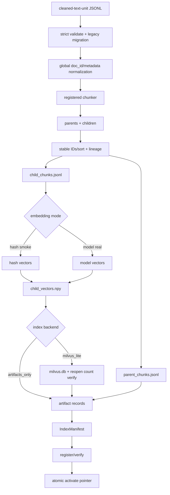
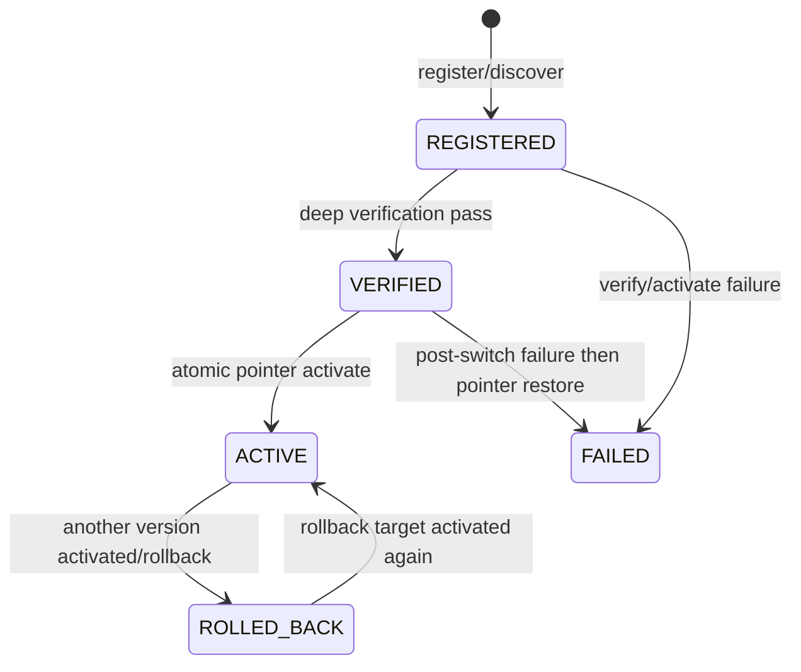
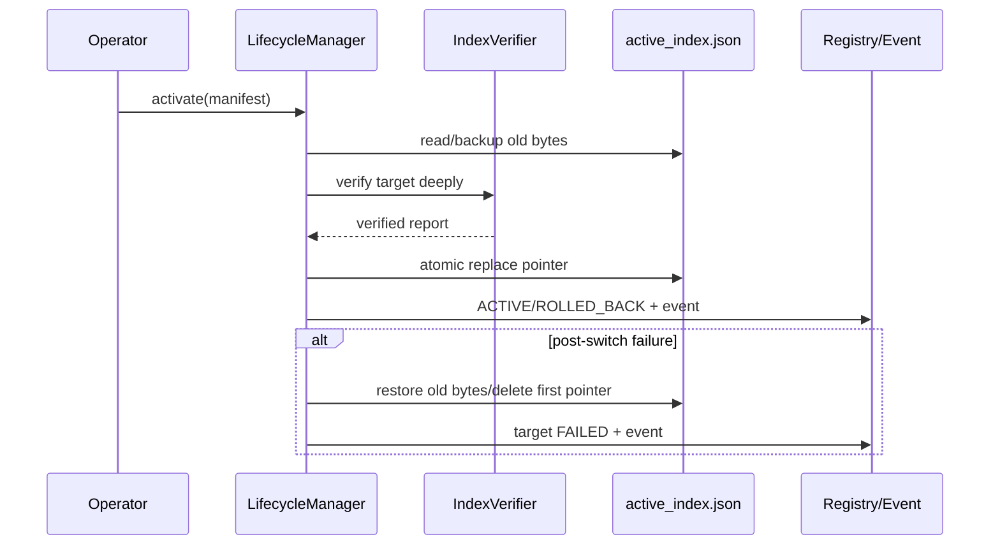

# 05 RAG 离线索引链

## 本文范围

解释当前可证实的离线起点（cleaned-text-unit JSONL）、Parent/Child Chunk、Embedding、Milvus Lite、Manifest、Registry、Activate/Resolver/Reload/Rollback。原始 PDF 发现/解析不在当前 Builder 链中，单独标注证据缺口。

## 当前事实结论

- [IMPLEMENTED_ONLY] `OfflineIndexBuilder` 已实现不可变版本产物，但不会更新 active pointer。
- [IMPLEMENTED_ONLY] `IndexLifecycleManager` 是 active pointer 唯一写入者，先深度验证、再原子切换，切换后异常会恢复旧 pointer。
- [INTEGRATED] 在线 `RetrievalRuntime` 通过 `ActiveIndexResolver` 读取 active pointer，并支持 build-new-before-swap reload。
- [BROKEN] `ParentChildChunkResult` 在 `ChildParentChunker.py` 中缺失，使 Builder 当前无法导入。
- 当前 Builder 的 source 是 cleaned-text-unit JSONL；仓库未找到“PDF discovery/parser 直接调用 Builder”的生产链。

## 入口

```text
scripts/build_offline_index.py:main() [39-55]
→ OfflineIndexConfigLoader.load()
→ OfflineIndexBuilder.validate()/build()
```

生命周期：

```text
scripts/manage_index_lifecycle.py:main()
→ IndexLifecycleManager.discover_and_register()/verify()/activate()/rollback()
```

## 完整调用链

```text
OfflineIndexBuildConfig.source.path（cleaned-text-unit JSONL）
→ OfflineIndexBuilder.validate()
→ load_jsonl_dicts()
→ migrate_legacy_cleaned_text_unit_payload()
→ canonical cleaned records + global doc_id validation
→ ComponentRegistry.build(chunker)
→ ChildParentChunker.chunk_documents()
→ stable sort parent/child
→ add offline index lineage
→ parent_chunks.jsonl + child_chunks.jsonl
→ hash/model embedding
→ child_vectors.npy + vector records
→ optional MilvusClient(milvus.db)
→ reopen and verify row count
→ ArtifactRecord hashes/fingerprints
→ IndexManifest + reproducibility_hash
→ atomic manifest write
→ IndexLifecycleManager.register()
→ verify()
→ activate() atomic active_index.json
→ ActiveIndexResolver.resolve()
→ RetrievalRuntime.reload()
```

## 离线处理 Flowchart



## 原始 PDF 到 Builder 的证据边界

需求模板中的“文件发现 → PDF 解析 → 标准化”不是当前 `OfflineIndexBuilder` 的实现：

- Builder docstring 和 `validate()` 明确要求 cleaned-text-unit source（`builder.py:3-6`、`180-249`）。
- `build()` 直接 `load_jsonl_dicts(source_path)` 并迁移旧 cleaned unit（`308-320`）。
- `scripts/build_offline_index.py` 只加载 build config 后调用 Builder。

因此当前可确认链从“已清洗 JSONL”开始。仓库其他 parser/数据管道可能生成 source，但未找到它们与 Builder 的直接生产接线；不能声称原始 PDF 自动入索引。

## Config 与 Index Identity

`backend/rag/offline/config.py`：

| Schema | 行号 | 关键字段 | 语义 |
|---|---:|---|---|
| `SourceDatasetConfig` | `57-85` | path/format | cleaned source |
| `EmbeddingBuildConfig` | `87-119` | mode/name/version/model/dim/device | hash 或真实模型 |
| `IndexStorageConfig` | `121-141` | backend/collection/metric | artifacts 或 Milvus Lite |
| `OutputConfig` | `143-166` | root/pointer/update flag | 禁止 Builder 激活 |
| `OfflineIndexBuildConfig` | `168-271` | dataset/chunker/embedding/index/output | identity/hash/version |

`index_version` 由 dataset_version、chunker identity、embedding identity 和 index identity hash 组合。source 路径/hash 不直接进入 identity，因此同 version 若 source hash/config hash 冲突，Builder 明确拒绝复用（`builder.py:277-297`）。

## Parent 与 Child

Builder 调注册的 chunker，取得 `chunk_result.parents` 和 `.children`（`369-388`）。Parent 保存大上下文和文档 lineage；Child 保存检索粒度文本、`parent_chunk_id`、doc/tenant/kb/file metadata。稳定排序按 parent/child ID；离线 index_version/config_hash/dataset_version 加到每条记录。

ID 的具体算法属于 chunker/schema builder；Builder不重新生成已有 canonical parent/child ID。它要求 doc_id 全局唯一，避免跨 tenant/source 碰撞。由于 `ParentChildChunkResult` 类型目前缺失，本次无法实例化并动态展示 ID 样例。

## Embedding 与 Milvus

`builder.py:410-579`：

- `hash`：`encode_texts_with_hash()`，仅烟测；
- `model`：真实 text embedding，配置 model_name/device/batch/version；
- 必须是二维矩阵，行数等于 child 数，维度等于 config；
- 写 `child_vectors.npy` 和向量 record；
- `milvus_lite` 时创建/reset collection、插入 child/vector、校验 inserted count；
- 关闭后重新打开 Milvus，再验证 persisted row count；
- collection name、metric、embedding model/version/dim 进入 manifest。

`milvus_lite` artifact 使用 `milvus_semantic_v1` fingerprint，不简单依赖数据库文件/目录字节布局；旧目录型 artifact 有兼容解释（`backend/rag/offline/manifest.py:267-283`）。

## Manifest 与 Artifact

`IndexManifest` 在 `backend/rag/offline/manifest.py:310-369`，包含：

- schema/index/build/dataset identity；
- config/source hashes；
- source/chunker/embedding/index 结构；
- parent/child/document counts；
- 每个 ArtifactRecord 的 path、sha256、count、kind、integrity mode；
- reproducibility hash。

`manifest.write()` 与 `ActiveIndexPointer.write()` 都用同目录临时文件 + `os.replace` 原子发布（`backend/rag/offline/manifest.py:21-58`、`355-369`、`392-393`）。

## 生命周期状态

`IndexLifecycleStatus`（`backend/rag/offline/lifecycle.py:86-103`）：



Registry snapshot 原子替换，history 追加 fsync（`IndexRegistry:234-360`）。Manifest 与 active pointer 才是在线事实源；Registry/history 是控制面审计。

## Activate 与 Rollback

`IndexLifecycleManager.activate()`（`764-927`）：

1. 读取 target manifest 和旧 pointer raw bytes。
2. 调完整 verifier。
3. 验证 report 指向同一 manifest/index。
4. `_write_pointer()` 原子发布。
5. 更新 target/previous registry status。
6. 追加 activated event。
7. 任意切换后异常：恢复旧 bytes，或首次激活时删除新 pointer；target 记 failed。

`rollback()`（`928-1014`）不是直接改状态：找到目标版本，复用完整 `activate()`，再追加显式 rollback event并标记旧版本。



## Resolver 与在线 Reload

`ActiveIndexResolver.resolve()`（`resolver.py:67-207`）：

- strict parse pointer；
- pointer-relative resolve manifest；
- verify manifest SHA；
- require pointer.index_version == manifest.index_version；
- require parent/child，Milvus backend 还 require milvus artifact；
- verify configured artifact paths/hashes；
- 返回在线 config projection 与 lineage。

`RetrievalRuntime.reload()` 只有新 engine 完成构建、pointer 未发生 race 后才 swap；失败保留旧 engine，详见在线篇。

## State 修改

离线 Builder只写版本目录，不写 active pointer。Lifecycle Manager 修改 Registry/history/pointer；在线 Runtime 只交换内存 engine。它们不修改 Agent GraphState。检索结果中 index lineage 最终进入 evidence metadata。

## 失败、重试与恢复

- 半成品版本目录：manifest 缺失且目录非空时拒绝隐式覆盖。
- 同 index version config/source hash 不同：collision。
- Milvus insert/reopen count 不一致：构建失败，manifest 不发布。
- activate 验证失败：pointer 不变。
- post-switch 失败：恢复旧 pointer。
- reload 构建失败：旧 engine 保留。
- 没有通用自动 retry loop；操作者修复原因后重新调用。

## 配置来源

- build YAML/JSON → `OfflineIndexConfigLoader`；
- 默认 root/pointer 来自 config；
- online pointer 可由 RuntimeOptions 覆盖；
- real embedding/Milvus 需要 `local-model`/`local-rag` optional dependencies；
- active manifest 最终覆盖 online path/model/index lineage。

## 对应测试

- `test_rag_offline_chunker_index_version.py`
- `test_step_11_2_offline_index_verification.py`
- `test_step_11_3_index_lifecycle.py`
- `test_p1_security_durability_identity_closure.py`

本次全量收集中前三类 Builder/verification 测试受 `ParentChildChunkResult` 阻塞；生命周期文件定义存在，但不能将历史测试结果当作当前通过。

## 尚未实现或无法确认

- PDF discovery/parser 到 cleaned JSONL 的直接接线未找到。
- `Failed Archive` 没有独立归档目录协议；失败主要体现在未发布 manifest、registry FAILED 和事件。
- lock 主要依赖原子文件操作/进程内管理；未找到覆盖全部 Builder/Lifecycle 的跨进程全局锁协议。
- `delete_version()` 实际执行 `shutil.rmtree`，但禁止删除 active version；本任务未调用。

## 常见误解

- Builder build 成功 ≠ 索引自动上线。
- Manifest hash 验证 ≠ Milvus 内容验证；激活使用更深 verifier。
- hash embedding ≠ real provider。

## 推荐下一篇

[06_MODEL_GATEWAY_AND_LLM_RUNTIME.md](06_MODEL_GATEWAY_AND_LLM_RUNTIME.md)。
