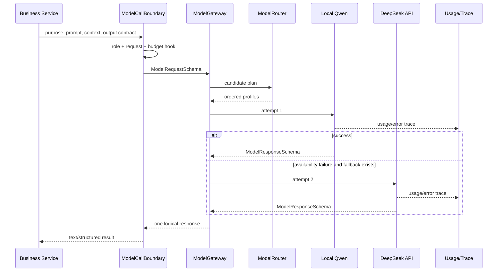

# 06 Model Gateway 与 LLM 运行时

## 本文范围

追踪业务服务到统一模型调用边界、路由、Provider、usage、fallback、structured output、trace 与隐私；并回答本地 Qwen、DeepSeek 和 Standalone 的关系。

## 当前事实结论

- [PRODUCTION] Planner/Writer/Judge/Query Expansion 的真实模型调用最终可走同一个 `ModelGateway`，调用 purpose 先映射 role，再由 role policy 选择模型。
- [REAL_PROVIDER] 本地 Qwen 和 DeepSeek/OpenAI-compatible adapter 都已实现并注册；是否可用取决于路径、依赖和 API key。
- [INTEGRATED] fallback 在 availability failure 时真实执行；validation/quality/configuration failure 不随意 fallback。显式 `model_name` 只产生一个候选。
- Prompt trace 不保存完整原文，但保存长度、hash 和 bounded preview；LocalQwen raw output 也含最多 1000 字 prompt preview，不能写成“零原文”。
- [STANDALONE] V1 默认 reasoner 是 `ScenarioAgentReasoner`，没有接 `ModelGateway`。

## 入口

业务推荐入口是：

```text
backend/model_gateway/call_boundary.py:
ModelCallBoundary.generate_response() [112-228]
```

底层统一入口：

```text
backend/model_gateway/model_gateway.py:
ModelGateway.generate() [213-361]
```

组合根：

```text
backend/bootstrap/model_factory.py:
build_default_model_routing() [19-127]
ModelGatewayFactory.build() [130-154]
```

## 完整调用链

```text
业务 service / RAG plugin
→ ModelGatewayTextGenerator.generate() 或 ModelCallBoundary.generate_response()
→ purpose_to_role()
→ Prompt/Context 构造 + ModelRequestSchema
→ budget hook（一次 logical call）
→ ModelGateway.generate()
→ ModelRouter.resolve_plan()
→ ProviderRegistry.require(profile/client)
→ ModelInvoker.invoke()
→ LocalQwenLLMClient / LangChain OpenAI-compatible / FakeLLMClient
→ ModelResponseSchema
→ observer trace + UsageLedger
→ structured parser/Pydantic validation（调用侧）
→ 业务输出 Schema
```

## Model Gateway Sequence



## 默认路由

`build_default_model_routing()`：

- 若 `DEFAULT_MODEL_NAME=fake_llm`：所有 roles 只指向 fake profile。
- real 配置注册：
  - local Qwen 1.5B：primary；
  - local Qwen 3B：resident/secondary；
  - DeepSeek API：remote；
  - local Qwen 7B GPTQ：disabled profile；
- 每个 role 有独立有序 fallback policy。

具体 role 包括 supervisor、planner、writer、judge、query expansion 等。`purpose_to_role()` 在 `call_boundary.py:38-55` 映射业务 purpose，确保调用方不硬编码 provider。

## 调用场景表

| 场景 | 调用方 | Prompt 来源 | Model Route | 输出 Schema | 失败处理 |
|---|---|---|---|---|---|
| Section writer | SectionGenerationService | PromptManager + context | writer role | ModelResponse → section | truncation/rewrite/structured error |
| Semantic judge | SemanticSectionJudge | judge template | judge role | SemanticGateResult | conservative fallback/advisory |
| Self-RAG checker | quality plugin | checker context | judge role | check result | deterministic/plugin fallback |
| citation repair | grounding repair | repair prompt | writer/judge policy | repaired content | retain original/fail gate |
| query expansion | MultiQuery/HyDE | RAG templates | query expansion role | query list/text | deterministic transform |
| CRAG assessment | assessor | query/evidence summary | judge role | EvidenceAssessment | deterministic assessment |
| corrective query | planner plugin | evidence gaps | query expansion role | query list | deterministic planner |
| Supervisor | SupervisorAgent capabilities | router/runtime | supervisor role | routing/model response | provider failure classification |

Structured output 并非 Gateway 自动保证：Gateway返回 `ModelResponseSchema`；具体调用侧解析 JSON、Pydantic validate，并将 invalid JSON 映射为保守结果或结构化失败。

## Provider 与加载

`provider_factory.py`：

- local HF profile → `LocalQwenLLMClient`；
- openai-compatible profile → LangChain `ChatOpenAI` runnable；
- DeepSeek 使用 base URL/provider model/key；
- 缺 API key 或 `langchain-openai` 时构造 unavailable runnable，使启动可继续，调用时按 availability policy fallback。

`local_qwen_client.py:82-171` 在第一次调用时通过共享 local HF runtime 加载 tokenizer/model，格式化 chat prompt、限制 max_new_tokens、调用 generate，输出 usage/finish reason。`local_hf_runtime.py` 负责并发 load-once 和 unload 等待活动 generation。

## Fallback 精确语义

`ModelGateway.generate()`（`213-361`）：

1. 为一个 logical call 取得有序 selections。
2. 每个 provider attempt 都记录 observer 和 usage。
3. cancellation 立即终止，不 fallback。
4. 只有 failure policy 分类为 availability 且还有候选时 fallback。
5. configuration、validation、business quality 等失败不借 fallback 隐藏。
6. 显式 request.model_name 时 router 只返回该模型，等价于关闭跨模型 fallback。

timeout/retry：Provider（例如 ChatOpenAI）配置 `max_retries=0`，重试由更外层 Gateway/workflow 策略控制，避免双层不可计数重试。ModelRequest 自带 `timeout_seconds`。

## Usage 与 Cost

`UsageLedger` 按 logical call、provider attempt、model/role 聚合 prompt/completion/total tokens、调用/失败/fallback 等。`MainlineApplicationService` 在 run 结束或 worker idle 后写 `model_usage_v1` JSON。

仓库有 usage/cost 字段与聚合边界，但实际货币 cost 取决于 profile/provider pricing metadata；不能从 token 自动推断未配置价格。

## Prompt、Hash、Trace 与隐私

`observability/trace_summary.py:model_request_summary()`（`162-205`）生成：

- prompt length；
- SHA-256；
- bounded preview；
- role/model/request lineage；
- bounded params/context summary。

不是完整 prompt dump，但 preview 仍可能含业务片段。`LocalQwenLLMClient` raw output 还含最多 1000 字 prompt preview。Trace 使用 JSONL `JsonlRunTraceRecorder`；ModelObserver 记录 started/finished/error 与 usage。

业务 prompt 来源主要是版本化 `prompts/` + `PromptManager`；动态上下文经 `LLMContextManager`/RAG packer 预算控制。不是所有 Model 调用都强制经过 Context Manager：RAG query expansion/judge 可直接构造短 prompt，但仍经 ModelCallBoundary/Gateway。

## Schema 流转

```text
business input + prompt/context
→ ModelRequestSchema
→ ModelSelection/Profile
→ provider-native response
→ ModelResponseSchema
→ caller JSON parse/Pydantic validation
→ SemanticGate/EvidenceAssessment/GeneratedSection/etc.
```

`ModelRequestSchema`/`ModelResponseSchema` 是 Canonical model contract；LangChain messages/runnable dict 是 Provider transport，不应跨过 adapter 进入业务 state。

## State 修改

Gateway 不直接修改 GraphState。它更新内部 usage ledger并发 trace；调用侧将 validated model result 写 candidate state。logical budget hook 在调用前 reservation，最终 usage 在应用层持久化。

## 失败、重试与恢复

- 本地路径缺失：preflight 或 provider availability failure。
- DeepSeek 缺 key：unavailable client → 可按 policy fallback。
- timeout/cancel：结构化 failure，取消不 fallback。
- invalid JSON：调用侧 conservative fallback/validation failure。
- model usage 在 late worker 存在时先写 `finalized=false`，idle callback 再原子覆盖。
- Gateway.close() 等待活动 calls 并幂等关闭 Provider。

## 配置来源

`backend/core/config.py:146-212,292-390` 与 `.env.example`：

- `DEFAULT_MODEL_NAME`
- `SUPERVISOR_MODEL_NAME`
- `LOCAL_QWEN_*_MODEL_NAME/PATH`
- `LOCAL_QWEN_DEVICE/MAX_NEW_TOKENS`
- `DEEPSEEK_MODEL_NAME/PROVIDER_MODEL_NAME/BASE_URL/API_KEY`
- `ENABLE_LLM_ROUTING`
- `ENABLE_SEMANTIC_GATE/SEMANTIC_GATE_MODEL_NAME`

进程环境优先；不要把 `.env.example` 的 `D:\models\...` 当作所有机器的事实。

## 对应测试

- `test_model_gateway_lifecycle.py`
- `test_model_gateway_multi_model_runtime.py`
- `test_langchain_model_gateway_integration.py`
- `test_provider_protocol_hardening.py`
- `test_model_usage_artifact.py`
- `test_rag_model_gateway_runtime.py`
- `test_real_provider_acceptance.py`

本次安全集合中的 Gateway/LangChain/lifecycle/provider tests 执行通过；multi-model/RAG usage 文件因 RAG/quality import 无法收集。真实 Provider test 为 `1 skipped`，未发出外部请求。

## 尚未实现或无法确认

- DeepSeek adapter 已接线，但本次没有凭据，因此 operational availability 未确认。
- Standalone V1 没有 ModelGateway adapter；`ReasonerFactory` 是未来注入点，但连接尚未实现。
- 未确认本地 Qwen 模型路径可加载。

## 常见误解

- “接入 DeepSeek”表示 adapter/routing 存在，不表示当前环境已成功调用。
- fallback 是受控 availability fallback，不是任何坏答案都换模型。
- prompt hash 不等于 prompt 已完全匿名化，preview 仍需按敏感数据处理。

## 推荐下一篇

[07_AGENT_RAG_V1_STANDALONE.md](07_AGENT_RAG_V1_STANDALONE.md)。
