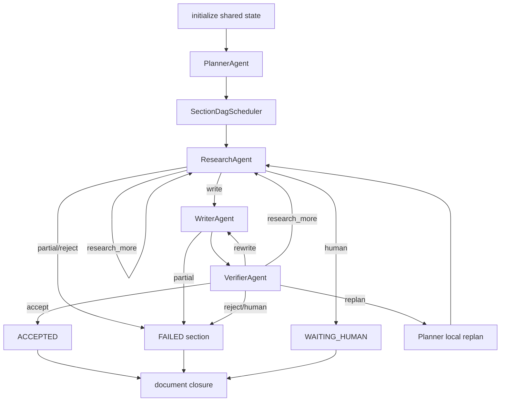

# 07 agent_rag_v1 独立运行时

## 本文范围

把新 V1 放回全仓库关系中，逐层解释 `MultiAgentApplicationService → RuntimeFactory → WorkflowOrchestrator → Planner/Research/Writer/Verifier → StateGateway/ToolGateway → Document Closure`，并明确默认 Fake 与未接生产的边界。

## 当前事实结论

- [STANDALONE] 这是可独立执行的完整垂直切片，不是 Schema 草稿；文件持久化、事件、checkpoint、恢复、文档发布均真实执行。
- [FAKE] 默认 `RuntimeFactory` 使用 `FixtureFactSnapshotProvider`、`FixtureTemplateProvider`、`ScenarioRetrievalService`、`ScenarioAgentReasoner`；没有真实 LLM/RAG。
- [STANDALONE] 没有第二个 `SupervisorAgent`。`SupervisorStateAdapter` 只初始化 V1 shared state；调度者是 `WorkflowOrchestrator`。
- [IMPLEMENTED_ONLY] Ports 和 factory injection 为未来真实 adapter 留出边界，但当前生产组合根没有引用 V1 application service。
- 专项测试已实跑：10 个文件，`84 passed in 4.44s`。

## 入口

CLI：

```text
scripts/run_agent_rag_v1_standalone.py
→ runtime/agent_rag_v1/scenario_runtime.py:run_scenario() [17-32]
→ MultiAgentApplicationService.run() [application_service.py:29-38]
```

公共输入/输出：

- `MultiAgentProjectInputSchema`（`contracts.py:90-103`）
- `StandaloneRunResultSchema`（`contracts.py:157-...`）

## 完整调用链

```text
MultiAgentApplicationService.run()
→ _resolve_identity()
→ RuntimeFactory.create_session()
  → fixture template/fact providers
  → FileArtifactStore / JSONL logs / JsonCheckpointStore
  → BudgetManager / StateGateway / ToolGateway
  → register knowledge.retrieve
  → ScenarioAgentReasoner
  → PlannerAgent / ResearchAgent / WriterAgent / VerifierAgent
  → closure/validator/version services
  → WorkflowOrchestrator
→ MultiAgentApplicationService._initialize_state()
  → persist immutable input artifacts
  → SupervisorStateAdapter.initialize()
  → first full checkpoint
→ WorkflowOrchestrator.run()
  → task RUNNING patch
  → Planner
  → SectionDagScheduler batches
  → per section Research → Writer → Verifier
  → optional research_more / rewrite / replan / human / draining
  → document verify/assemble/validate/review/version/publish/export
→ StandaloneRunResultSchema
```

## RuntimeFactory：单一组合根

`runtime_factory.py:140-284`：

| 组件 | 默认实现 | 状态 | 作用 |
|---|---|---|---|
| fact provider | `FixtureFactSnapshotProvider` | [FAKE] | 项目事实快照 |
| template provider | `FixtureTemplateProvider` | [FAKE] | 固定运行模板 |
| retrieval | `ScenarioRetrievalService` | [FAKE] | Scenario 证据 |
| reasoner | `ScenarioAgentReasoner` | [FAKE] | 四角色确定性响应 |
| exporter | `MarkdownDocumentExporter` | [STANDALONE] | 真实原子文件导出 |
| artifact | `FileArtifactStore` | [STANDALONE] | immutable/hash envelope |
| event | `JsonlDomainEventLog` | [STANDALONE] | state commit transaction log |
| tool log | `JsonlToolExecutionStore` | [STANDALONE] | 幂等 tool result |
| checkpoint | `JsonCheckpointStore` | [STANDALONE] | full snapshot/hash |
| writer log | `JsonlWriterProgressEventLog` | [STANDALONE] | 段落级恢复 |
| state/tool gateway | concrete services | [STANDALONE] | 权限/版本/幂等 |
| four agents | concrete Agent classes | [STANDALONE] | 强输入/输出契约 |
| closure services | concrete services | [STANDALONE] | 文档闭环 |

运行目录由 `_paths()`（`287-307`）确定：

```text
{output_dir}/_runtime/{task_id}/{run_id}/
├─ artifacts/
├─ checkpoints/
├─ domain-events.jsonl
├─ tool-executions.jsonl
└─ writer-progress-events.jsonl
```

## 初始化

`application_service.py:52-179`：

1. 将 fact snapshot、template、source inventory、task context、source snapshot 写 immutable artifact。
2. 根据 template sections 构造共享 `DocumentPlanSchema`。
3. `SupervisorStateAdapter.initialize()` 创建 `MultiAgentSharedStateSchema`；它没有创建 Supervisor。
4. 仅初始化阶段直接设置 project_name/template/source_versions；注释明确之后所有 mutation 必须经过 Gateway（`168-177`）。
5. 保存 event_sequence=0 的首个 checkpoint。

## Orchestrator 与四 Agent

`WorkflowOrchestrator.run()`（`76-102`）将 task 置 RUNNING，调用 planner，验证 DAG，执行 section batches，捕获 budget/unhandled failure，最后无论成功/退化都进入 `_close_document()`。



Agents 不互相调用。`_invoke_*()`（`390-586`）为每个角色构造最小 `AgentExecutionContextSchema`、强 invocation schema、授权 artifact refs/tools、writable paths 和 budget；`_call_agent()`（`588-624`）reserve → `agent.run()` → settle/release → trace。

| Agent | 输入 | 可写 domain | Tool | 强输出 |
|---|---|---|---|---|
| Planner | `PlannerInvocationInputSchema` | `execution_plan` | 无 | `PlannerResultPayloadSchema` |
| Research | `ResearchInvocationInputSchema` | `section.research` | `knowledge.retrieve` | `ResearchResultPayloadSchema` |
| Writer | `WriterInvocationInputSchema` | `section.writing` | 无 | `WriterResultPayloadSchema` |
| Verifier | `VerifierInvocationInputSchema` | `section.verification` | 无 | `VerifierResultPayloadSchema` |

Agent base 验证 role/context、tool authorization、payload type、artifact refs 和 patch targets，避免将完整 shared state 交给业务 reasoner。

## Section DAG 与路由

`_run_section_dag()`（`104-133`）让 `SectionDagScheduler.next_batch()` 返回安全 batch；当前实现随后按 batch 顺序执行，而不是开线程并发。`max_parallel_sections` 影响调度选择/契约，但默认 orchestrator 的 for-loop 仍串行调用 `_execute_section()`。

`_execute_section()`（`135-268`）执行 Research→Writer→Verifier 循环。`WorkflowRouter` 有优先级规则，budget draining/cancel/human 等控制信号先于业务 rewrite/research。

Verifier action：

- ACCEPT → accepted；
- REWRITE → 新 writer revision；
- RESEARCH_MORE → 回 research；
- REPLAN → `ResumeRouter` + local Planner，旧 attempt superseded，并验证 stale write 被 StateGateway 拒绝；
- HUMAN_REVIEW/REJECT → waiting/failed。

## StateGateway

Canonical state：`backend/apps/enterprise_document/schemas/agent_rag_v1/state.py:202-249` 的 `MultiAgentSharedStateSchema`，顶层 domains：

```text
state_meta
task_context
source_snapshot
execution_plan
section_states
document_validation
artifact_state
runtime_control
human_review
final_result
domain_versions
```

写入链：

```text
StatePatchRequestSchema
→ StateWritePermissionValidator
→ identity / attempt / owner / expected domain version
→ deep-copy candidate
→ JSON pointer operations
→ StateTransitionValidator
→ DomainEventSchema(sequence=n+1)
→ event_log.append()
→ candidate event_sequence/version update
→ StateCommitResult
→ checkpoint_store.save(candidate)
```

`StateGateway.commit()` 在 `state_gateway.py:153-268`。同 request_id 重放时返回幂等结果；旧 domain version、stale attempt、错误 owner/path/transition fail closed。不同 section domain 可在版本上互不冲突。

`WorkflowOrchestrator._patch()`（`1103-1141`）生成 field-level replace operations；`_commit_request()`（`1143-1149`）每次 commit 后保存 full checkpoint。

## ToolGateway

`RuntimeFactory` 只注册 `knowledge.retrieve@standalone-v1`，`max_retries=0`（`193-205`）。Research Agent 通过授权 session 调用：

- 验 role/context/tool；
- `call_id`/fingerprint 幂等；
- handler 输出 normalize 为 `NormalizedToolResultSchema`；
- result 和 error 可写 artifact；
- JSONL tool store 拒绝同 call_id 不同内容碰撞；
- Scenario retrieval 不代表真实 RAG。

## Writer 与恢复

`StreamingWriterService.generate()`（`streaming_writer.py:46-214`）逐段落：

1. 生成 paragraph artifact；
2. `ParagraphPrecheckService` 检查 claim/fact；
3. 每个通过的 paragraph 写 immutable artifact 和 progress event；
4. hard error 时在下一段前停止；
5. 完成时写 explicit SectionGenerationCompleted event。

`_recover_interrupted_writer()`（orchestrator `367-388`）读取最新 checkpoint 和 writer progress events，恢复 state，并记录 reused paragraph ids。`test_agent_rag_v1_recovery_e2e.py` 实际验证此路径。

## 文档闭环

`_close_document()`（`925-1101`）始终执行：

1. 未收敛 section 标 failed。
2. GroupAggregator 计算 aggregate。
3. `DocumentVerifierService` 做跨 section fact conflict。
4. verification artifact + document_validation patch。
5. `VersionPolicyService` 选择 semver。
6. GenerationReport build/persist。
7. `MultiAgentDocumentAssembler` 生成包含 placeholder 的完整文档。
8. `DocumentAssemblyValidator` 检查 section/report/artifact。
9. `FinalArtifactReviewService` 检查 assembly/body/marketing language。
10. `DocumentVersionPublisher` 发布 version artifact。
11. patch artifact/task/final domains。
12. Markdown exporter 输出文档/report。
13. 返回 final state、paths、trace。

失败 task 仍能导出模板结构和失败占位符，这是显式 degraded artifact，不等于成功内容。

## Artifact、Event、Checkpoint、Trace

| 链 | 实现 | 特性 |
|---|---|---|
| Artifact | `FileArtifactStore` | ref hash 文件名、envelope、content hash、fsync+replace、不可变 |
| Domain Event | `JsonlDomainEventLog` | run 内 sequence 连续、request/event id 幂等 |
| Tool Event | `JsonlToolExecutionStore` | call_id 幂等与碰撞检测 |
| Writer Event | `JsonlWriterProgressEventLog` | paragraph/completion 恢复 |
| Checkpoint | `JsonCheckpointStore` | event_sequence 文件名、state hash、full snapshot |
| Trace | `RuntimeTraceSchema` | 内存聚合，最终嵌入 result；不是生产 Trace V2 |

## 与生产主链对比

| 能力 | 现有生产主链 | agent_rag_v1 | 重复 | 已连接 |
|---|---|---|---|---|
| 应用 façade | MainlineApplicationService | MultiAgentApplicationService | 是 | 否 |
| Supervisor 概念 | `SupervisorAgent` | 无；Orchestrator + state adapter | 部分 | 否 |
| 调度 | 顶层/Section LangGraph | 手写 DAG/router | 是 | 否 |
| 角色 | Stage Services | 4 强契约 Agents | 是 | 否 |
| Shared State | GraphStateSchema | MultiAgentSharedStateSchema | 是 | 否 |
| 状态 commit | diff/write contract | field patch/domain version | 是 | 否 |
| RAG | RAGService real/fake | ScenarioRetrievalService | 接口重叠 | 否 |
| LLM | ModelGateway | ScenarioAgentReasoner | 接口重叠 | 否 |
| Artifact | 业务 output + workspace | immutable V1 store | 是 | 否 |
| Event/checkpoint | task/LangGraph/side-effect | domain event/full JSON | 是 | 否 |
| 文档 gate | production hard gate | closure validators/review | 是 | 否 |

## Schema 流转

```text
MultiAgentProjectInputSchema
→ RuntimeTemplateSchema + FactSnapshotSchema
→ MultiAgentSharedStateSchema
→ AgentExecutionContextSchema + role InvocationInput
→ AgentExecutionResultSchema + role Payload
→ StatePatchRequestSchema
→ DomainEventSchema
→ checkpointed MultiAgentSharedStateSchema
→ GenerationReport/Assembly/Review/PublishedVersion
→ StandaloneRunResultSchema
```

## 状态修改

初始化后所有 runtime mutation 通过 StateGateway。Agent 只能返回 patch request，不能持有/修改 whole state。Orchestrator 是唯一 commit caller；每个 committed patch 后保存 checkpoint。artifact 内容先写，state 只保存 ref；读取时校验 hash 和 task identity。

## 失败、重试与恢复

- Agent exception：release budget，orchestrator persist runtime error artifact，section/task fail。
- Tool：默认 max_retries=0；幂等 call 可重放。
- Budget：reserve 原子检查，超限进入 DRAINING，不再启动新工作，关闭 open sections。
- Stale attempt：domain version/attempt validation 拒绝。
- Crash：latest checkpoint + 连续 Domain Event replay。
- Writer crash：checkpoint + paragraph progress events。
- Human review schema/router 已实现，但 CLI Scenario 不是生产 HITL 接线。

## 配置来源

主要来自 `MultiAgentProjectInputSchema`：scenario、output_dir、max_parallel_sections、budget_limits、previous_document_version。默认 fixtures 在 `standalone_adapters.py`；没有读取生产 `.env` 的 model/RAG 路由。

## 对应测试

10 个专项文件：

- agents、contracts、document_closure、infrastructure、recovery、recovery_e2e、runtime_contracts、standalone_e2e、workflow、writer_claims。

实跑命令和结果见测试篇；`84 passed` 覆盖 success/research-more/rewrite/replan/partial/failed/human/budget/crash/tamper/idempotency。

## 尚未实现或无法确认

- 没有生产 ModelGateway/RAG adapter。
- 没有接入 Mainline/Supervisor/LangGraph。
- max_parallel_sections 尚未对应真正并发执行。
- RuntimeTraceSchema 是 standalone summary，不是持久 Trace V2 JSONL。

## 常见误解

- `SupervisorStateAdapter` 不是 Supervisor。
- 真实文件落盘不等于真实 Provider。
- 专项 E2E 全绿只证明注入 Scenario 下的边界/基础设施闭环。

## 推荐下一篇

[08_SCHEMA_AND_STATE_CATALOG.md](08_SCHEMA_AND_STATE_CATALOG.md)。
