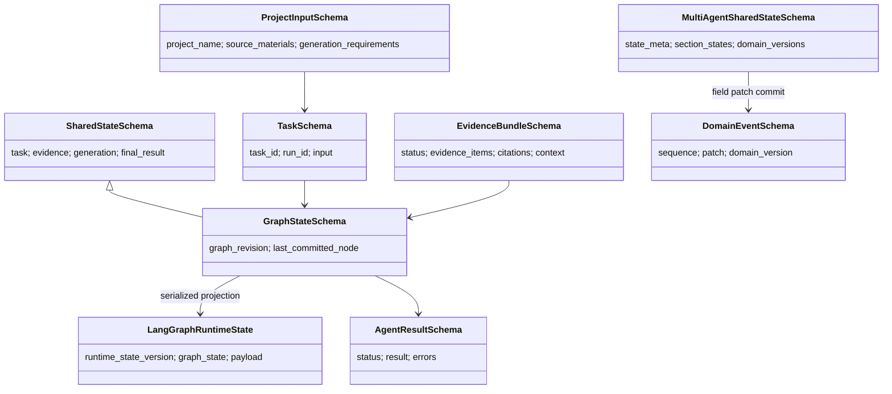

# 08 全仓库 Schema 与 State 索引

## 本文范围

本篇对生产代码（排除 `backend/tests`）做 AST 扫描，纳入类名以 `Schema/State/Result` 结尾，或直接继承 `BaseModel/SchemaBase/ContractSchema/TypedDict` 的类型。证据提交共识别 **255** 个核心类，名称均唯一。表格按业务领域解释，而不是把同名概念混为一体。

## 当前事实结论

- [PRODUCTION] 跨域 Canonical 契约主要在 `backend/schemas/`；enterprise_document 自有业务契约位于其 `schemas/`。
- [PRODUCTION] `GraphStateSchema` 是现有主链业务 state source of truth；`LangGraphRuntimeState` 是 checkpoint/runtime projection。
- [STANDALONE] `MultiAgentSharedStateSchema` 是另一套隔离 source of truth，不能与 GraphState 互换。
- [LEGACY] 旧 Retrieval Result、兼容 re-export 和旧 chunk Schema 并存；进入业务层前必须过 mapper/adapter。
- [SCHEMA_ONLY] “已定义”不代表生产已消费；全量表的状态列给出领域归属，主链表才表示当前接线。

## 入口

```text
ProjectInput/Task → backend/apps/enterprise_document/schemas/project_input_schema.py, backend/schemas/task.py
Graph/Workflow → backend/agent/runtime + backend/schemas/graph.py
Enterprise document → backend/apps/enterprise_document/schemas
RAG → backend/schemas/rag.py + backend/rag/schema/config/offline
Model → backend/schemas/model.py + backend/model_gateway/model_contract.py
Standalone → backend/apps/enterprise_document/schemas/agent_rag_v1
```

## 主要 Canonical 与 Projection

| 概念 | Source of Truth | Projection/Transport | 创建 | 修改 | 消费/持久化 |
|---|---|---|---|---|---|
| 项目输入 | `ProjectInputSchema` | CLI dict、Task projection | ProjectInputFactory | immutable | TaskFactory/Stage |
| 任务 | `TaskSchema` + Task event aggregate | `TaskStateSnapshotSchema` | TaskFactory | TaskManager events | Supervisor/JSONL |
| 生产业务状态 | `GraphStateSchema` | `LangGraphRuntimeState` | Supervisor/codec | node delta applier | SQLite checkpoint |
| 工作流 | `WorkflowDefinitionSchema` | graph config/namespace | workflow builder | immutable | engines/checkpoint |
| Section | Plan + generated section | Section graph payload/result | Stage/codec | Section graph + fan-in | GraphState |
| 检索证据 | `EvidenceBundleSchema`、Citation | raw retrieval result | RAGResultMapper | registry/remap | GraphState/artifact |
| 模型调用 | ModelRequest/Response | provider native/LangChain | CallBoundary | provider adapter | trace/usage |
| 索引 | `IndexManifest` + `ActiveIndexPointer` | online config dict | Builder/Lifecycle | immutable + pointer | files/Milvus |
| Standalone | `MultiAgentSharedStateSchema` | patches/events/checkpoints | StateAdapter | StateGateway | JSONL/JSON |
| 最终文档 | SchemeWriterOutput/AgentResult | CLI summary | Stage/engine | terminal | artifact/workspace |

## Schema 关系图



## 完整 Schema 流转

```text
[PRODUCTION]
ProjectInputSchema → TaskSchema → GraphStateSchema → GraphNodeInputSchema
→ enterprise_document stage input/output → Evidence/Citation/Context + ModelResponse
→ GeneratedSection/SchemeDraft/HardGate → SchemeWriterOutput
→ WorkflowEngineResult → AgentResultSchema → application summary

[STANDALONE]
MultiAgentProjectInputSchema → RuntimeTemplate/FactSnapshot
→ MultiAgentSharedStateSchema → AgentExecutionContext + role Invocation
→ AgentExecutionResult + strong Payload → StatePatchRequest → DomainEvent
→ full checkpoint → GenerationReport/PublishedDocument → StandaloneRunResult
```

## 全量核心类目录（255）

“关键字段”来自类体顶层注解的前 8 项；空项表示该类主要通过继承、方法或非注解字段形成。创建/修改/消费是领域级路由，主链精确调用见前七篇。

| Schema/State/Result | 文件:行 | 父类 | 关键字段（最多 8） | 分类 | 创建/修改位置 | 消费位置 | 持久化 | 生命周期 |
|---|---|---|---|---|---|---|---|---|
| `GraphStateSchema` | `backend/agent/runtime/graph_state.py:18` | `SharedStateSchema` | schema_version,graph_revision,current_node_id,completed_node_ids,node_history,workflow_engine_name,workflow_engine_version,graph_metadata | Runtime/Persistence | Graph codec/diff/applier | Supervisor/workflow engine | LangGraph SQLite/runtime | workflow run/checkpoint |
| `LangGraphRuntimeState` | `backend/agent/runtime/langgraph_state.py:29` | `TypedDict` | runtime_state_version,task_id,run_id,workflow_id,workflow_version,workflow_namespace,graph_state_payload,node_inputs | Runtime/Persistence | Graph codec/diff/applier | Supervisor/workflow engine | LangGraph SQLite/runtime | workflow run/checkpoint |
| `SharedStateSchema` | `backend/agent/runtime/shared_state_schema.py:19` | `SchemaBase` | schema_version,task_id,run_id,task_type,user_input,tenant_id,task,workflow | Runtime/Persistence | Graph codec/diff/applier | Supervisor/workflow engine | LangGraph SQLite/runtime | workflow run/checkpoint |
| `WorkflowStepSchema` | `backend/agent/runtime/workflow_schema.py:17` | `SchemaBase` | schema_version,step_id,step_name,step_type,target_name,order,input_keys,output_keys | Runtime/Persistence | Graph codec/diff/applier | Supervisor/workflow engine | LangGraph SQLite/runtime | workflow run/checkpoint |
| `WorkflowDefinitionSchema` | `backend/agent/runtime/workflow_schema.py:74` | `SchemaBase` | schema_version,workflow_id,workflow_name,task_type,workflow_version,description,steps,is_active | Runtime/Persistence | Graph codec/diff/applier | Supervisor/workflow engine | LangGraph SQLite/runtime | workflow run/checkpoint |
| `GenerationPluginConfig` | `backend/apps/enterprise_document/config/grounded_generation.py:13` | `BaseModel` | name,version,enabled,params | Domain | domain service/adapter | Enterprise document graph/services | embedded state/artifact/transport | request/task/run |
| `GroundedGenerationPolicyConfig` | `backend/apps/enterprise_document/config/grounded_generation.py:30` | `BaseModel` | schema_version,policy_id,policy_version,generation_checker,repair_strategy,max_retrieval_rounds,max_rewrite_rounds,max_total_llm_calls | Domain | domain service/adapter | Enterprise document graph/services | embedded state/artifact/transport | request/task/run |
| `RuntimeSectionTemplateSchema` | `backend/apps/enterprise_document/runtime/agent_rag_v1/contracts.py:54` | `ContractSchema` | section_id,section_title,section_order,strategy,hard_dependencies,consistency_references,execution_group,can_run_in_parallel | Standalone-only | domain service/adapter | Standalone agents/services | V1 artifact/event/checkpoint or runtime | single standalone run/recovery |
| `RuntimeTemplateSchema` | `backend/apps/enterprise_document/runtime/agent_rag_v1/contracts.py:69` | `ContractSchema` | schema_version,template_version,document_title,sections | Standalone-only | domain service/adapter | Standalone agents/services | V1 artifact/event/checkpoint or runtime | single standalone run/recovery |
| `MultiAgentProjectInputSchema` | `backend/apps/enterprise_document/runtime/agent_rag_v1/contracts.py:90` | `ContractSchema` | schema_version,project_name,scenario,task_id,run_id,output_dir,max_parallel_sections,previous_document_version | Standalone-only | domain service/adapter | Standalone agents/services | V1 artifact/event/checkpoint or runtime | single standalone run/recovery |
| `RetrievalRequestSchema` | `backend/apps/enterprise_document/runtime/agent_rag_v1/contracts.py:105` | `ContractSchema` | task_id,run_id,section_id,query_topics,research_round,scenario | Standalone-only | domain service/adapter | Standalone agents/services | V1 artifact/event/checkpoint or runtime | single standalone run/recovery |
| `RetrievalResponseSchema` | `backend/apps/enterprise_document/runtime/agent_rag_v1/contracts.py:114` | `ContractSchema` | status,evidence_ids,supported_topics,evidence_gaps,conflicts,source_refs | Standalone-only | domain service/adapter | Standalone agents/services | V1 artifact/event/checkpoint or runtime | single standalone run/recovery |
| `ExportedDocumentPathsSchema` | `backend/apps/enterprise_document/runtime/agent_rag_v1/contracts.py:123` | `ContractSchema` | document_path,generation_report_path | Standalone-only | domain service/adapter | Standalone agents/services | V1 artifact/event/checkpoint or runtime | single standalone run/recovery |
| `SectionAttemptRecordSchema` | `backend/apps/enterprise_document/runtime/agent_rag_v1/contracts.py:128` | `ContractSchema` | section_id,attempt_id,execution_id,plan_revision,status | Standalone-only | domain service/adapter | Standalone agents/services | V1 artifact/event/checkpoint or runtime | single standalone run/recovery |
| `RuntimeTraceSchema` | `backend/apps/enterprise_document/runtime/agent_rag_v1/contracts.py:136` | `ContractSchema` | schema_version,agent_invocations,router_actions,section_batches,state_commit_count,retrieval_tool_calls,research_rounds,writer_revisions | Standalone-only | domain service/adapter | Standalone agents/services | V1 artifact/event/checkpoint or runtime | single standalone run/recovery |
| `StandaloneRunResultSchema` | `backend/apps/enterprise_document/runtime/agent_rag_v1/contracts.py:157` | `ContractSchema` | schema_version,task_id,run_id,task_status,document_version,section_results,document_artifact_ref,generation_report_ref | Standalone-only | domain service/adapter | Standalone agents/services | V1 artifact/event/checkpoint or runtime | single standalone run/recovery |
| `ContractSchema` | `backend/apps/enterprise_document/schemas/agent_rag_v1/_base.py:10` | `SchemaBase` | 方法/派生字段 | Standalone-only | domain service/adapter | Standalone agents/services | V1 artifact/event/checkpoint or runtime | single standalone run/recovery |
| `ArtifactReferenceSchema` | `backend/apps/enterprise_document/schemas/agent_rag_v1/artifacts.py:12` | `ContractSchema` | reference_schema_version,artifact_ref,artifact_type,content_hash,schema_version,size_bytes,created_by,task_id | Standalone-only | domain service/adapter | Standalone agents/services | V1 artifact/event/checkpoint or runtime | single standalone run/recovery |
| `TaskBudgetLimitsSchema` | `backend/apps/enterprise_document/schemas/agent_rag_v1/budgets.py:12` | `ContractSchema` | schema_version,max_model_calls,max_tool_calls,max_total_replans,max_total_rewrites,max_document_repair_tasks,max_wall_clock_seconds | Standalone-only | domain service/adapter | Standalone agents/services | V1 artifact/event/checkpoint or runtime | single standalone run/recovery |
| `BudgetVectorSchema` | `backend/apps/enterprise_document/schemas/agent_rag_v1/budgets.py:22` | `ContractSchema` | model_calls,tool_calls,total_replans,total_rewrites,document_repair_tasks | Standalone-only | domain service/adapter | Standalone agents/services | V1 artifact/event/checkpoint or runtime | single standalone run/recovery |
| `BudgetReservationSchema` | `backend/apps/enterprise_document/schemas/agent_rag_v1/budgets.py:30` | `ContractSchema` | schema_version,reservation_id,task_id,requested,settled,status | Standalone-only | domain service/adapter | Standalone agents/services | V1 artifact/event/checkpoint or runtime | single standalone run/recovery |
| `BudgetSnapshotSchema` | `backend/apps/enterprise_document/schemas/agent_rag_v1/budgets.py:39` | `ContractSchema` | schema_version,task_id,limits,reserved,used,draining,elapsed_seconds | Standalone-only | domain service/adapter | Standalone agents/services | V1 artifact/event/checkpoint or runtime | single standalone run/recovery |
| `ClaimSourceBindingSchema` | `backend/apps/enterprise_document/schemas/agent_rag_v1/claims.py:18` | `ContractSchema` | source_type,source_ref,support_type | Standalone-only | domain service/adapter | Standalone agents/services | V1 artifact/event/checkpoint or runtime | single standalone run/recovery |
| `ClaimSchema` | `backend/apps/enterprise_document/schemas/agent_rag_v1/claims.py:24` | `ContractSchema` | schema_version,claim_id,section_id,paragraph_id,claim_type,text_span_ref,normalized_value,unit | Standalone-only | domain service/adapter | Standalone agents/services | V1 artifact/event/checkpoint or runtime | single standalone run/recovery |
| `ExcelDeviceFactSchema` | `backend/apps/enterprise_document/schemas/agent_rag_v1/claims.py:54` | `ContractSchema` | schema_version,fact_id,device_name,aliases,device_type,model,specification,quantity | Standalone-only | domain service/adapter | Standalone agents/services | V1 artifact/event/checkpoint or runtime | single standalone run/recovery |
| `FactSnapshotSchema` | `backend/apps/enterprise_document/schemas/agent_rag_v1/claims.py:81` | `ContractSchema` | schema_version,snapshot_version,artifact_ref,devices,construction_scope,calculation_parameters | Standalone-only | domain service/adapter | Standalone agents/services | V1 artifact/event/checkpoint or runtime | single standalone run/recovery |
| `DocumentConflictSchema` | `backend/apps/enterprise_document/schemas/agent_rag_v1/document_closure.py:14` | `ContractSchema` | conflict_id,conflict_type,severity,section_ids,target_section_ids,claim_ids,authoritative_fact_ref,message | Standalone-only | domain service/adapter | Standalone agents/services | V1 artifact/event/checkpoint or runtime | single standalone run/recovery |
| `RepairTaskSchema` | `backend/apps/enterprise_document/schemas/agent_rag_v1/document_closure.py:25` | `ContractSchema` | repair_id,priority,conflict_ids,target_section_ids,action,authoritative_fact_refs,prerequisite_repair_ids,status | Standalone-only | domain service/adapter | Standalone agents/services | V1 artifact/event/checkpoint or runtime | single standalone run/recovery |
| `ConflictRepairPlanSchema` | `backend/apps/enterprise_document/schemas/agent_rag_v1/document_closure.py:36` | `ContractSchema` | schema_version,repair_tasks | Standalone-only | domain service/adapter | Standalone agents/services | V1 artifact/event/checkpoint or runtime | single standalone run/recovery |
| `DocumentVerificationResultSchema` | `backend/apps/enterprise_document/schemas/agent_rag_v1/document_closure.py:41` | `ContractSchema` | schema_version,mode,checked_section_ids,conflicts,repair_plan,passed | Standalone-only | domain service/adapter | Standalone agents/services | V1 artifact/event/checkpoint or runtime | single standalone run/recovery |
| `SectionGenerationReportSchema` | `backend/apps/enterprise_document/schemas/agent_rag_v1/document_closure.py:50` | `ContractSchema` | section_id,section_title,status,deliverable_paragraph_ids,failure_stage,reason,recoverable,recovery_action | Standalone-only | domain service/adapter | Standalone agents/services | V1 artifact/event/checkpoint or runtime | single standalone run/recovery |
| `PartialSuccessReasonSchema` | `backend/apps/enterprise_document/schemas/agent_rag_v1/document_closure.py:61` | `ContractSchema` | section_id,stage,what_happened,stop_reason,recoverable,recovery_action | Standalone-only | domain service/adapter | Standalone agents/services | V1 artifact/event/checkpoint or runtime | single standalone run/recovery |
| `GenerationReportSchema` | `backend/apps/enterprise_document/schemas/agent_rag_v1/document_closure.py:70` | `ContractSchema` | schema_version,task_id,run_id,task_status,document_version,section_results,partial_success_reasons,source_versions | Standalone-only | domain service/adapter | Standalone agents/services | V1 artifact/event/checkpoint or runtime | single standalone run/recovery |
| `AssembledDocumentSchema` | `backend/apps/enterprise_document/schemas/agent_rag_v1/document_closure.py:88` | `ContractSchema` | schema_version,task_id,run_id,task_status,document_title,document_artifact_ref,content_hash,included_section_ids | Standalone-only | domain service/adapter | Standalone agents/services | V1 artifact/event/checkpoint or runtime | single standalone run/recovery |
| `AssemblyValidationResultSchema` | `backend/apps/enterprise_document/schemas/agent_rag_v1/document_closure.py:101` | `ContractSchema` | schema_version,passed,checks,failures,warnings | Standalone-only | domain service/adapter | Standalone agents/services | V1 artifact/event/checkpoint or runtime | single standalone run/recovery |
| `FinalArtifactReviewResultSchema` | `backend/apps/enterprise_document/schemas/agent_rag_v1/document_closure.py:109` | `ContractSchema` | schema_version,passed,issue_codes,route_to,affected_section_ids | Standalone-only | domain service/adapter | Standalone agents/services | V1 artifact/event/checkpoint or runtime | single standalone run/recovery |
| `PublishedDocumentVersionSchema` | `backend/apps/enterprise_document/schemas/agent_rag_v1/document_closure.py:119` | `ContractSchema` | schema_version,task_id,run_id,document_version,task_status,document_artifact_ref,generation_report_ref,published_at | Standalone-only | domain service/adapter | Standalone agents/services | V1 artifact/event/checkpoint or runtime | single standalone run/recovery |
| `WorkflowErrorSchema` | `backend/apps/enterprise_document/schemas/agent_rag_v1/errors.py:18` | `ContractSchema` | schema_version,error_id,source,category,scope,retryability,affected_section_ids,error_code | Standalone-only | domain service/adapter | Standalone agents/services | V1 artifact/event/checkpoint or runtime | single standalone run/recovery |
| `DomainEventSchema` | `backend/apps/enterprise_document/schemas/agent_rag_v1/events.py:15` | `ContractSchema` | schema_version,event_id,event_type,sequence,task_id,run_id,section_id,actor_role | Standalone-only | domain service/adapter | Standalone agents/services | V1 artifact/event/checkpoint or runtime | single standalone run/recovery |
| `ParagraphGeneratedEventSchema` | `backend/apps/enterprise_document/schemas/agent_rag_v1/events.py:37` | `ContractSchema` | schema_version,event_id,task_id,run_id,section_id,attempt_id,input_snapshot_version,paragraph | Standalone-only | domain service/adapter | Standalone agents/services | V1 artifact/event/checkpoint or runtime | single standalone run/recovery |
| `SectionGenerationCompletedEventSchema` | `backend/apps/enterprise_document/schemas/agent_rag_v1/events.py:50` | `ContractSchema` | schema_version,event_id,task_id,run_id,section_id,attempt_id,input_snapshot_version,expected_paragraph_ids | Standalone-only | domain service/adapter | Standalone agents/services | V1 artifact/event/checkpoint or runtime | single standalone run/recovery |
| `CandidateEvidenceItemSchema` | `backend/apps/enterprise_document/schemas/agent_rag_v1/evidence.py:12` | `ContractSchema` | schema_version,evidence_id,source_ref,source_kind,content,mentioned_project_names,device_name,claimed_model | Standalone-only | domain service/adapter | Standalone agents/services | V1 artifact/event/checkpoint or runtime | single standalone run/recovery |
| `ValidatedEvidenceItemSchema` | `backend/apps/enterprise_document/schemas/agent_rag_v1/evidence.py:36` | `ContractSchema` | schema_version,evidence_id,source_ref,sanitized_content,project_adapted,validation_status,validation_reason_codes | Standalone-only | domain service/adapter | Standalone agents/services | V1 artifact/event/checkpoint or runtime | single standalone run/recovery |
| `RejectedCandidateEvidenceSchema` | `backend/apps/enterprise_document/schemas/agent_rag_v1/evidence.py:46` | `ContractSchema` | schema_version,evidence_id,source_ref,validation_status,reason_code | Standalone-only | domain service/adapter | Standalone agents/services | V1 artifact/event/checkpoint or runtime | single standalone run/recovery |
| `EvidenceSanitizationResultSchema` | `backend/apps/enterprise_document/schemas/agent_rag_v1/evidence.py:54` | `ContractSchema` | schema_version,accepted,rejected | Standalone-only | domain service/adapter | Standalone agents/services | V1 artifact/event/checkpoint or runtime | single standalone run/recovery |
| `AgentExecutionContextSchema` | `backend/apps/enterprise_document/schemas/agent_rag_v1/execution.py:28` | `ContractSchema` | schema_version,invocation_id,logical_operation_id,task_id,run_id,section_id,agent_role,execution_mode | Standalone-only | domain service/adapter | Standalone agents/services | V1 artifact/event/checkpoint or runtime | single standalone run/recovery |
| `AgentExecutionResultSchema` | `backend/apps/enterprise_document/schemas/agent_rag_v1/execution.py:68` | `ContractSchema` | schema_version,invocation_id,agent_role,execution_mode,execution_id,attempt_id,input_snapshot_version,status | Standalone-only | domain service/adapter | Standalone agents/services | V1 artifact/event/checkpoint or runtime | single standalone run/recovery |
| `PlannerInvocationInputSchema` | `backend/apps/enterprise_document/schemas/agent_rag_v1/invocations.py:13` | `ContractSchema` | schema_version,template_schema_ref,source_inventory_ref,fact_snapshot_ref,current_plan_ref,target_section_ids,constraints | Standalone-only | domain service/adapter | Standalone agents/services | V1 artifact/event/checkpoint or runtime | single standalone run/recovery |
| `ResearchInvocationInputSchema` | `backend/apps/enterprise_document/schemas/agent_rag_v1/invocations.py:23` | `ContractSchema` | schema_version,section_id,section_task_ref,fact_snapshot_ref,source_inventory_ref,evidence_topics,prior_evidence_package_ref | Standalone-only | domain service/adapter | Standalone agents/services | V1 artifact/event/checkpoint or runtime | single standalone run/recovery |
| `WriterInvocationInputSchema` | `backend/apps/enterprise_document/schemas/agent_rag_v1/invocations.py:33` | `ContractSchema` | schema_version,section_id,strategy,fact_snapshot_ref,evidence_package_ref,base_draft_ref,verifier_issue_refs,generation_cursor | Standalone-only | domain service/adapter | Standalone agents/services | V1 artifact/event/checkpoint or runtime | single standalone run/recovery |
| `VerifierInvocationInputSchema` | `backend/apps/enterprise_document/schemas/agent_rag_v1/invocations.py:44` | `ContractSchema` | schema_version,execution_mode,target_artifact_ref,fact_snapshot_ref,section_id,claim_ids,binding_refs,verified_section_summary_refs | Standalone-only | domain service/adapter | Standalone agents/services | V1 artifact/event/checkpoint or runtime | single standalone run/recovery |
| `StatePatchActorSchema` | `backend/apps/enterprise_document/schemas/agent_rag_v1/patches.py:13` | `ContractSchema` | agent_role,execution_id,attempt_id | Standalone-only | StateGateway/Orchestrator | Standalone agents/services | V1 artifact/event/checkpoint or runtime | single standalone run/recovery |
| `StatePatchOperationSchema` | `backend/apps/enterprise_document/schemas/agent_rag_v1/patches.py:19` | `ContractSchema` | operation,path,value | Standalone-only | StateGateway/Orchestrator | Standalone agents/services | V1 artifact/event/checkpoint or runtime | single standalone run/recovery |
| `StatePatchRequestSchema` | `backend/apps/enterprise_document/schemas/agent_rag_v1/patches.py:41` | `ContractSchema` | schema_version,request_id,task_id,section_id,actor,input_snapshot_version,expected_domain_version,target_domain | Standalone-only | StateGateway/Orchestrator | Standalone agents/services | V1 artifact/event/checkpoint or runtime | single standalone run/recovery |
| `PlannerResultPayloadSchema` | `backend/apps/enterprise_document/schemas/agent_rag_v1/payloads.py:18` | `ContractSchema` | plan_ref,plan_revision,section_task_ids,affected_section_ids,impact_analysis_ref | Standalone-only | domain service/adapter | Standalone agents/services | V1 artifact/event/checkpoint or runtime | single standalone run/recovery |
| `RejectedEvidenceSchema` | `backend/apps/enterprise_document/schemas/agent_rag_v1/payloads.py:26` | `ContractSchema` | evidence_id,reason_code | Standalone-only | domain service/adapter | Standalone agents/services | V1 artifact/event/checkpoint or runtime | single standalone run/recovery |
| `ResearchEvidencePackageSchema` | `backend/apps/enterprise_document/schemas/agent_rag_v1/payloads.py:31` | `ContractSchema` | schema_version,section_id,accepted_evidence_ids,rejected_evidence,supported_topics,evidence_gaps,conflicts,research_status | Standalone-only | domain service/adapter | Standalone agents/services | V1 artifact/event/checkpoint or runtime | single standalone run/recovery |
| `ResearchResultPayloadSchema` | `backend/apps/enterprise_document/schemas/agent_rag_v1/payloads.py:43` | `ContractSchema` | section_id,evidence_package_ref,evidence_summary | Standalone-only | domain service/adapter | Standalone agents/services | V1 artifact/event/checkpoint or runtime | single standalone run/recovery |
| `ParagraphArtifactSchema` | `backend/apps/enterprise_document/schemas/agent_rag_v1/payloads.py:49` | `ContractSchema` | paragraph_id,paragraph_version,order,role,content_ref,content_hash | Standalone-only | domain service/adapter | Standalone agents/services | V1 artifact/event/checkpoint or runtime | single standalone run/recovery |
| `WriterResultPayloadSchema` | `backend/apps/enterprise_document/schemas/agent_rag_v1/payloads.py:58` | `ContractSchema` | section_id,draft_ref,draft_version,paragraphs,generation_complete,expected_paragraph_ids,change_manifest_ref,generation_cursor | Standalone-only | domain service/adapter | Standalone agents/services | V1 artifact/event/checkpoint or runtime | single standalone run/recovery |
| `VerifierIssueSchema` | `backend/apps/enterprise_document/schemas/agent_rag_v1/payloads.py:76` | `ContractSchema` | issue_id,issue_code,severity,message,section_id,paragraph_id,claim_ids,details_ref | Standalone-only | domain service/adapter | Standalone agents/services | V1 artifact/event/checkpoint or runtime | single standalone run/recovery |
| `VerifierResultPayloadSchema` | `backend/apps/enterprise_document/schemas/agent_rag_v1/payloads.py:87` | `ContractSchema` | execution_mode,action,issue_ids,accepted_paragraph_ids,rejected_paragraph_ids,verification_ref,repair_plan_ref | Standalone-only | domain service/adapter | Standalone agents/services | V1 artifact/event/checkpoint or runtime | single standalone run/recovery |
| `RunningInvocationRecoveryInputSchema` | `backend/apps/enterprise_document/schemas/agent_rag_v1/recovery.py:19` | `ContractSchema` | schema_version,invocation_id,task_id,run_id,execution_id,attempt_id,input_snapshot_version,idempotency_key | Standalone-only | domain service/adapter | Standalone agents/services | V1 artifact/event/checkpoint or runtime | single standalone run/recovery |
| `RunningInvocationRecoveryContextSchema` | `backend/apps/enterprise_document/schemas/agent_rag_v1/recovery.py:56` | `ContractSchema` | schema_version,task_id,run_id,input_snapshot_version,active_execution_ids,active_attempt_ids,draining,cancelled | Standalone-only | domain service/adapter | Standalone agents/services | V1 artifact/event/checkpoint or runtime | single standalone run/recovery |
| `InvocationRecoveryDecisionSchema` | `backend/apps/enterprise_document/schemas/agent_rag_v1/recovery.py:67` | `ContractSchema` | schema_version,invocation_id,action,reason_code,idempotency_key,result_ref,starts_new_call | Standalone-only | domain service/adapter | Standalone agents/services | V1 artifact/event/checkpoint or runtime | single standalone run/recovery |
| `HumanReviewResumeRequestSchema` | `backend/apps/enterprise_document/schemas/agent_rag_v1/recovery.py:77` | `ContractSchema` | schema_version,task_id,review_id,input_snapshot_version,decision_ref,trigger_kind | Standalone-only | domain service/adapter | Standalone agents/services | V1 artifact/event/checkpoint or runtime | single standalone run/recovery |
| `HumanReviewResumeResultSchema` | `backend/apps/enterprise_document/schemas/agent_rag_v1/recovery.py:86` | `ContractSchema` | schema_version,review,resume_decision | Standalone-only | domain service/adapter | Standalone agents/services | V1 artifact/event/checkpoint or runtime | single standalone run/recovery |
| `SectionDomainVersionsSchema` | `backend/apps/enterprise_document/schemas/agent_rag_v1/state.py:20` | `ContractSchema` | research,writing,claims,verification,execution | Standalone-only | StateGateway/Orchestrator | Standalone agents/services | V1 artifact/event/checkpoint or runtime | single standalone run/recovery |
| `SectionExecutionStateSchema` | `backend/apps/enterprise_document/schemas/agent_rag_v1/state.py:28` | `ContractSchema` | status,execution_id,active_attempt_id,active_plan_version,input_snapshot_version,lease_owner,lease_expires_at,hard_dependencies | Standalone-only | StateGateway/Orchestrator | Standalone agents/services | V1 artifact/event/checkpoint or runtime | single standalone run/recovery |
| `SectionResearchStateSchema` | `backend/apps/enterprise_document/schemas/agent_rag_v1/state.py:42` | `ContractSchema` | evidence_package_ref,evidence_ids,evidence_gap_count,research_rounds,tool_call_refs | Standalone-only | StateGateway/Orchestrator | Standalone agents/services | V1 artifact/event/checkpoint or runtime | single standalone run/recovery |
| `SectionWritingStateSchema` | `backend/apps/enterprise_document/schemas/agent_rag_v1/state.py:50` | `ContractSchema` | draft_ref,draft_version,paragraph_refs,paragraph_versions,expected_paragraph_ids,generation_complete,change_manifest_ref | Standalone-only | StateGateway/Orchestrator | Standalone agents/services | V1 artifact/event/checkpoint or runtime | single standalone run/recovery |
| `SectionClaimsStateSchema` | `backend/apps/enterprise_document/schemas/agent_rag_v1/state.py:60` | `ContractSchema` | claim_ids,active_claim_ids,claim_set_version,extraction_ref | Standalone-only | StateGateway/Orchestrator | Standalone agents/services | V1 artifact/event/checkpoint or runtime | single standalone run/recovery |
| `SectionVerificationStateSchema` | `backend/apps/enterprise_document/schemas/agent_rag_v1/state.py:67` | `ContractSchema` | execution_mode,recommended_action,verification_ref,issue_ids,accepted_paragraph_ids,rejected_paragraph_ids,verification_rounds | Standalone-only | StateGateway/Orchestrator | Standalone agents/services | V1 artifact/event/checkpoint or runtime | single standalone run/recovery |
| `SectionStateSchema` | `backend/apps/enterprise_document/schemas/agent_rag_v1/state.py:77` | `ContractSchema` | schema_version,section_id,section_title,section_order,applicable,strategy,execution_group,can_run_in_parallel | Standalone-only | StateGateway/Orchestrator | Standalone agents/services | V1 artifact/event/checkpoint or runtime | single standalone run/recovery |
| `StateMetaSchema` | `backend/apps/enterprise_document/schemas/agent_rag_v1/state.py:114` | `ContractSchema` | schema_version,task_id,run_id,input_snapshot_version,created_at,updated_at,event_sequence | Standalone-only | StateGateway/Orchestrator | Standalone agents/services | V1 artifact/event/checkpoint or runtime | single standalone run/recovery |
| `TaskContextStateSchema` | `backend/apps/enterprise_document/schemas/agent_rag_v1/state.py:124` | `ContractSchema` | task_status,project_name,template_version,requirements_ref,task_context_ref | Standalone-only | StateGateway/Orchestrator | Standalone agents/services | V1 artifact/event/checkpoint or runtime | single standalone run/recovery |
| `SourceSnapshotStateSchema` | `backend/apps/enterprise_document/schemas/agent_rag_v1/state.py:132` | `ContractSchema` | source_snapshot_ref,fact_snapshot_ref,template_schema_ref,source_inventory_ref,source_versions | Standalone-only | StateGateway/Orchestrator | Standalone agents/services | V1 artifact/event/checkpoint or runtime | single standalone run/recovery |
| `ExecutionPlanStateSchema` | `backend/apps/enterprise_document/schemas/agent_rag_v1/state.py:140` | `ContractSchema` | plan_ref,plan_version,active_plan_revision_id,section_order,version | Standalone-only | StateGateway/Orchestrator | Standalone agents/services | V1 artifact/event/checkpoint or runtime | single standalone run/recovery |
| `DocumentValidationStateSchema` | `backend/apps/enterprise_document/schemas/agent_rag_v1/state.py:148` | `ContractSchema` | verification_ref,conflict_repair_plan_ref,validation_version,status,issue_ids | Standalone-only | StateGateway/Orchestrator | Standalone agents/services | V1 artifact/event/checkpoint or runtime | single standalone run/recovery |
| `ArtifactStateSchema` | `backend/apps/enterprise_document/schemas/agent_rag_v1/state.py:156` | `ContractSchema` | assembly_ref,assembly_validation_ref,final_artifact_ref,generation_report_ref,document_version,version | Standalone-only | StateGateway/Orchestrator | Standalone agents/services | V1 artifact/event/checkpoint or runtime | single standalone run/recovery |
| `RuntimeControlStateSchema` | `backend/apps/enterprise_document/schemas/agent_rag_v1/state.py:165` | `ContractSchema` | draining,cancelled,active_execution_ids,budget_reserved,budget_settled,checkpoint_ref,version | Standalone-only | StateGateway/Orchestrator | Standalone agents/services | V1 artifact/event/checkpoint or runtime | single standalone run/recovery |
| `HumanReviewStateSchema` | `backend/apps/enterprise_document/schemas/agent_rag_v1/state.py:175` | `ContractSchema` | review_id,scope,section_id,status,request_ref,decision_ref | Standalone-only | StateGateway/Orchestrator | Standalone agents/services | V1 artifact/event/checkpoint or runtime | single standalone run/recovery |
| `FinalResultStateSchema` | `backend/apps/enterprise_document/schemas/agent_rag_v1/state.py:184` | `ContractSchema` | task_status,document_version,document_artifact_ref,generation_report_ref,published | Standalone-only | StateGateway/Orchestrator | Standalone agents/services | V1 artifact/event/checkpoint or runtime | single standalone run/recovery |
| `DomainVersionsSchema` | `backend/apps/enterprise_document/schemas/agent_rag_v1/state.py:192` | `ContractSchema` | task_context,execution_plan,document_validation,artifact_state,runtime_control,final_result,sections | Standalone-only | StateGateway/Orchestrator | Standalone agents/services | V1 artifact/event/checkpoint or runtime | single standalone run/recovery |
| `MultiAgentSharedStateSchema` | `backend/apps/enterprise_document/schemas/agent_rag_v1/state.py:202` | `ContractSchema` | schema_version,state_meta,task_context,source_snapshot,execution_plan,section_states,document_validation,artifact_state | Standalone-only | StateGateway/Orchestrator | Standalone agents/services | V1 artifact/event/checkpoint or runtime | single standalone run/recovery |
| `ToolInvocationSchema` | `backend/apps/enterprise_document/schemas/agent_rag_v1/tool_calls.py:13` | `ContractSchema` | schema_version,call_id,agent_role,tool_name,arguments,task_id,run_id,section_id | Standalone-only | domain service/adapter | Standalone agents/services | V1 artifact/event/checkpoint or runtime | single standalone run/recovery |
| `ToolHandlerOutputSchema` | `backend/apps/enterprise_document/schemas/agent_rag_v1/tool_calls.py:27` | `ContractSchema` | schema_version,status,data_type,data,source_refs,warnings,raw_result,error_code | Standalone-only | domain service/adapter | Standalone agents/services | V1 artifact/event/checkpoint or runtime | single standalone run/recovery |
| `ToolProvenanceSchema` | `backend/apps/enterprise_document/schemas/agent_rag_v1/tools.py:13` | `ContractSchema` | source_refs,raw_artifact_ref,input_snapshot_version,tool_name,tool_version,input_fingerprint | Standalone-only | domain service/adapter | Standalone agents/services | V1 artifact/event/checkpoint or runtime | single standalone run/recovery |
| `ToolQualitySchema` | `backend/apps/enterprise_document/schemas/agent_rag_v1/tools.py:32` | `ContractSchema` | warnings | Standalone-only | domain service/adapter | Standalone agents/services | V1 artifact/event/checkpoint or runtime | single standalone run/recovery |
| `ToolResultErrorSchema` | `backend/apps/enterprise_document/schemas/agent_rag_v1/tools.py:36` | `ContractSchema` | error_code | Standalone-only | domain service/adapter | Standalone agents/services | V1 artifact/event/checkpoint or runtime | single standalone run/recovery |
| `NormalizedToolResultSchema` | `backend/apps/enterprise_document/schemas/agent_rag_v1/tools.py:40` | `ContractSchema` | schema_version,call_id,status,data_type,data,provenance,quality,error | Standalone-only | domain service/adapter | Standalone agents/services | V1 artifact/event/checkpoint or runtime | single standalone run/recovery |
| `RouterSignalSchema` | `backend/apps/enterprise_document/schemas/agent_rag_v1/workflow.py:20` | `ContractSchema` | signal_id,kind,section_id,payload | Standalone-only | domain service/adapter | Standalone agents/services | V1 artifact/event/checkpoint or runtime | single standalone run/recovery |
| `RouterDecisionSchema` | `backend/apps/enterprise_document/schemas/agent_rag_v1/workflow.py:27` | `ContractSchema` | schema_version,action,selected_signal_id,priority,section_id,discarded_signal_ids,reason | Standalone-only | domain service/adapter | Standalone agents/services | V1 artifact/event/checkpoint or runtime | single standalone run/recovery |
| `ScheduledSectionBatchSchema` | `backend/apps/enterprise_document/schemas/agent_rag_v1/workflow.py:37` | `ContractSchema` | schema_version,section_ids,blocked_section_ids,max_parallel_sections | Standalone-only | domain service/adapter | Standalone agents/services | V1 artifact/event/checkpoint or runtime | single standalone run/recovery |
| `SectionGroupResultSchema` | `backend/apps/enterprise_document/schemas/agent_rag_v1/workflow.py:44` | `ContractSchema` | schema_version,group_id,status,applicable_section_ids,deliverable_section_ids,unavailable_section_ids,reason_codes | Standalone-only | domain service/adapter | Standalone agents/services | V1 artifact/event/checkpoint or runtime | single standalone run/recovery |
| `ResumeRequestSchema` | `backend/apps/enterprise_document/schemas/agent_rag_v1/workflow.py:54` | `ContractSchema` | task_id,section_ids,trigger_kind,trigger_ref | Standalone-only | domain service/adapter | Standalone agents/services | V1 artifact/event/checkpoint or runtime | single standalone run/recovery |
| `ResumeDecisionSchema` | `backend/apps/enterprise_document/schemas/agent_rag_v1/workflow.py:61` | `ContractSchema` | schema_version,stage,affected_section_ids,invalidated_domains,preserved_domains,reason_code | Standalone-only | domain service/adapter | Standalone agents/services | V1 artifact/event/checkpoint or runtime | single standalone run/recovery |
| `SectionBindingSnapshotSchema` | `backend/apps/enterprise_document/schemas/agent_rag_v1/workflow.py:70` | `ContractSchema` | section_id,fact_refs,claim_refs,evidence_topics,hard_dependencies,consistency_references | Standalone-only | domain service/adapter | Standalone agents/services | V1 artifact/event/checkpoint or runtime | single standalone run/recovery |
| `RejectedDraftArtifactSchema` | `backend/apps/enterprise_document/schemas/scheme_writer/output.py:18` | `SchemaBase` | artifact_type,draft,rejection_code,rejection_reasons,hard_gate | Canonical/Projection | domain service/adapter | Enterprise document graph/services | embedded state/artifact/transport | request/task/run |
| `DeliverableFinalResultSchema` | `backend/apps/enterprise_document/schemas/scheme_writer/output.py:30` | `SchemaBase` | artifact_type,draft,output_format | Canonical/Projection | domain service/adapter | Enterprise document graph/services | embedded state/artifact/transport | request/task/run |
| `SchemeWriterOutputSchema` | `backend/apps/enterprise_document/schemas/scheme_writer/output.py:40` | `SchemaBase` | schema_version,task_id,run_id,status,document_plan,generated_draft,rejected_artifact,deliverable_final_result | Canonical/Projection | domain service/adapter | Enterprise document graph/services | embedded state/artifact/transport | request/task/run |
| `SectionPlanSchema` | `backend/apps/enterprise_document/schemas/scheme_writer/planning.py:11` | `SchemaBase` | schema_version,section_id,section_title,section_order,citation_required,depends_on,execution_group,can_run_in_parallel | Canonical/Projection | domain service/adapter | Enterprise document graph/services | embedded state/artifact/transport | request/task/run |
| `DocumentPlanSchema` | `backend/apps/enterprise_document/schemas/scheme_writer/planning.py:51` | `SchemaBase` | schema_version,plan_id,document_id,document_title,sections,planning_source,created_at,metadata | Canonical/Projection | domain service/adapter | Enterprise document graph/services | embedded state/artifact/transport | request/task/run |
| `SectionExecutionRequestSchema` | `backend/apps/enterprise_document/schemas/scheme_writer/section_execution.py:25` | `SchemaBase` | schema_version,shared_state,document_id,project_input,section_plan,structured_facts,previous_sections,document_rag_context | Canonical/Projection | domain service/adapter | Enterprise document graph/services | embedded state/artifact/transport | request/task/run |
| `SectionExecutionResultSchema` | `backend/apps/enterprise_document/schemas/scheme_writer/section_execution.py:57` | `SchemaBase` | schema_version,section,evidence,retrieved_chunks,rag_outputs,citation_registry,budget_usage,need_human_review | Canonical/Projection | domain service/adapter | Enterprise document graph/services | embedded state/artifact/transport | request/task/run |
| `ParallelSectionStateDeltaSchema` | `backend/apps/enterprise_document/schemas/scheme_writer/section_execution.py:81` | `SchemaBase` | schema_version,generated_section_ids,generated_outputs,warnings,errors,runtime_errors,metadata_updates,retry_count_delta | Canonical/Projection | domain service/adapter | Enterprise document graph/services | embedded state/artifact/transport | request/task/run |
| `ParallelSectionExecutionEnvelopeSchema` | `backend/apps/enterprise_document/schemas/scheme_writer/section_execution.py:111` | `SchemaBase` | schema_version,section_id,result,state_delta | Canonical/Projection | domain service/adapter | Enterprise document graph/services | embedded state/artifact/transport | request/task/run |
| `SectionGraphExecutionRequestSchema` | `backend/apps/enterprise_document/schemas/section_execution_graph.py:28` | `SchemaBase` | schema_version,document_id,project_input,section_plan,structured_facts,previous_sections,document_rag_context,document_retrieved_chunks | Canonical/Projection | domain service/adapter | Enterprise document graph/services | embedded state/artifact/transport | request/task/run |
| `SectionExecutionGraphPayloadSchema` | `backend/apps/enterprise_document/schemas/section_execution_graph.py:50` | `SchemaBase` | schema_version,task_id,run_id,document_id,project_input,section_plan,structured_facts,previous_sections | Canonical/Projection | domain service/adapter | Enterprise document graph/services | embedded state/artifact/transport | request/task/run |
| `SectionExecutionGraphState` | `backend/apps/enterprise_document/schemas/section_execution_graph.py:121` | `TypedDict` | section_graph_state_version,section_payload,current_section_node,section_route | Canonical/Projection | Graph codec/diff/applier | Enterprise document graph/services | embedded state/artifact/transport | request/task/run |
| `StructuredFactSchema` | `backend/apps/enterprise_document/schemas/table_agent_schema.py:15` | `SchemaBase` | schema_version,fact_id,task_id,run_id,fact_type,content,source_type,source_ids | Canonical/Projection | domain service/adapter | Enterprise document graph/services | embedded state/artifact/transport | request/task/run |
| `TableAgentInputSchema` | `backend/apps/enterprise_document/schemas/table_agent_schema.py:36` | `SchemaBase` | schema_version,task_id,run_id,user_input,file_ids,table_refs,requirements,goal | Canonical/Projection | domain service/adapter | Enterprise document graph/services | embedded state/artifact/transport | request/task/run |
| `TableAnalysisSchema` | `backend/apps/enterprise_document/schemas/table_agent_schema.py:65` | `SchemaBase` | table_summary,device_summary,project_scale,device_list,resource_config,estimate_summary,risk_items,extra | Canonical/Projection | domain service/adapter | Enterprise document graph/services | embedded state/artifact/transport | request/task/run |
| `TableAgentOutputSchema` | `backend/apps/enterprise_document/schemas/table_agent_schema.py:77` | `SchemaBase` | schema_version,task_id,run_id,status,project_input,table_analysis,structured_facts,citations | Canonical/Projection | domain service/adapter | Enterprise document graph/services | embedded state/artifact/transport | request/task/run |
| `StateCommitResult` | `backend/apps/enterprise_document/services/agent_rag_v1/state_gateway.py:40` | `-` | state,event,committed | Standalone-only | domain service/adapter | Standalone agents/services | V1 artifact/event/checkpoint or runtime | single standalone run/recovery |
| `CitationOccurrenceIntegrityResult` | `backend/apps/enterprise_document/services/scheme_writer/citation_integrity_service.py:62` | `-` | checks,metadata | Domain | domain service/adapter | Enterprise document graph/services | embedded state/artifact/transport | request/task/run |
| `HighRiskClaimGateResult` | `backend/apps/enterprise_document/services/scheme_writer/high_risk_claim_service.py:234` | `-` | claims,violations | Domain | domain service/adapter | Enterprise document graph/services | embedded state/artifact/transport | request/task/run |
| `SectionContentRecoveryResult` | `backend/apps/enterprise_document/services/scheme_writer/section_content_recovery.py:21` | `-` | content,truncation,truncation_retry_responses,truncation_recovery_strategy,compression_response,compression_fallback_strategy,target_section_chars,max_section_chars | Domain | domain service/adapter | Enterprise document graph/services | embedded state/artifact/transport | request/task/run |
| `SectionQualityEvaluationResult` | `backend/apps/enterprise_document/services/scheme_writer/section_quality_evaluator.py:22` | `-` | status,error,warnings,eval_result,semantic_hard_issues,semantic_soft_issues,semantic_warning_issues,semantic_fact_issues | Domain | domain service/adapter | Enterprise document graph/services | embedded state/artifact/transport | request/task/run |
| `_ParallelSectionState` | `backend/apps/enterprise_document/workflows/section_parallel_execution_graph.py:24` | `TypedDict` | envelopes | Domain | domain service/adapter | Enterprise document graph/services | embedded state/artifact/transport | request/task/run |
| `_SideEffectState` | `backend/core/runtime/side_effects.py:72` | `-` | state,claim_token,execution_id,lease_expires_at,semantic_fingerprint | Domain | domain service/adapter | application/runtime | embedded state/artifact/transport | request/task/run |
| `CaptureTransitionEvent` | `backend/data_capture/lifecycle.py:34` | `BaseModel` | schema_version,event_id,record_id,task_id,run_id,revision,event_type,from_state | Domain | domain service/adapter | application/runtime | embedded state/artifact/transport | request/task/run |
| `RAGEvalMetricSchema` | `backend/eval/rag/capture/schemas.py:16` | `SchemaBase` | schema_version,name,score,reason,details | Evaluation | RAG pipeline/mapper | Eval reports/scripts | eval JSON/JSONL/report | offline evaluation |
| `RAGEvalResultSchema` | `backend/eval/rag/capture/schemas.py:34` | `SchemaBase` | schema_version,sample_id,task_id,run_id,capture_type,query,answer,context_precision | Evaluation | RAG pipeline/mapper | Eval reports/scripts | eval JSON/JSONL/report | offline evaluation |
| `RAGEvalReportSchema` | `backend/eval/rag/capture/schemas.py:77` | `SchemaBase` | schema_version,report_id,run_id,source_path,created_at,total,average_overall_score,average_context_precision | Evaluation | RAG pipeline/mapper | Eval reports/scripts | eval JSON/JSONL/report | offline evaluation |
| `StrictModel` | `backend/eval/rag/strategy/schemas.py:12` | `BaseModel` | 方法/派生字段 | Evaluation | RAG pipeline/mapper | Eval reports/scripts | eval JSON/JSONL/report | offline evaluation |
| `SampleMetricResult` | `backend/eval/rag/strategy/schemas.py:250` | `StrictModel` | sample_id,query,success,run_id,latency_ms,metrics,retrieved_result_count,retrieved_ids | Evaluation | RAG pipeline/mapper | Eval reports/scripts | eval JSON/JSONL/report | offline evaluation |
| `_StrictModel` | `backend/experiments/manifest.py:16` | `BaseModel` | 方法/派生字段 | Domain | domain service/adapter | application/runtime | embedded state/artifact/transport | request/task/run |
| `StrictGatewayModel` | `backend/model_gateway/model_contract.py:17` | `BaseModel` | 方法/派生字段 | Model | Model boundary/provider | Gateway/business callers | trace + usage snapshot | logical model call/run |
| `RetrievalStageResult` | `backend/rag/application/parent_child_retrieval.py:30` | `-` | retrieval_plan,query_expansion,p2_results,reranked_results,results,evidence_quality,correction_triggered | Retrieval | RAG pipeline/mapper | RAGService/engine/plugins | embedded state/artifact/transport | single retrieval/runtime |
| `IntentPolicyConfig` | `backend/rag/config/retrieval_policies.py:13` | `BaseModel` | schema_version,policy_id,short_query_max_chars | Retrieval | RAG pipeline/mapper | RAGService/engine/plugins | embedded state/artifact/transport | single retrieval/runtime |
| `RetrievalGatePolicyConfig` | `backend/rag/config/retrieval_policies.py:21` | `BaseModel` | schema_version,policy_id,correction_budget | Retrieval | RAG pipeline/mapper | RAGService/engine/plugins | embedded state/artifact/transport | single retrieval/runtime |
| `ComponentConfig` | `backend/rag/config/static_retrieval.py:14` | `BaseModel` | name,version,enabled,params | Retrieval | RAG pipeline/mapper | RAGService/engine/plugins | embedded state/artifact/transport | single retrieval/runtime |
| `ContextGateConfig` | `backend/rag/config/static_retrieval.py:31` | `BaseModel` | long_context_threshold_ratio,model_context_window,prompt_reserved_tokens,section_token_budget,max_evidence_items,max_context_chars | Retrieval | RAG pipeline/mapper | RAGService/engine/plugins | embedded state/artifact/transport | single retrieval/runtime |
| `StaticRetrievalSpec` | `backend/rag/config/static_retrieval.py:42` | `BaseModel` | schema_version,spec_id,spec_version,query_transformers,retrievers,source_fusion,query_fusion,candidate_enricher | Retrieval | RAG pipeline/mapper | RAGService/engine/plugins | embedded state/artifact/transport | single retrieval/runtime |
| `OfflineIndexBuildResult` | `backend/rag/offline/builder.py:108` | `-` | status,index_version,config_hash,source_hash,output_dir,manifest_path,document_count,parent_chunk_count | Index | Builder/Lifecycle/Resolver | Offline/online index boundary | JSON/JSONL/NPY/Milvus | build→verify→active/rollback |
| `SourceDatasetConfig` | `backend/rag/offline/config.py:57` | `BaseModel` | path,format,tenant_id,kb_id | Index | Builder/Lifecycle/Resolver | Offline/online index boundary | JSON/JSONL/NPY/Milvus | build→verify→active/rollback |
| `EmbeddingBuildConfig` | `backend/rag/offline/config.py:87` | `BaseModel` | mode,name,version,model_name,device,batch_size,dim | Index | Builder/Lifecycle/Resolver | Offline/online index boundary | JSON/JSONL/NPY/Milvus | build→verify→active/rollback |
| `IndexStorageConfig` | `backend/rag/offline/config.py:121` | `BaseModel` | backend,metric_type,collection_name,recreate,insert_batch_size,max_text_chars | Index | Builder/Lifecycle/Resolver | Offline/online index boundary | JSON/JSONL/NPY/Milvus | build→verify→active/rollback |
| `OutputConfig` | `backend/rag/offline/config.py:143` | `BaseModel` | root_dir,active_pointer,update_active_pointer | Index | Builder/Lifecycle/Resolver | Offline/online index boundary | JSON/JSONL/NPY/Milvus | build→verify→active/rollback |
| `OfflineIndexBuildConfig` | `backend/rag/offline/config.py:168` | `BaseModel` | schema_version,build_id,dataset_version,source,chunker,embedding,index,outputs | Index | Builder/Lifecycle/Resolver | Offline/online index boundary | JSON/JSONL/NPY/Milvus | build→verify→active/rollback |
| `IndexLifecycleResult` | `backend/rag/offline/lifecycle.py:205` | `-` | operation,status,index_version,previous_index_version,manifest_path,active_pointer_path,verification,registry_entry | Index | Builder/Lifecycle/Resolver | Offline/online index boundary | JSON/JSONL/NPY/Milvus | build→verify→active/rollback |
| `ArtifactRecord` | `backend/rag/offline/manifest.py:285` | `BaseModel` | path,sha256,record_count,kind,integrity_mode,metadata_only_paths | Index | Builder/Lifecycle/Resolver | Offline/online index boundary | JSON/JSONL/NPY/Milvus | build→verify→active/rollback |
| `IndexManifest` | `backend/rag/offline/manifest.py:310` | `BaseModel` | schema_version,index_version,build_id,dataset_version,config_hash,source_hash,source,chunker | Index | Builder/Lifecycle/Resolver | Offline/online index boundary | JSON/JSONL/NPY/Milvus | build→verify→active/rollback |
| `ActiveIndexPointer` | `backend/rag/offline/manifest.py:371` | `BaseModel` | schema_version,index_version,manifest_path,manifest_sha256 | Index | Builder/Lifecycle/Resolver | Offline/online index boundary | JSON/JSONL/NPY/Milvus | build→verify→active/rollback |
| `OfflineIndexVerificationResult` | `backend/rag/offline/verification.py:183` | `-` | status,manifest_path,index_version,checks,metrics,self_retrieval | Index | Builder/Lifecycle/Resolver | Offline/online index boundary | JSON/JSONL/NPY/Milvus | build→verify→active/rollback |
| `PromptBuildResult` | `backend/rag/prompt/parent_child_prompt_builder.py:38` | `-` | prompt,prompt_id,prompt_version,template,variables | Retrieval | RAG pipeline/mapper | RAGService/engine/plugins | embedded state/artifact/transport | single retrieval/runtime |
| `QueryExpansionResult` | `backend/rag/query/query_expander.py:22` | `-` | original_query,strategy,rewritten_queries,hyde_query,retrieval_queries,metadata,runtime_context | Retrieval | RAG pipeline/mapper | RAGService/engine/plugins | embedded state/artifact/transport | single retrieval/runtime |
| `CleanedTextUnitSchema` | `backend/rag/schema/cleaned_text_unit.py:14` | `BaseModel` | schema_version,unit_id,doc_id,tenant_id,kb_id,file_id,source_type,source_uri | Retrieval | RAG pipeline/mapper | RAGService/engine/plugins | embedded state/artifact/transport | single retrieval/runtime |
| `RetrievalResult` | `backend/rag/schema/eval_schema.py:20` | `-` | rank,score,doc_id,chunk_id,text,source,metadata | Retrieval | RAG pipeline/mapper | RAGService/engine/plugins | embedded state/artifact/transport | single retrieval/runtime |
| `RetrievalEvalResult` | `backend/rag/schema/eval_schema.py:38` | `-` | hit_at_k,recall_at_k,mrr,context_keyword_hit | Retrieval | RAG pipeline/mapper | RAGService/engine/plugins | embedded state/artifact/transport | single retrieval/runtime |
| `GenerationEvalResult` | `backend/rag/schema/eval_schema.py:50` | `-` | answer_keyword_hit,answer_context_overlap,citation_hit | Retrieval | RAG pipeline/mapper | RAGService/engine/plugins | embedded state/artifact/transport | single retrieval/runtime |
| `EvalResult` | `backend/rag/schema/eval_schema.py:62` | `-` | query,retrieval_eval,generation_eval,answer,retrieved_results | Retrieval | RAG pipeline/mapper | RAGService/engine/plugins | embedded state/artifact/transport | single retrieval/runtime |
| `AgentSpecSchema` | `backend/schemas/agent.py:25` | `SchemaBase` | schema_version,agent_name,agent_type,description,capabilities,supported_task_types,required_tools,optional_tools | Canonical/Projection | domain service/adapter | application/runtime | embedded state/artifact/transport | request/task/run |
| `AgentMessageSchema` | `backend/schemas/agent.py:71` | `SchemaBase` | schema_version,message_id,task_id,run_id,from_agent,to_agent,message_type,step_id | Canonical/Projection | domain service/adapter | application/runtime | embedded state/artifact/transport | request/task/run |
| `AgentResultSchema` | `backend/schemas/agent.py:107` | `SchemaBase` | schema_version,result_id,task_id,run_id,agent_name,agent_type,status,result_type | Canonical/Projection | domain service/adapter | application/runtime | embedded state/artifact/transport | request/task/run |
| `CitationSchema` | `backend/schemas/citation.py:17` | `SchemaBase` | schema_version,citation_id,source_type,doc_id,file_id,source_document_id,parent_chunk_id,child_chunk_id | Canonical/Projection | domain service/adapter | application/runtime | embedded state/artifact/transport | request/task/run |
| `CitationBindingSchema` | `backend/schemas/citation.py:66` | `SchemaBase` | schema_version,binding_id,citation_id,target_document_id,target_section_id,target_paragraph_id,target_claim_id,target_marker_index | Canonical/Projection | domain service/adapter | application/runtime | embedded state/artifact/transport | request/task/run |
| `SchemaBase` | `backend/schemas/common.py:17` | `BaseModel` | 方法/派生字段 | Canonical/Projection | domain service/adapter | application/runtime | embedded state/artifact/transport | request/task/run |
| `ErrorSourceSchema` | `backend/schemas/common.py:28` | `SchemaBase` | schema_version,component,agent_name,tool_name,step_name,extra | Canonical/Projection | domain service/adapter | application/runtime | embedded state/artifact/transport | request/task/run |
| `ErrorSchema` | `backend/schemas/common.py:51` | `SchemaBase` | schema_version,error_id,error_code,error_type,message,error_message,user_visible_message,recoverable | Canonical/Projection | domain service/adapter | application/runtime | embedded state/artifact/transport | request/task/run |
| `WarningSchema` | `backend/schemas/common.py:120` | `SchemaBase` | schema_version,warning_code,message,source,details,created_at,extra | Canonical/Projection | domain service/adapter | application/runtime | embedded state/artifact/transport | request/task/run |
| `UserContextSchema` | `backend/schemas/context.py:20` | `SchemaBase` | user_id,tenant_id,session_id,user_query,metadata | Canonical/Projection | domain service/adapter | application/runtime | embedded state/artifact/transport | request/task/run |
| `TaskContextSchema` | `backend/schemas/context.py:35` | `SchemaBase` | task_id,run_id,task_type,project_name,generation_requirements,output_schema,metadata | Canonical/Projection | domain service/adapter | application/runtime | embedded state/artifact/transport | request/task/run |
| `ConversationContextSchema` | `backend/schemas/context.py:54` | `SchemaBase` | messages,summary,max_messages,metadata | Canonical/Projection | domain service/adapter | application/runtime | embedded state/artifact/transport | request/task/run |
| `BusinessContextSchema` | `backend/schemas/context.py:67` | `SchemaBase` | project_input,source_materials,missing_information,conflicting_information,manual_boundaries,metadata | Canonical/Projection | domain service/adapter | application/runtime | embedded state/artifact/transport | request/task/run |
| `EvidenceContextSchema` | `backend/schemas/context.py:84` | `SchemaBase` | query,contract,context_text,retrieved_chunks,citations,used_doc_ids,evidence_available,assessment_status | Canonical/Projection | domain service/adapter | application/runtime | embedded state/artifact/transport | request/task/run |
| `GenerationContextSchema` | `backend/schemas/context.py:113` | `SchemaBase` | document_id,document_title,required_sections,current_section_id,current_section_title,generated_section_ids,token_budget,metadata | Canonical/Projection | domain service/adapter | application/runtime | embedded state/artifact/transport | request/task/run |
| `WorkflowStepStateSchema` | `backend/schemas/context.py:134` | `SchemaBase` | step_id,step_name,target_name,status,started_at,finished_at,attempt,error | Canonical/Projection | domain service/adapter | application/runtime | embedded state/artifact/transport | request/task/run |
| `RuntimeContextSchema` | `backend/schemas/context.py:157` | `SchemaBase` | status,current_step,workflow_step_states,retry_count,errors,metadata | Canonical/Projection | domain service/adapter | application/runtime | embedded state/artifact/transport | request/task/run |
| `ContextBundleSchema` | `backend/schemas/context.py:174` | `SchemaBase` | schema_version,user,task,conversation,business,evidence,generation,runtime | Canonical/Projection | domain service/adapter | application/runtime | embedded state/artifact/transport | request/task/run |
| `ContextItemSchema` | `backend/schemas/context.py:198` | `SchemaBase` | schema_version,item_id,source_type,title,content,priority,required,truncate_allowed | Canonical/Projection | domain service/adapter | application/runtime | embedded state/artifact/transport | request/task/run |
| `ContextBudgetSchema` | `backend/schemas/context.py:225` | `SchemaBase` | schema_version,max_context_chars,max_input_tokens,reserved_output_tokens,safety_margin_tokens,used_context_chars,estimated_input_tokens,remaining_context_chars | Canonical/Projection | domain service/adapter | application/runtime | embedded state/artifact/transport | request/task/run |
| `ContextDecisionSchema` | `backend/schemas/context.py:254` | `SchemaBase` | schema_version,item_id,source_type,action,reason,priority,required,chars_before | Canonical/Projection | domain service/adapter | application/runtime | embedded state/artifact/transport | request/task/run |
| `ContextBuildRequestSchema` | `backend/schemas/context.py:286` | `SchemaBase` | schema_version,task_id,run_id,call_purpose,section_id,section_title,items,max_context_chars | Canonical/Projection | domain service/adapter | application/runtime | embedded state/artifact/transport | request/task/run |
| `LLMContextPackageSchema` | `backend/schemas/context.py:355` | `SchemaBase` | schema_version,package_id,task_id,run_id,call_purpose,section_id,section_title,selected_items | Canonical/Projection | domain service/adapter | application/runtime | embedded state/artifact/transport | request/task/run |
| `DataCaptureRecordSchema` | `backend/schemas/data_capture.py:17` | `SchemaBase` | schema_version,record_id,lifecycle_revision,capture_type,capture_stage,task_id,run_id,trace_id | Canonical/Projection | domain service/adapter | application/runtime | embedded state/artifact/transport | request/task/run |
| `RAGEvalSampleSchema` | `backend/schemas/eval_schema.py:17` | `SchemaBase` | schema_version,sample_id,query,reference_answer,expected_doc_ids,expected_parent_chunk_ids,expected_child_chunk_ids,expected_keywords | Canonical/Projection | domain service/adapter | application/runtime | embedded state/artifact/transport | request/task/run |
| `EvalExpectedSchema` | `backend/schemas/eval_schema.py:110` | `SchemaBase` | required_sections,expected_doc_ids,expected_keywords,expected_citation_required,extra | Canonical/Projection | domain service/adapter | application/runtime | embedded state/artifact/transport | request/task/run |
| `EvalSampleSchema` | `backend/schemas/eval_schema.py:128` | `SchemaBase` | schema_version,sample_id,task_type,user_input,project_input,file_ids,kb_ids,template_id | Canonical/Projection | domain service/adapter | application/runtime | embedded state/artifact/transport | request/task/run |
| `EvalMetricsSchema` | `backend/schemas/eval_schema.py:169` | `SchemaBase` | success,has_required_sections,has_citations,hit_at_k,mrr,context_keyword_hit,latency_ms,extra | Canonical/Projection | domain service/adapter | application/runtime | embedded state/artifact/transport | request/task/run |
| `EvalResultSchema` | `backend/schemas/eval_schema.py:190` | `SchemaBase` | schema_version,eval_result_id,sample_id,task_id,run_id,task_type,metrics,score | Canonical/Projection | domain service/adapter | application/runtime | embedded state/artifact/transport | request/task/run |
| `FeedbackRatingSchema` | `backend/schemas/feedback.py:16` | `SchemaBase` | overall,completeness,accuracy,relevance,format_quality,usability,extra | Canonical/Projection | domain service/adapter | application/runtime | embedded state/artifact/transport | request/task/run |
| `HumanEditSchema` | `backend/schemas/feedback.py:39` | `SchemaBase` | has_edit,edited_result,edit_summary,extra | Canonical/Projection | domain service/adapter | application/runtime | embedded state/artifact/transport | request/task/run |
| `FeedbackSchema` | `backend/schemas/feedback.py:52` | `SchemaBase` | schema_version,feedback_id,task_id,run_id,user_id,rating,comment,human_edit | Canonical/Projection | domain service/adapter | application/runtime | embedded state/artifact/transport | request/task/run |
| `GraphNodeInputSchema` | `backend/schemas/graph.py:47` | `SchemaBase` | schema_version,node_id,node_name,node_type,target_name,workflow_id,workflow_version,task_id | Canonical/Projection | domain service/adapter | application/runtime | embedded state/artifact/transport | request/task/run |
| `GraphStateDeltaSchema` | `backend/schemas/graph.py:119` | `SchemaBase` | schema_version,node_id,base_revision,next_revision,set_values,changed_paths,declared_write_keys,declared_write_paths | Canonical/Projection | Graph codec/diff/applier | application/runtime | embedded state/artifact/transport | request/task/run |
| `GraphNodeOutputSchema` | `backend/schemas/graph.py:196` | `SchemaBase` | schema_version,node_id,node_name,node_type,target_name,status,result,state_delta | Canonical/Projection | domain service/adapter | application/runtime | embedded state/artifact/transport | request/task/run |
| `GraphNodeExecutionRecordSchema` | `backend/schemas/graph.py:248` | `SchemaBase` | schema_version,node_id,node_name,target_name,status,input_sha256,delta_sha256,base_revision | Canonical/Projection | domain service/adapter | application/runtime | embedded state/artifact/transport | request/task/run |
| `WorkflowEngineResultSchema` | `backend/schemas/graph.py:282` | `SchemaBase` | schema_version,engine_name,engine_version,workflow_id,workflow_version,task_id,run_id,status | Canonical/Projection | domain service/adapter | application/runtime | embedded state/artifact/transport | request/task/run |
| `HumanReviewRequestSchema` | `backend/schemas/human_review.py:21` | `SchemaBase` | schema_version,task_id,run_id,workflow_id,workflow_version,requested_at,document_id,hard_gate_passed | Canonical/Projection | domain service/adapter | application/runtime | embedded state/artifact/transport | request/task/run |
| `HumanReviewDecisionSchema` | `backend/schemas/human_review.py:39` | `SchemaBase` | schema_version,decision,feedback,decided_at,reviewer_id,metadata | Canonical/Projection | domain service/adapter | application/runtime | embedded state/artifact/transport | request/task/run |
| `GenerationParamsSchema` | `backend/schemas/model.py:17` | `SchemaBase` | max_new_tokens,temperature,top_p,do_sample,extra | Model | Model boundary/provider | Gateway/business callers | trace + usage snapshot | logical model call/run |
| `ModelMessageSchema` | `backend/schemas/model.py:32` | `SchemaBase` | role,content,extra | Model | Model boundary/provider | Gateway/business callers | trace + usage snapshot | logical model call/run |
| `ModelRequestSchema` | `backend/schemas/model.py:43` | `SchemaBase` | schema_version,model_call_id,task_id,run_id,model_role,model_name,caller_agent,prompt | Model | Model boundary/provider | Gateway/business callers | trace + usage snapshot | logical model call/run |
| `TokenUsageSchema` | `backend/schemas/model.py:86` | `SchemaBase` | prompt_tokens,completion_tokens,total_tokens,extra | Model | Model boundary/provider | Gateway/business callers | trace + usage snapshot | logical model call/run |
| `ModelResponseSchema` | `backend/schemas/model.py:99` | `SchemaBase` | schema_version,model_call_id,task_id,run_id,model_name,success,content,raw_output | Model | Model boundary/provider | Gateway/business callers | trace + usage snapshot | logical model call/run |
| `ModelRunSchema` | `backend/schemas/model.py:146` | `SchemaBase` | schema_version,model_run_id,task_id,run_id,agent_name,model_role,provider,model_name | Model | Model boundary/provider | Gateway/business callers | trace + usage snapshot | logical model call/run |
| `PromptTemplateSchema` | `backend/schemas/prompt.py:17` | `SchemaBase` | schema_version,prompt_id,prompt_name,prompt_version,task_type,scenario,template_path,template_text | Canonical/Projection | domain service/adapter | application/runtime | embedded state/artifact/transport | request/task/run |
| `PromptRenderResultSchema` | `backend/schemas/prompt.py:49` | `SchemaBase` | schema_version,prompt_id,prompt_name,prompt_version,rendered_text,variables,metadata,extra | Canonical/Projection | domain service/adapter | application/runtime | embedded state/artifact/transport | request/task/run |
| `RetrievalAccessScopeSchema` | `backend/schemas/rag.py:21` | `SchemaBase` | schema_version,tenant_id,authorized_kb_ids,allowed_file_ids,allowed_doc_ids | Canonical/Projection | domain service/adapter | application/runtime | embedded state/artifact/transport | request/task/run |
| `RetrievalNarrowingSchema` | `backend/schemas/rag.py:96` | `SchemaBase` | tenant_id,file_ids,doc_ids | Canonical/Projection | domain service/adapter | application/runtime | embedded state/artifact/transport | request/task/run |
| `RAGToolInputSchema` | `backend/schemas/rag.py:149` | `SchemaBase` | schema_version,task_id,run_id,agent_name,query,rewritten_queries,kb_ids,access_scope | Canonical/Projection | domain service/adapter | application/runtime | embedded state/artifact/transport | request/task/run |
| `RetrievedChunkSchema` | `backend/schemas/rag.py:192` | `SchemaBase` | schema_version,rank,score,score_type,rerank_score,rerank_score_type,matched_chunk_id,context_chunk_id | Canonical/Projection | domain service/adapter | application/runtime | embedded state/artifact/transport | request/task/run |
| `RAGContextSchema` | `backend/schemas/rag.py:257` | `SchemaBase` | schema_version,context_text,used_context_chunk_ids,matched_chunk_ids,used_doc_ids,max_context_chars,used_context_chars,context_item_count | Canonical/Projection | domain service/adapter | application/runtime | embedded state/artifact/transport | request/task/run |
| `RAGTraceSchema` | `backend/schemas/rag.py:293` | `SchemaBase` | schema_version,retrieval_mode,query,rewritten_queries,embedding_model,embedding_version,reranker_model,reranker_version | Canonical/Projection | domain service/adapter | application/runtime | embedded state/artifact/transport | request/task/run |
| `RAGEvidenceLineageSchema` | `backend/schemas/rag.py:372` | `SchemaBase` | schema_version,index_name,index_version,dataset_version,vector_db,embedding_model,embedding_version,embedding_dim | Canonical/Projection | domain service/adapter | application/runtime | embedded state/artifact/transport | request/task/run |
| `RAGEvidenceItemSchema` | `backend/schemas/rag.py:412` | `SchemaBase` | schema_version,evidence_id,disposition,rank,pre_context_rank,matched_chunk_id,context_chunk_id,child_chunk_id | Canonical/Projection | domain service/adapter | application/runtime | embedded state/artifact/transport | request/task/run |
| `RAGEvidenceAssessmentSchema` | `backend/schemas/rag.py:479` | `SchemaBase` | schema_version,status,evidence_available,selected_evidence_count,dropped_evidence_count,citation_count,judge_name,judge_version | Canonical/Projection | domain service/adapter | application/runtime | embedded state/artifact/transport | request/task/run |
| `EvidenceBundleSchema` | `backend/schemas/rag.py:508` | `SchemaBase` | schema_version,query,rewritten_queries,task_id,run_id,status,retrieval_trace_id,items | Canonical/Projection | domain service/adapter | application/runtime | embedded state/artifact/transport | request/task/run |
| `RAGToolOutputSchema` | `backend/schemas/rag.py:683` | `SchemaBase` | schema_version,task_id,run_id,status,query,rewritten_queries,evidence,retrieved_chunks | Canonical/Projection | domain service/adapter | application/runtime | embedded state/artifact/transport | request/task/run |
| `TaskOptionsSchema` | `backend/schemas/task.py:49` | `SchemaBase` | need_table_analysis,need_rag,need_citation,need_word_export,need_human_review,retrieval_mode,max_context_chars,extra | Canonical/Projection | TaskFactory/TaskManager | application/runtime | embedded state/artifact/transport | request/task/run |
| `TaskSchema` | `backend/schemas/task.py:73` | `SchemaBase` | schema_version,task_id,run_id,tenant_id,task_type,task_name,project_name,user_id | Canonical/Projection | TaskFactory/TaskManager | application/runtime | embedded state/artifact/transport | request/task/run |
| `TaskStateSnapshotSchema` | `backend/schemas/task_state.py:13` | `SchemaBase` | schema_version,task_id,run_id,task_type,tenant_id,task_name,project_name,user_input | Canonical/Projection | TaskFactory/TaskManager | application/runtime | task JSONL | request/task/run |
| `TaskStateEventSchema` | `backend/schemas/task_state.py:41` | `SchemaBase` | schema_version,event_id,task_id,run_id,task_type,revision,event_type,previous_status | Canonical/Projection | TaskFactory/TaskManager | application/runtime | task JSONL | request/task/run |
| `TaskStateRecordSchema` | `backend/schemas/task_state.py:65` | `SchemaBase` | schema_version,task_id,run_id,task_type,tenant_id,task_name,project_name,user_input | Canonical/Projection | TaskFactory/TaskManager | application/runtime | task JSONL | request/task/run |
| `ToolSpecSchema` | `backend/schemas/tool.py:18` | `SchemaBase` | schema_version,tool_name,tool_type,description,input_schema,output_schema,supported_task_types,timeout_seconds | Canonical/Projection | domain service/adapter | application/runtime | embedded state/artifact/transport | request/task/run |
| `ToolCallSchema` | `backend/schemas/tool.py:52` | `SchemaBase` | schema_version,tool_call_id,task_id,run_id,tool_name,tool_input,caller_agent,step_id | Canonical/Projection | domain service/adapter | application/runtime | embedded state/artifact/transport | request/task/run |
| `ToolResultSchema` | `backend/schemas/tool.py:86` | `SchemaBase` | schema_version,tool_call_id,task_id,run_id,tool_name,success,status,result | Canonical/Projection | domain service/adapter | application/runtime | embedded state/artifact/transport | request/task/run |
| `RunTraceEventSchema` | `backend/schemas/trace.py:17` | `SchemaBase` | schema_version,event_id,event_sequence,trace_id,run_id,task_id,parent_event_id,span_id | Canonical/Projection | domain service/adapter | application/runtime | trace JSONL | request/task/run |
| `WorkflowStreamEventSchema` | `backend/schemas/workflow_stream.py:36` | `SchemaBase` | schema_version,event_id,sequence,stream_session_id,resume_count,stream_kind,timestamp,task_id | Canonical/Projection | domain service/adapter | application/runtime | embedded state/artifact/transport | request/task/run |


| `ChangeSetSchema` | `backend/apps/enterprise_document/schemas/agent_rag_v1/workflow.py:79` | `ContractSchema` | changed_fact_refs,changed_claim_refs,changed_evidence_topics,excel_scope_changed,device_categories_changed,core_model_or_quantity_changed,template_structure_changed,project_boundary_changed | Standalone-only | StateGateway/Orchestrator | Standalone agents/services | V1 artifact/event/checkpoint or runtime | single standalone run/recovery |
| `SectionImpactSchema` | `backend/apps/enterprise_document/schemas/agent_rag_v1/workflow.py:91` | `ContractSchema` | section_id,action,reason_codes | Standalone-only | StateGateway/Orchestrator | Standalone agents/services | V1 artifact/event/checkpoint or runtime | single standalone run/recovery |
| `ImpactAnalysisSchema` | `backend/apps/enterprise_document/schemas/agent_rag_v1/workflow.py:97` | `ContractSchema` | schema_version,section_impacts,affected_ratio,full_regeneration,major_change | Standalone-only | StateGateway/Orchestrator | Standalone agents/services | V1 artifact/event/checkpoint or runtime | single standalone run/recovery |
| `VersionDecisionSchema` | `backend/apps/enterprise_document/schemas/agent_rag_v1/workflow.py:105` | `ContractSchema` | schema_version,previous_version,next_version,change_level,reason_codes | Standalone-only | StateGateway/Orchestrator | Standalone agents/services | V1 artifact/event/checkpoint or runtime | single standalone run/recovery |
| `GeneratedParagraphInputSchema` | `backend/apps/enterprise_document/schemas/agent_rag_v1/writer_pipeline.py:23` | `ContractSchema` | paragraph_id,paragraph_version,order,role,content | Standalone-only | StateGateway/Orchestrator | Standalone agents/services | V1 artifact/event/checkpoint or runtime | single standalone run/recovery |
| `ParagraphPrecheckResultSchema` | `backend/apps/enterprise_document/schemas/agent_rag_v1/writer_pipeline.py:38` | `ContractSchema` | schema_version,section_id,paragraph_id,passed,blocking,claims,issues | Standalone-only | StateGateway/Orchestrator | Standalone agents/services | V1 artifact/event/checkpoint or runtime | single standalone run/recovery |
| `ParagraphChangeSchema` | `backend/apps/enterprise_document/schemas/agent_rag_v1/writer_pipeline.py:48` | `ContractSchema` | paragraph_id,change_type,old_content_hash,new_content_hash,reason_code,verifier_issue_ids | Standalone-only | StateGateway/Orchestrator | Standalone agents/services | V1 artifact/event/checkpoint or runtime | single standalone run/recovery |
| `WriterRevisionResultSchema` | `backend/apps/enterprise_document/schemas/agent_rag_v1/writer_pipeline.py:57` | `ContractSchema` | schema_version,section_id,base_draft_version,new_draft_version,change_manifest | Standalone-only | StateGateway/Orchestrator | Standalone agents/services | V1 artifact/event/checkpoint or runtime | single standalone run/recovery |
| `DraftSnapshotSchema` | `backend/apps/enterprise_document/schemas/agent_rag_v1/writer_pipeline.py:65` | `ContractSchema` | schema_version,section_id,draft_version,paragraphs | Standalone-only | StateGateway/Orchestrator | Standalone agents/services | V1 artifact/event/checkpoint or runtime | single standalone run/recovery |
| `DraftDiffResultSchema` | `backend/apps/enterprise_document/schemas/agent_rag_v1/writer_pipeline.py:72` | `ContractSchema` | schema_version,actual_changes,undeclared_paragraph_ids,declaration_mismatches | Standalone-only | StateGateway/Orchestrator | Standalone agents/services | V1 artifact/event/checkpoint or runtime | single standalone run/recovery |
| `StreamingWriterOutcomeSchema` | `backend/apps/enterprise_document/schemas/agent_rag_v1/writer_pipeline.py:79` | `ContractSchema` | schema_version,writer_result,paragraph_events,section_completed_event,precheck_results,blocked_paragraph_id | Standalone-only | StateGateway/Orchestrator | Standalone agents/services | V1 artifact/event/checkpoint or runtime | single standalone run/recovery |
| `IncrementalClaimResultSchema` | `backend/apps/enterprise_document/schemas/agent_rag_v1/writer_pipeline.py:92` | `ContractSchema` | schema_version,claims,reused_claim_ids,invalidated_claim_ids,removed_claim_ids,full_section_reextract | Standalone-only | StateGateway/Orchestrator | Standalone agents/services | V1 artifact/event/checkpoint or runtime | single standalone run/recovery |
| `DepartmentGroupSchema` | `backend/apps/enterprise_document/schemas/project_input_schema.py:18` | `SchemaBase` | group_name,department_count,approximate_staff_per_department,max_staff_per_department,description | Canonical/Projection | domain service/adapter | application/runtime | embedded state/artifact/transport | request/task/run |
| `HardwareResourceSchema` | `backend/apps/enterprise_document/schemas/project_input_schema.py:29` | `SchemaBase` | resource_type,device_model,server_count,cards_per_server,total_cards,access_mode,purpose,description | Canonical/Projection | domain service/adapter | application/runtime | embedded state/artifact/transport | request/task/run |
| `SourceMaterialSchema` | `backend/apps/enterprise_document/schemas/project_input_schema.py:43` | `SchemaBase` | material_type,material_name,status,description,file_ids,doc_ids,metadata | Canonical/Projection | domain service/adapter | application/runtime | embedded state/artifact/transport | request/task/run |
| `ManualBoundarySchema` | `backend/apps/enterprise_document/schemas/project_input_schema.py:56` | `SchemaBase` | item,handled_by,description | Canonical/Projection | domain service/adapter | application/runtime | embedded state/artifact/transport | request/task/run |
| `GenerationRequirementsSchema` | `backend/apps/enterprise_document/schemas/project_input_schema.py:65` | `SchemaBase` | required_sections,need_citation,citation_required_sections,need_human_review,min_section_chars,max_section_retries,max_context_chars,max_tokens_per_section | Canonical/Projection | domain service/adapter | application/runtime | embedded state/artifact/transport | request/task/run |
| `OutputSchemaDefinition` | `backend/apps/enterprise_document/schemas/project_input_schema.py:83` | `SchemaBase` | document_title,output_format,required_sections,required_fields,heading_style,extra | Canonical/Projection | domain service/adapter | application/runtime | embedded state/artifact/transport | request/task/run |
| `ProjectInputSchema` | `backend/apps/enterprise_document/schemas/project_input_schema.py:95` | `SchemaBase` | schema_version,task_id,tenant_id,project_name,task_type,user_query,source_materials,generation_requirements | Canonical/Projection | domain service/adapter | application/runtime | embedded state/artifact/transport | request/task/run |
| `SchemeGenerationGraphPayloadSchema` | `backend/apps/enterprise_document/schemas/scheme_generation_graph.py:77` | `SchemaBase` | schema_version,task_id,run_id,workflow_namespace,started_at,project_input,table_analysis,structured_facts | Canonical/Projection | domain service/adapter | application/runtime | embedded state/artifact/transport | request/task/run |
| `SchemeGenerationGraphState` | `backend/apps/enterprise_document/schemas/scheme_generation_graph.py:150` | `LangGraphRuntimeState` | scheme_generation_state_version,scheme_generation_payload,current_business_node,business_route,human_review_response | Canonical/Projection | domain service/adapter | application/runtime | embedded state/artifact/transport | request/task/run |
| `SchemeSectionSchema` | `backend/apps/enterprise_document/schemas/scheme_writer/document.py:18` | `SchemaBase` | schema_version,section_id,section_title,section_level,section_order,input,prompt,model_output | Canonical/Projection | domain service/adapter | application/runtime | embedded state/artifact/transport | request/task/run |
| `SchemeDraftSchema` | `backend/apps/enterprise_document/schemas/scheme_writer/document.py:42` | `SchemaBase` | schema_version,draft_id,document_id,task_id,run_id,title,full_text,sections | Canonical/Projection | domain service/adapter | application/runtime | embedded state/artifact/transport | request/task/run |
| `DocumentAssemblyRequestSchema` | `backend/apps/enterprise_document/schemas/scheme_writer/document_assembly.py:21` | `SchemaBase` | schema_version,task_id,run_id,document_id,document_title,required_sections,sections,retrieved_chunks | Canonical/Projection | domain service/adapter | application/runtime | embedded state/artifact/transport | request/task/run |
| `SectionEvidenceRequirementSchema` | `backend/apps/enterprise_document/schemas/scheme_writer/document_assembly.py:47` | `SchemaBase` | section_title,assessment_status,generation_blocked,generation_block_reason,requirement_satisfied | Canonical/Projection | domain service/adapter | application/runtime | embedded state/artifact/transport | request/task/run |
| `DocumentAssemblyResultSchema` | `backend/apps/enterprise_document/schemas/scheme_writer/document_assembly.py:62` | `SchemaBase` | schema_version,draft,retrieved_chunks,citations,citation_bindings,known_chunk_ids,evidence_available,semantic_evidence_sufficient | Canonical/Projection | domain service/adapter | application/runtime | embedded state/artifact/transport | request/task/run |
| `TruncationCheckSchema` | `backend/apps/enterprise_document/schemas/scheme_writer/evaluation.py:11` | `SchemaBase` | schema_version,truncated,reasons,finish_reason,json_closed,sentence_complete,output_chars,metadata | Canonical/Projection | domain service/adapter | application/runtime | embedded state/artifact/transport | request/task/run |
| `SemanticGateIssueSchema` | `backend/apps/enterprise_document/schemas/scheme_writer/evaluation.py:23` | `SchemaBase` | schema_version,issue_type,severity,claim,reason,recommended_action,confidence,source | Canonical/Projection | domain service/adapter | application/runtime | embedded state/artifact/transport | request/task/run |
| `SemanticGateResultSchema` | `backend/apps/enterprise_document/schemas/scheme_writer/evaluation.py:36` | `SchemaBase` | schema_version,decision,issues,summary,model_call_id,fallback_used,error_message,raw_output | Canonical/Projection | domain service/adapter | application/runtime | embedded state/artifact/transport | request/task/run |
| `SectionEvalSchema` | `backend/apps/enterprise_document/schemas/scheme_writer/evaluation.py:48` | `SchemaBase` | schema_version,passed,checks,failures,warnings,semantic_gate | Canonical/Projection | domain service/adapter | application/runtime | embedded state/artifact/transport | request/task/run |
| `HardGateResultSchema` | `backend/apps/enterprise_document/schemas/scheme_writer/evaluation.py:58` | `SchemaBase` | schema_version,passed,failures,warnings,checks,metadata | Canonical/Projection | domain service/adapter | application/runtime | embedded state/artifact/transport | request/task/run |
| `SectionEvidenceBundleSchema` | `backend/apps/enterprise_document/schemas/scheme_writer/evidence.py:13` | `SchemaBase` | schema_version,section_id,section_title,retrieval_scope,query,tool_call_ids,rag_context,retrieved_chunks | Canonical/Projection | domain service/adapter | application/runtime | embedded state/artifact/transport | request/task/run |
| `SchemeGenerationOptionsSchema` | `backend/apps/enterprise_document/schemas/scheme_writer/generation.py:13` | `SchemaBase` | need_citation,citation_required_sections,need_word_export,need_human_review,max_context_chars,max_section_retries,max_tokens_per_section,min_section_chars | Canonical/Projection | domain service/adapter | application/runtime | embedded state/artifact/transport | request/task/run |
| `SchemeWriterInputSchema` | `backend/apps/enterprise_document/schemas/scheme_writer/generation.py:26` | `SchemaBase` | schema_version,task_id,run_id,user_input,requirements,project_input,table_analysis,structured_facts | Canonical/Projection | domain service/adapter | application/runtime | embedded state/artifact/transport | request/task/run |

## 同概念多 Schema 与 Source of Truth

1. **State**：`SharedStateSchema` 是基础；`GraphStateSchema` 加图提交元数据；`LangGraphRuntimeState` 是 checkpoint transport；V1 Shared State 是独立 canonical。
2. **Retrieval**：`rag/schema/Retrieval_Result_Schema.py` 是 engine/legacy raw；`schemas/rag.py` 的 Evidence/Context 是业务 canonical；mapper 是边界。
3. **Agent Result**：生产 `AgentResultSchema` 与 V1 `AgentExecutionResultSchema`/StandaloneRunResult 不同。
4. **Section**：plan、execution payload、generated section、report result 分别对应计划、runtime、内容和报告。
5. **Checkpoint**：LangGraph channel checkpoint 与 V1 full-state JSON envelope 是两种协议。
6. **Artifact**：生产 SchemeWriter artifact、RunWorkspace path 和 V1 immutable ArtifactReference 分属不同层。

## Adapter 与禁止跨层对象

- CLI dict 只能经 ProjectInputFactory。
- raw RAG dict 只能经 RAG request/result mapper 和 legacy evidence adapter。
- Provider-native response 只能经 ModelResponse contract。
- LangGraph TypedDict 不能作为业务 service 的 canonical input 长期持有。
- V1 Agent 收到最小 context + artifact refs，禁止收到 whole shared state。
- V1 state patch 不可用于生产 GraphState；生产 node delta 也不可直接写 V1。

## State 与 Payload 边界

State 表示可恢复业务真相；Payload 表示某节点/调用的可序列化输入输出。顶层 graph payload 可以携带 state dump，但 commit 仍由 write contract 控制。V1 payload 必须转成 `StatePatchRequestSchema` 后才能修改 canonical state。

## 状态修改

生产由 candidate/diff/contract/applier 修改，revision 只在合法 delta 后增长。Standalone 由 target domain、expected version、owner、attempt 和 JSON Pointer operation 修改；事件先 durable append，随后发布 candidate，再保存 checkpoint。

## 失败、重试与恢复

Schema validation 是 fail-closed 边界：identity/version/status/payload 不一致会在写入前拒绝。恢复时先验证 schema_version 和 identity；未知 runtime state version、checkpoint hash、event gap 都不能静默迁移。旧 retrieval/cleaned-unit 只有显式 migrate/adapter 路径。

## 配置来源

Schema 默认值来自类定义；运行值由 ProjectInput、AppSettings、RuntimeOptions、YAML、Manifest 和 Provider response 构造。不能把 `Field(default=...)` 与 factory override 混为同一来源。

## 对应测试

`test_agent_rag_v1_contracts.py`、`test_phase1_langgraph_serializable_state.py`、`test_step_15_graph_state_workflow_engine.py`、`test_step_12_evidence_contract.py`、`stage1/test_contracts.py` 以及 offline manifest/lifecycle tests。V1 与通用 LangGraph schema tests 本次可执行；生产/RAG 部分受 import 缺陷阻塞。

## 尚未实现或无法确认

- 本表按定义识别“核心候选”，无法仅凭类定义证明每个类有生产消费者；状态列是领域路由而非全部 [INTEGRATED]。
- `RETRIEVAL_RESULT_TEMPLATE` 当前不可导入，使旧 retrieval schema 不能实例化。
- 兼容 re-export 是否仍被外部仓库使用，当前仓库证据不足。

## 常见误解

- 同名字段不等于同一语义；必须看 owner、schema_version 和 adapter。
- Pydantic 对象可序列化不代表适合直接作为 LangGraph channel。
- Projection 可重建，不应反向成为 canonical truth。

## 推荐下一篇

[09_ARTIFACT_EVENT_CHECKPOINT_TRACE.md](09_ARTIFACT_EVENT_CHECKPOINT_TRACE.md)。
