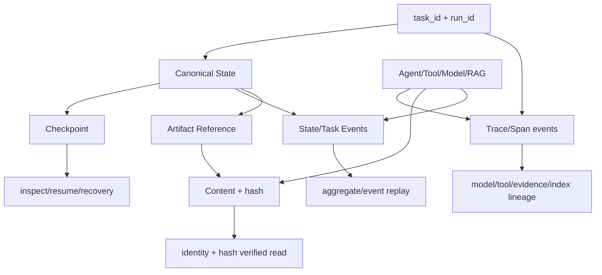

# 09 Artifact、Event、Checkpoint 与 Trace

## 本文范围

分别梳理生产主链与 Standalone V1 的四条持久化/可观测链，说明文件格式、原子性、幂等、序列、hash、恢复、late result、Trace V1/V2 和证据 lineage。

## 当前事实结论

- 两条运行时不共用同一套实现。生产使用 Task JSONL、LangGraph SQLite、side-effect JSONL、Trace V2 和业务 artifact；V1 使用 immutable artifact envelope、Domain Event JSONL、full JSON checkpoint、tool/writer logs。
- 生产 checkpoint 不等于 Domain Event replay；V1 才明确采用 checkpoint + incremental Domain Event recovery。
- 生产 late worker 由 tracked execution/commit scope 阻止超时后提交；V1 主要用 attempt/domain version 拒绝 stale write。
- Trace 只存摘要/hash/preview，不是完整 prompt 零泄漏。

## 入口

生产路径由 `RunWorkspace`（`backend/application/run_workspace.py:17-170`）和 `SupervisorFactory`（`148-166`）确定。V1 路径由 `RuntimeFactory._paths()`（`runtime_factory.py:287-307`）确定。

## 关系图



## 生产 Artifact 链

```text
Stage Service 生成 section/draft/output
→ SchemeWriterOutputSchema / deliverable or rejected artifact
→ GraphState final/output fields
→ WorkflowEngineResult
→ AgentResultSchema
→ Mainline summary
→ run_demo end-to-end report/artifact
```

`stage_service.persist_output()`（`1331-1462`）构造业务输出、更新 SharedStateWriter 的 scheme outputs/artifacts，并做 data capture exactly-once。Artifact lifecycle 区分 deliverable/rejected/technical failure，technical failure 不应伪造业务 artifact。

`RunWorkspace` 的固定路径：

| 内容 | 路径格式 | 写入者 |
|---|---|---|
| task state | `tasks/{task_id}_state.jsonl` | `JsonlTaskManager` |
| trace | `runs/{run_id}_trace.jsonl` | `JsonlRunTraceRecorder` |
| model usage | `runs/{run_id}_model_usage.json` | Mainline service |
| raw capture | `captures/raw_interactions/{run_id}_raw_interactions.jsonl` | capture recorder |
| SFT candidates | `captures/sft_candidates/{run_id}_sft_candidates.jsonl` | capture |
| eval samples | `captures/eval_samples/{run_id}_eval_samples.jsonl` | capture |
| graph checkpoint | run dir `langgraph_checkpoints.sqlite3` | official LangGraph saver |
| side effects | run dir `side_effect_commits.jsonl` | execution control |

Model usage 用随机临时文件完整写入后 `os.replace`（`run_workspace.py:63-83`）；读取校验 task_id/run_id/usage object（`85-110`）。

## 生产 Domain/Task Event

生产没有统一的“所有业务字段变更 DomainEvent”。可持久事件至少分三类：

1. `JsonlTaskManager` 的 `TaskStateEventSchema`：task aggregate source，跨 run 重放。
2. data capture lifecycle events：候选/验证/训练准备状态。
3. side-effect claim events：ACQUIRED/COMMITTED/RELEASED 状态机。

`CrashSafeJsonlEventLog`（`core/persistence/crash_safe_jsonl.py:28-101`）处理 append、完整行读取、尾部 torn line 恢复；中段损坏不能静默跳过。TaskManager 从事件重建 record，而不是把投影 JSON 当唯一真相。

## 生产 Checkpoint

`create_sqlite_checkpoint_resource()`（`official_checkpoint_saver.py:165-205`）返回 saver + closeable resource；先检查旧数据库格式，必要时要求显式迁移。`WorkflowNamespaceCheckpointSaver` 把配置限制到 workflow namespace（`langgraph_state.py:56-189`）。

身份：

```text
thread_id = run_id
checkpoint_ns = workflow_id/workflow_version（Section 再加 sections/{section_id}）
```

同 run 不同 workflow/version/section 不共享 channel。`LangGraphRuntimeStateCodec` 校验 runtime state version、run_id、workflow identity 和 JSON serializability。inspect 从 checkpoint tuple、next tasks/interrupt 恢复；resume 使用同 identity。

## Side-effect exactly-once 与 Late Result

`JsonlSideEffectCommitStore`（`core/runtime/side_effects.py:252-621`）以 stable side_effect_id + input/identity fingerprint：

- acquire 未见过 → ACQUIRED；
- 同 identity 已 commit → ALREADY_COMMITTED；
- live claim → ALREADY_IN_PROGRESS；
- collision → `SideEffectIdentityConflict`；
- stale lease 可重新 acquire；
- execution finish/release/commit 均写日志。

`WorkflowNodeExecutionRunner` 用独立 worker、deadline、cooperative cancellation。timeout 返回时 worker 若仍 live，外层抑制并发 retry；commit scope 已关闭，late result 不能修改 canonical state。Mainline close 会等 active workers 或延迟最终 usage/资源 close。

## 生产 Trace

`ObservabilityFactory` 在 `TRACE_ENABLED` 时创建 `JsonlRunTraceRecorder`。Trace Context 使用 parent/span IDs；ToolExecutor、ModelObserver、WorkflowObserver、RAG wrapper 记录 started/finished/error。

Trace V2 validator（`observability/trace_reader.py:65-...`）检查：

- event schema/version；
- run/span identity；
- start/end 对；
- tool/model lineage；
- error/latency；
- evidence/index/citation metadata。

Trace summary：

- model request：长度、SHA-256、bounded preview、参数摘要；
- tool call/result：bounded values、contract summary；
- RAG：selected/dropped/status/lineage；
- 不应直接存完整 arbitrary object，但 preview 仍是敏感数据。

## Standalone Artifact 链

`FileArtifactStore`（`artifact_store.py:21-190`）：

```text
content
→ content_hash
→ ArtifactReferenceSchema envelope
→ stable artifact_ref
→ filename = sha256(artifact_ref)
→ temp write + fsync + os.replace
→ immutable read with ref/identity/content-hash verification
```

同 ref 同内容幂等；同 ref 不同 envelope/content 拒绝覆盖。State 只存 artifact_ref，context 通过授权 refs 读取。

## Standalone Domain Event

`StateGateway.commit()` 构造 `DomainEventSchema`：

- deterministic event_id/request_id；
- task/run/section/actor/execution/attempt；
- input snapshot；
- target domain、before/after domain version；
- field operations；
- event sequence、reason、timestamp。

`JsonlDomainEventLog` 要求 run 内 sequence 从 1 连续增长（`event_log.py:26-39`），同 event id 幂等，冲突/缺口拒绝。Gateway 先在 candidate 上验证，event append 成功后才返回 candidate；append failure 不发布 state。

## Standalone Checkpoint 与 Crash Recovery

`JsonCheckpointStore.save()`（`checkpoint_store.py:33-74`）写：

- task/run；
- `event_sequence`；
- full state JSON；
- canonical state hash；
- 文件名为 20 位 sequence；
- temp + fsync + replace；
- 同 sequence 不同 state 拒绝。

`load_latest()` 校验 envelope hash、identity、state event_sequence。`EventReplayRecoveryService.recover()`：

```text
latest valid checkpoint
→ list Domain Events
→ skip sequence <= checkpoint
→ require exact next sequence
→ replay through StateGateway
→ verify event identity
→ recovered state
```

Writer 还有独立 paragraph progress log，使 checkpoint 之前/之后已完成的段落可以复用。

## Standalone Trace

`RuntimeTraceSchema`（`backend/apps/enterprise_document/runtime/agent_rag_v1/contracts.py:136-155`）在内存收集 batch、Agent invocations、router actions、attempts、writer revisions、recovery、stale rejection、budget 等，最后嵌入 `StandaloneRunResultSchema`。它没有默认 JSONL trace sink，和生产 Trace V2 不是同一协议。

## 四链对比

| 维度 | 生产 | Standalone V1 |
|---|---|---|
| Artifact | Scheme output/workspace/capture | immutable hash envelope |
| Event | task/capture/side-effect 分离 | 每个 state patch 一个 Domain Event |
| Checkpoint | official LangGraph SQLite channels | full-state JSON by sequence |
| Trace | JSONL Trace V2 spans | RuntimeTrace result summary |
| 原子写 | crash-safe append、SQLite、replace | fsync+replace、JSONL append |
| 恢复 | LangGraph resume + task replay | checkpoint + Domain Event replay |
| 幂等 | side-effect claim/workflow ids | request/event/tool/artifact ids |
| stale/late | commit scope + worker guard | attempt + domain version |

## Schema 流转

生产：

```text
GraphState ↔ LangGraphRuntimeState → SQLite
TaskStateEvent → task JSONL → TaskStateRecord
TraceSink event → trace JSONL
SchemeWriterOutput → GraphState/AgentResult → artifact/report
```

V1：

```text
Artifact content → ArtifactReference
StatePatchRequest → DomainEvent → SharedState
SharedState → checkpoint envelope
paragraph → writer event
all closure refs → StandaloneRunResult
```

## 状态修改

持久化组件不能绕过 canonical write boundary。生产 checkpoint 保存已提交 graph update；side-effect ledger不等于业务 state。V1 event append 是 StateGateway transaction 的 durable boundary，checkpoint 在 Orchestrator commit 返回后保存。

## 失败、重试与恢复

- torn final JSONL line：读取完整前缀；middle corruption：fail closed。
- artifact/checkpoint hash mismatch：integrity error。
- task/run identity mismatch：拒绝恢复。
- side-effect collision：拒绝重复执行。
- active worker timeout：禁止重叠 retry；late result discard。
- V1 event gap：recovery error；不能猜缺失 patch。

## 配置来源

生产路径来自 `DATA_ROOT`/RunWorkspace、Factory 固定文件名、workflow identity。V1 路径来自 project input output_dir/task/run。side-effect lease、timeout、trace enabled 来自构造参数/RuntimeOptions。

## 对应测试

- `test_step_13_trace_v2.py`
- `test_side_effect_state_machine_closure.py`
- `test_phase4_durable_resume_hitl.py`
- `test_model_usage_artifact.py`
- `test_agent_rag_v1_infrastructure.py`
- `test_agent_rag_v1_recovery.py`
- `test_agent_rag_v1_recovery_e2e.py`
- `test_agent_rag_v1_writer_claims.py`

本次 Trace/side-effect/V1 tests 可执行；生产 durable resume 与 usage tests 被 quality import 阻塞。

## 尚未实现或无法确认

- Standalone RuntimeTrace 没有持久 trace file。
- 生产没有单一统一 Domain Event 总线。
- Prompt preview 的业务脱敏策略除 bounded summary 外未见更强全局规则。

## 常见误解

- checkpoint 不是 artifact store。
- trace event 不是业务 event，也不能用来恢复 canonical state。
- JSONL append + sequence 不自动等于 event sourcing；只有明确定义 replay 的 aggregate 才是。

## 推荐下一篇

[10_QUALITY_GATE_AND_EVALUATION.md](10_QUALITY_GATE_AND_EVALUATION.md)。
