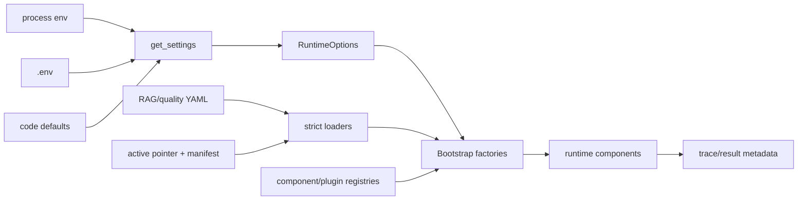

# 11 配置与注册表

## 本文范围

追踪配置定义 → 加载/校验 → Factory → Runtime Component，覆盖 Settings、env、YAML/JSON、模型、RAG、索引、Prompt、预算、timeout、cache、version 和 registry。

## 当前事实结论

- `AppSettings` 读取优先级：进程环境变量 > 仓库根 `.env` > 代码默认。
- `.env.example` 是示例，不是运行事实；`run_demo.py` 还会基于 fake/real 参数覆盖部分进程环境。
- RAG 在线组件由静态 YAML + active manifest 双层决定：YAML 定算法图，manifest 定数据/模型/路径 lineage。
- 生产 Plugin Registry 当前因 `SelfRAGJudge` 导入失败；RAG default registry 又因 `ParentChildChunkResult` 失败。
- Standalone 不消费生产 model/RAG YAML；主要消费自身输入 schema 与 Scenario。

## 入口

```text
backend/core/config.py:get_settings() [292-390]
→ backend/bootstrap/runtime_options.py:RuntimeOptions.from_environment()
→ ModelGatewayFactory / RAGServiceFactory / AgentQualityFactory / SupervisorFactory
```

RAG：

```text
StaticRetrievalSpecLoader + IntentPolicyLoader
→ ParentChildRAGRuntimeFactory.build()
→ ComponentRegistry.build(category, name, version)
```

## 完整配置链



## 配置字段表

| 配置项 | 定义/来源 | 默认/示例 | 环境变量 | 消费位置 | 运行影响 |
|---|---|---|---|---|---|
| app name/env | `AppSettings` | agent-rag-system/dev | `APP_NAME`, `APP_ENV` | application/trace | identity/metadata |
| data root | `AppSettings` | `data` | `DATA_ROOT` | RunWorkspace/RAG | tasks/runs/captures/index |
| prompt root | `AppSettings` | `prompts` | `PROMPT_ROOT` | PromptManager | prompt files |
| default prompt | `AppSettings` | scheme v1 | `DEFAULT_SCHEME_PROMPT_ID` | SchemeWriter | alias/version |
| trace | `AppSettings` | true in example | `TRACE_ENABLED` | ObservabilityFactory | JSONL trace |
| capture | `AppSettings` | true in example | `DATA_CAPTURE_ENABLED` | capture recorder | raw/SFT/eval |
| LLM routing | `AppSettings` | true | `ENABLE_LLM_ROUTING` | model routing | multi-profile |
| default model | `get_settings:310` | code `fake_llm`; example local 1.5B | `DEFAULT_MODEL_NAME` | ModelFactory | fake/real profile |
| supervisor model | AppSettings | defaults to default | `SUPERVISOR_MODEL_NAME` | Supervisor | explicit route |
| local aliases | AppSettings | example Qwen2.5 | `LOCAL_QWEN_*` | ProviderFactory | path/device/tokens |
| DeepSeek | AppSettings | deepseek-chat/API base | `DEEPSEEK_*` | ProviderFactory | remote adapter |
| semantic gate | RuntimeOptions | false example | `ENABLE_SEMANTIC_GATE` | SectionGeneration | advisory judge |
| semantic model | RuntimeOptions | local 1.5B example | `SEMANTIC_GATE_MODEL_NAME` | judge | model choice |
| section parallelism | RuntimeOptions `83-92` | 1 | `SECTION_MAX_CONCURRENCY` | Stage Service | 1..32 |
| RAG spec | RuntimeOptions | static v1 YAML | runtime option/env | RAG factory | component graph |
| intent policy | RuntimeOptions | intent v1 YAML | override | planner | transform mode |
| gate policy | RuntimeOptions | retrieval gate v1 | override | CRAG/context | thresholds |
| active index | Retrieval config | data path | option/env | Resolver | online version |
| grounded generation | YAML | enabled checker/repair | file path/code | AgentQualityFactory | budgets/plugins |
| workflow timeout | `WorkflowStepSchema` | 1000s | workflow definition | engines | node deadline |
| model timeout | `ModelRequestSchema` | 120s | request/profile | provider | call deadline |
| workflow retries | node/step contract | 0+ | definition/YAML | engine | technical retry |
| RAG correction budget | intent/spec | 1 | plan override 0..3 | pipeline | corrective rounds |
| context limits | static spec | 12000 chars/5 items | YAML | Context Gate | pack/truncate |
| V1 budget | ProjectInput | default factory | input | BudgetManager | draining |

代码默认 `fake_llm` 与 `run_demo.py` 默认 real 并不矛盾：前者是裸 `get_settings()`，后者在 CLI 配置阶段设置 model/RAG 环境。

## Model 配置链

```text
AppSettings model fields
→ build_default_model_routing()
→ ModelRoutingConfig(Profile + RolePolicy)
→ ModelRouter
→ ModelProviderFactory
→ ModelGateway
```

Profile 保存 provider kind、provider model、local path、timeout、availability/disabled；RolePolicy 保存有序 candidates。API key 不写 trace summary。7B profile 当前配置为 disabled，不应称为默认可用 fallback。

## RAG 静态规格

`backend/rag/config/static_retrieval_v1.yaml` 当前组件：

| Category | 实现 |
|---|---|
| transformers | identity、multi_query、hyde |
| retrievers | milvus_dense_child、bm25_child |
| source fusion | rrf_child, k=60 |
| query fusion | rrf_parent, k=60, top_k=5 |
| enricher | parent_child, parent granularity |
| reranker | bge_parent_cross_encoder, top_k=5 |
| assessor | crag, confidence 0.55 |
| corrective gate | evidence_sufficiency |
| corrective planner | section_gap, max 2 |
| packers | default、lost_in_middle |
| context gate | window 8192/reserved 1536/section 4096 |

`intent_policy_v1.yaml` 的 short query threshold 为 16；retrieval gate policy 定 evidence/context gate 参数。Loader 进行 schema/name/version/params 校验，registry 再验证 plugin port。

## Grounded Generation 配置

`backend/apps/enterprise_document/config/grounded_generation_v1.yaml` 定：

- generation checker name/version/enabled/params；
- repair strategy；
- max retrieval/rewrite/LLM/token budgets；
- `budget_scope: section`。

`GroundedGenerationPolicy` 要求 checker 和 repair enabled（`grounded_generation.py:40-57`）。`AgentQualityFactory` 用 GenerationPluginRegistry 构建并输出 execution metadata。当前 registry module 因缺失 backend class 无法完成 import。

## Component Registry

`rag/registry/default_registrations.py:40-172` 注册：

- 4 chunkers；
- 3 query transformers；
- 2 retrievers；
- source/query fusion；
- parent-child enricher；
- BGE/noop reranker；
- CRAG/noop assessor；
- corrective gate/planner；
- 2 context packers。

Registry key 是 `category/name/version`；build 前做 plugin contract validation，避免仅凭鸭子类型。资源池持有 embedding/reranker/store 等重资源，RuntimeFactory 组合它们。

Generation Plugin Registry（`backend/apps/enterprise_document/quality/registry.py:35-119`）独立于 RAG registry，只管 checker/repair。Agent Registry（`backend/agent/agent_registry.py`）又是另一套，用于 Supervisor 的 Agent capabilities。三者不能混称“统一注册表”。

## Prompt 配置

PromptManager 从 `PROMPT_ROOT` 和 manifest/alias 加载版本化 prompt；`DEFAULT_SCHEME_PROMPT_ID` 只决定默认 alias。SupervisorFactory 把 prompt id 传给 SchemeWriterAgent/Stage Service。动态 query/context/citation requirements 由运行时渲染，不属于静态 prompt 文件。

## Index 配置与版本

Offline build config 产生 immutable `IndexManifest`；active pointer 只保存 index_version、manifest path/hash。在线 Resolver 将 manifest 的 embedding/index/parent/child/Milvus 配置投影到 `RetrievalRuntimeConfig`。因此线上实际 index 路径由 active pointer/manifest 决定，不应只看 `.env.example`。

## Cache

仓库存在 `backend/cache/` 与 context/model runtime 缓存，但主链关键的“缓存”更多是：

- local HF Runtime load-once；
- RetrievalRuntime 当前 engine；
- component resource pool；
- checkpoint/side-effect 幂等；
- Prompt/config loader 解析结果。

未找到一个可由单一 `CACHE_ENABLED` 控制的全局缓存层；不能虚构统一 cache 配置。

## Schema 流转

```text
env/string/YAML/JSON
→ AppSettings / RuntimeOptions / strict config schema
→ routing/spec/policy/manifest schemas
→ Factory
→ registered runtime components
→ execution metadata/trace lineage
```

任何未通过 schema/version/registry validation 的配置都不应到 runtime。

## 状态修改

配置通常在 run 创建时冻结到 runtime object；active index 是少数可在线切换的外部事实。Reload 以新 engine swap 更新运行时引用，不修改 GraphState。配置 identity/version/hash进入 trace、manifest、result metadata。

## 失败、重试与恢复

- 非法 int/bool/path/name/version：加载阶段 fail fast。
- real RAG 无 trusted scope：Factory 拒绝。
- active pointer/hash/manifest 错：Resolver fail closed。
- provider unavailable：调用时受控 fallback。
- registry 缺 component/version/port：build fail。
- reload config race：放弃新 engine，保留旧 engine。

## 对应测试

- `test_model_gateway_multi_model_runtime.py`
- `test_rag_config_driven_*`
- `test_rag_plugin_architecture_closure.py`
- `test_agent_rag_v1_runtime_contracts.py`
- `stage1/test_contracts.py`
- offline config/index tests

本次 V1 runtime config tests 通过；model/RAG registry tests 中不少受 `ParentChildChunkResult`/`SelfRAGJudge`/retrieval template 阻塞。

## 尚未实现或无法确认

- 未发现统一全局 cache switch。
- 一些配置字段存在但是否在每个路径消费需看具体 Factory；本篇只将已追到 consumer 的字段标为运行影响。
- `.env` 的实际秘密值未写入文档。

## 常见误解

- `.env.example` 不是生产配置。
- YAML 列出 plugin 不代表 plugin 可导入/资源可加载。
- registry 中注册 ≠ 生产选择；还要看 spec/role policy。

## 推荐下一篇

[12_TEST_ARCHITECTURE_AND_ACCEPTANCE.md](12_TEST_ARCHITECTURE_AND_ACCEPTANCE.md)。
