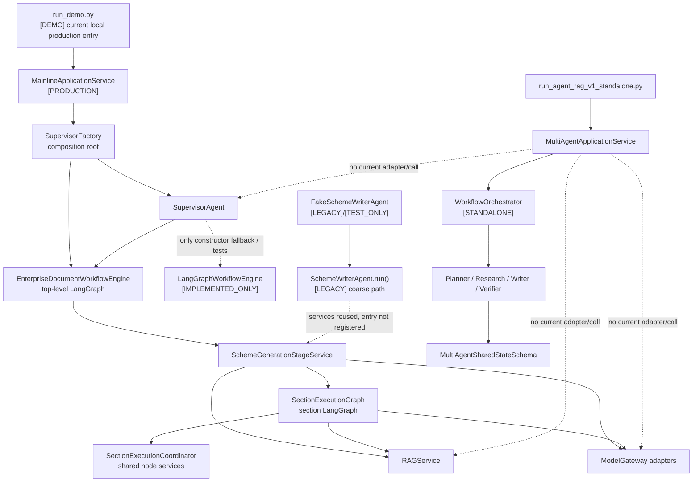

# 13 当前多套架构的真实关系

## 本文范围

本文不按模块分别介绍功能，而是回答仓库中同名、近义和新旧实现如何共存：`SupervisorAgent`、通用 `LangGraphWorkflowEngine`、企业文档顶层图、`SchemeWriterAgent`、Section 子图、RAGService，以及 [STANDALONE] `agent_rag_v1`。重点是当前 Composition Root 的实际装配，不把测试名称或历史名词当成生产事实。

## 当前事实结论

- [PRODUCTION] 当前真实装配链只有一个生产 Supervisor：`backend/agent/supervisor_agent.py:SupervisorAgent`。
- [PRODUCTION] `SupervisorFactory.build()` 在 `backend/bootstrap/supervisor_factory.py:56-175` 显式注入 `EnterpriseDocumentWorkflowEngine`；因此企业文档生产任务不走 Supervisor 默认构造的通用 `LangGraphWorkflowEngine`。
- [INTEGRATED] LangGraph 已真正接管顶层业务节点和单 Section 节点拓扑：两者都调用 `StateGraph(...).compile(checkpointer=...)`，不是仅有 Schema 或测试骨架。
- [LEGACY] `SchemeWriterAgent.run()` 的粗粒度整链入口仍存在，`FakeSchemeWriterAgent` 也保留历史注册名；但当前生产 Factory 将拆分后的 `SchemeGenerationStageService` 与 `SectionExecutionGraph` 注入专用 engine，不把粗粒度 SchemeWriter 注册为生产 workflow 节点。
- [IMPLEMENTED_ONLY] `LangGraphWorkflowEngine` 是可执行的通用 engine，也是 `SupervisorAgent` 未注入 engine 时的回退，但当前 `SupervisorFactory` 的企业文档路径没有选择它。
- [STANDALONE] `agent_rag_v1` 是另一套可运行编排和 canonical shared state；当前没有被 `run_demo.py`、`MainlineApplicationService` 或 `SupervisorFactory` 引用，因此不是第二条已上线生产主链。
- [BROKEN] 仓库没有 `NativeWorkflowEngine`、`WorkflowExecutor` 或 `RealRAGTool` 类/函数定义。前两者只是需求/历史命名；`RealRAGTool` 仅作为少量脚本和事件字段中的字符串出现，真实在线边界是 `RAGService`/`RAGServicePort`。

## 入口

### 生产入口

```text
scripts/run_demo.py:main()
→ scripts/mainline_runtime.py:run_mainline()
→ backend/application/mainline_service.py:MainlineApplicationService.run()
→ backend/bootstrap/supervisor_factory.py:SupervisorFactory.build()
→ backend/agent/supervisor_agent.py:SupervisorAgent.run()
→ backend/apps/enterprise_document/workflows/top_level_business_graph.py:
  EnterpriseDocumentWorkflowEngine.execute()
```

### Standalone 入口

```text
scripts/run_agent_rag_v1_standalone.py:main()
→ backend/apps/enterprise_document/runtime/agent_rag_v1/scenario_runtime.py:run_scenario()
→ application_service.py:MultiAgentApplicationService.run()
→ workflow_orchestrator.py:WorkflowOrchestrator.run()
```

两个入口没有彼此调用。

## 完整调用链与并存关系



实线表示当前调用或构造；虚线均附带当前证据边界，不能读成生产连接。

## 系统关系矩阵

| 系统/名词 | 是否真实入口使用 | 是否仍被调用 | 是否新代码 | 是否重复职责 | 是否可删除 |
|---|---|---|---|---|---|
| `SupervisorAgent` | 是，[PRODUCTION] | 是，由 Mainline 调用 | 否，主链核心 | 与 V1 orchestrator 有编排概念重叠，但契约不同 | 仍有调用不能删除 |
| `EnterpriseDocumentWorkflowEngine` | 是，[PRODUCTION] | 是，由 Supervisor 调用 | 当前专用主实现 | 与通用 engine 都执行图，但节点模型不同 | 仍有调用不能删除 |
| `LangGraphWorkflowEngine` | 企业文档 Factory 否 | 是，默认回退与测试直接调用 | 否 | 与专用 engine 有 runtime 能力重叠 | 仍有调用不能删除 |
| `NativeWorkflowEngine` | 否 | 否；仓库无该符号 | 否 | 无可比较实现 | 当前证据不足 |
| 顶层 LangGraph | 是，[INTEGRATED] | 是 | 当前主实现 | 与旧粗粒度 Agent 覆盖同一业务目标 | 仍有调用不能删除 |
| `SectionExecutionGraph` | 是，[INTEGRATED] | 是，由 Stage Service 构造/调用 | 当前主实现 | 与 coordinator 的旧手写循环共享职责边界 | 仍有调用不能删除 |
| `SectionExecutionCoordinator.execute()` | 不是生产图入口 | 方法仍存在；子图复用其服务/辅助逻辑 | 否 | 与子图在调度层有重叠 | 当前证据不足 |
| `SchemeWriterAgent.run()` | 当前 Factory 否 | 测试/兼容路径仍直接调用 | 否，[LEGACY] | 与 Stage Service + Section 图重复粗粒度职责 | 仍有调用不能删除 |
| `FakeSchemeWriterAgent` | 否 | 兼容/测试注册名 | 否，[LEGACY] | 完全继承 SchemeWriterAgent | 当前证据不足 |
| `RAGService` | 是，[PRODUCTION] | 是，由 Stage/Section 使用 | 当前真实边界 | 与不存在的 `RealRAGTool` 无双实现关系 | 仍有调用不能删除 |
| `RealRAGTool` | 否；仅字符串 | 无可调用定义 | 否 | 名称误导，不是实现 | 当前证据不足 |
| `agent_rag_v1` | 否，[STANDALONE] | 仅独立 CLI/专项测试 | 是 | 编排、状态、持久化能力与生产主链部分重复 | 仍有调用不能删除 |

“是否可删除”严格限定为代码引用证据，不是重构建议。即使生产入口没有调用，只要测试、兼容入口或独立 CLI 仍调用，也不能据此判定可删除。

## 当前到底有几套 Workflow

若按“可执行编排器”计数，至少有三类：

1. [PRODUCTION] `EnterpriseDocumentWorkflowEngine`：面向企业文档的专用顶层 LangGraph。
2. [IMPLEMENTED_ONLY] `LangGraphWorkflowEngine`：读取 `WorkflowDefinitionSchema` 的通用 LangGraph engine；在 Supervisor 构造器中是默认回退，并被测试直接执行。
3. [STANDALONE] `WorkflowOrchestrator`：V1 的显式 Python 调度循环，不使用 LangGraph。

此外，生产顶层图内部还有 [INTEGRATED] `SectionExecutionGraph` 子图；它是嵌套执行层，不应再被算成一条外部生产主链。`SchemeWriterAgent.run()` 是 [LEGACY] 粗粒度 agent 工作流入口，也不等于另一个 WorkflowEngine 类型。

## 当前到底有几套 Shared State

按 canonical 业务状态族计数是两套：

| 状态族 | Source of Truth | 投影/子状态 | 所属运行时 |
|---|---|---|---|
| 现有生产族 | `backend/agent/runtime/graph_state.py:GraphStateSchema`，继承 `SharedStateSchema` | `LangGraphRuntimeState` 是序列化运行投影；`SchemeGenerationGraphState` 和 `SectionExecutionGraphState` 是图级 TypedDict/载荷 | Supervisor + 顶层/Section LangGraph |
| V1 Standalone 族 | `backend/apps/enterprise_document/schemas/agent_rag_v1/state.py:MultiAgentSharedStateSchema` | Invocation、Patch、Event、Checkpoint Schema | WorkflowOrchestrator |

因此不能把每个 `TypedDict` 都称为第三套 canonical Shared State，也不能把两个 canonical family 合并。仓库目前没有生产 Adapter 在二者之间做双向转换。

## 当前到底有几套 Supervisor 概念

只有 `SupervisorAgent` 是可调用的 Supervisor 实体。V1 的 `SupervisorStateAdapter` 位于 `backend/apps/enterprise_document/services/agent_rag_v1/supervisor_state_adapter.py`，它只根据项目输入初始化 `MultiAgentSharedStateSchema`；既不选择 Agent，也不运行 workflow。V1 的实际调度者叫 `WorkflowOrchestrator`。

```text
SupervisorAgent.run()
→ 选择 workflow / 调用 injected WorkflowEngine

SupervisorStateAdapter.initialize()
→ 只创建 V1 shared state

WorkflowOrchestrator.run()
→ 运行 V1 Planner/Research/Writer/Verifier
```

把后两者合成“V1 Supervisor”是概念简写，不是仓库类关系。

## LangGraph、专用图与通用 Engine

`EnterpriseDocumentWorkflowEngine.build_graph()`（`backend/apps/enterprise_document/workflows/top_level_business_graph.py:1309-1458`）直接创建业务节点、普通边和 document-gate conditional edge。`SectionExecutionGraph.build_graph()`（`backend/apps/enterprise_document/workflows/section_execution_graph.py:1019-1069`）直接创建章节节点和条件路由。两者各自接收 Checkpointer 并编译，所以 LangGraph 是实际执行框架。

`LangGraphWorkflowEngine._compile()`（`langgraph_workflow_engine.py:331-374`）则把声明式 `WorkflowDefinitionSchema` 的 steps 转成通用节点。三者都使用 LangGraph，不意味着生产会先经过通用 engine 再经过专用 engine；当前 Factory 是直接把专用 engine 交给 Supervisor。

## SchemeWriter 与 Section 执行

新旧边界不是“旧代码全部不再调用”：

```text
[LEGACY] SchemeWriterAgent.run(SharedStateSchema)
→ 自身持有 SchemeWriter 分解服务
→ 在测试/兼容场景仍可完整执行

[PRODUCTION] EnterpriseDocumentWorkflowEngine
→ SchemeGenerationStageService.plan()/retrieve_document_evidence()/...
→ SchemeGenerationStageService.execute_sections()
→ SectionExecutionGraph.execute() × section
→ SectionExecutionCoordinator 所持 evidence/generation/quality/corrective 服务
```

`SectionExecutionCoordinator.execute()`（`section_execution_coordinator.py:201-...`）保留手写章节调度入口；生产子图主要调用 coordinator 内的服务和辅助能力。共享实现不代表调用栈中同时完整执行两次章节循环。

## RAG 命名边界

```text
backend/contracts/rag.py:RAGServicePort
→ backend/bootstrap/rag_service_factory.py:RAGServiceFactory
→ backend/rag/services/rag_service.py:RAGService.retrieve()
→ retrieval / rerank / CRAG / context gate
```

`RealRAGTool` 只在 `scripts/check_rag_plugin_info.py`、`scripts/run_step_12_acceptance.py` 等作为组件名字符串出现。不存在 `class RealRAGTool` 可供 Factory 实例化。生产文档中应写“真实 RAG 服务边界”，不能写成不存在的类。

## Schema 流转

### 生产族

```text
ProjectInputSchema
→ TaskSchema
→ SharedStateSchema / GraphStateSchema
→ LangGraphRuntimeState(serialized graph_state + node records)
→ SchemeGenerationGraphState
→ SectionExecutionGraphPayloadSchema / SectionExecutionGraphState
→ SchemeWriterOutputSchema
→ WorkflowEngineResultSchema
→ AgentResultSchema
```

### V1

```text
MultiAgentProjectInputSchema
→ MultiAgentSharedStateSchema
→ AgentExecutionContextSchema + role-specific Invocation Schema
→ role-specific ResultPayloadSchema + StatePatchSchema
→ DomainEventSchema + CheckpointEnvelopeSchema
→ StandaloneRunResultSchema
```

没有代码把 `GraphStateSchema` 自动转换为 `MultiAgentSharedStateSchema`，也没有把生产 `EvidenceBundle` 直接当作 V1 retrieval payload。

## 状态修改

- 生产业务节点在 candidate state 上执行，`GraphStateDiffer` 生成 delta，写契约校验后由 `GraphStateApplier` 提交 revision；LangGraph runtime 保存序列化投影。
- Section 子图通过 payload/state update 推进，并用自身 checkpoint namespace 隔离章节。
- 通用 engine 也使用 LangGraph runtime state，但其节点由 registry 中 Agent 执行。
- V1 的所有初始化后 mutation 应经过 `StateGateway`，以 event sequence、版本、权限和 checkpoint 形成独立事务边界。
- 两个状态族的 revision、event sequence、checkpoint identity 语义不同，不能跨族直接比较。

## 失败、重试、恢复

| 系统 | 失败/重试 | 恢复 |
|---|---|---|
| 企业文档顶层图 | `_run_stage()` 处理 timeout、cancel、retryable 与写契约失败；失败 candidate 不提交 | workflow/thread namespace 的 LangGraph Checkpointer，支持 inspect/resume/HITL |
| Section 子图 | evidence/generation gate 通过 conditional edge 进入 corrective、rewrite、partial 或 fail | section checkpoint namespace；父图汇总结果 |
| 通用 engine | `_execute_step()` 按 step contract 重试并处理 late worker/side effect ledger | 通用 LangGraph checkpointer |
| Legacy SchemeWriter | Agent 内部兼容重试/修复逻辑 | 不等于顶层图的 durable resume |
| V1 Standalone | router、budget、attempt/replan 和 stale-write 防护 | JSONL event replay + full checkpoint + invocation recovery |

这些恢复机制没有共享一个文件格式或事务日志。

## 配置来源

- 生产选择哪套 engine 由 `backend/bootstrap/supervisor_factory.py:SupervisorFactory.build()` 的代码装配决定，不是一个可热切换的 `workflow_engine=native/langgraph/v1` 配置字段。
- `SupervisorAgent.__init__()` 的默认 `LangGraphWorkflowEngine` 只在调用者没有注入 `workflow_engine` 时发生。
- `RuntimeFactory` 为 V1 读取 Standalone runtime options/output path，并默认注册 Scenario/Fake adapters。
- RAG/Model/Checkpointer 的生产配置分别经 `RAGServiceFactory`、模型 gateway/factory、`SupervisorFactory` 注入；详见 11 篇。

## 对应测试

- `backend/tests/test_phase2_top_level_business_graph.py` 检查 Factory 使用 `EnterpriseDocumentWorkflowEngine`，且不把粗粒度 `SchemeWriterAgent` 注册为主链节点。
- `backend/tests/test_phase3_section_execution_subgraph.py` 检查 Section 子图接管。
- `backend/tests/test_phase5_langchain_takeover_and_legacy_retirement.py` 检查 LangGraph 接管与 Legacy 边界。
- `backend/tests/test_phase1_langgraph_serializable_state.py` 验证通用 engine 的序列化 state/checkpointer。
- `backend/tests/test_agent_rag_v1_standalone_e2e.py` 验证 V1 只走独立入口。
- 当前前三个 takeover/主链测试文件在全量收集时受 `SelfRAGJudge` 导入错误阻塞；不能用测试文件存在替代本次绿色结果。

## 尚未实现

- [IMPLEMENTED_ONLY] 没有 V1 到生产 `SupervisorAgent` 的 Agent/Workflow adapter。
- [IMPLEMENTED_ONLY] 没有 V1 `ToolGateway` 到生产 `RAGServicePort` 的正式 adapter。
- [IMPLEMENTED_ONLY] 没有 V1 reasoner 到生产 `ModelGateway` 的正式 adapter。
- 没有生产与 V1 两套 canonical state、Event、Checkpoint 的迁移/互操作协议。
- 没有名为 `NativeWorkflowEngine`、`WorkflowExecutor` 或 `RealRAGTool` 的当前实现可供接线。

未来最自然的连接点是 V1 的 ports/factory injection 与现有 `RAGServicePort`、模型端口、Supervisor workflow port，但这只是代码边界所显示的可能位置，**尚未实现**。

## 常见误解

1. “Supervisor 默认值是 `LangGraphWorkflowEngine`”不等于生产 Factory 使用默认值；Factory 已显式覆盖。
2. “有两个 LangGraph 类”不等于生产串行跑两个顶层 engine。
3. “SchemeWriterAgent 仍存在”不等于生产顶层图仍调用其粗粒度 `run()`。
4. “SectionExecutionCoordinator 仍存在”不等于手写循环与 Section 子图重复执行；子图复用了其子服务。
5. “SupervisorStateAdapter”不是第二个 Supervisor。
6. “V1 测试全绿”不等于 V1 已进入生产主链。
7. 脚本里的 `"RealRAGTool"` 字符串不是可导入实现。

## 推荐下一篇

阅读 [14_READING_ROADMAP.md](14_READING_ROADMAP.md)，按依赖顺序进入具体文件；需要立即定位入口、类和方法时可直接跳到 `15_QUICK_REFERENCE.md`。
