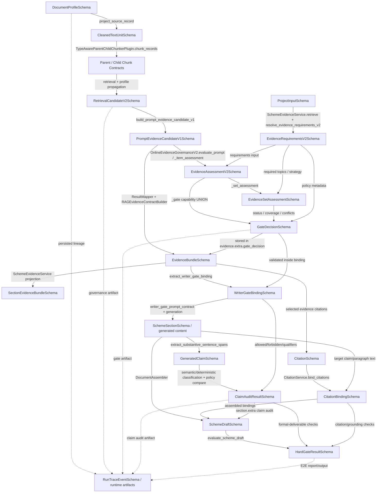

# 03 — Schema 转换关系图

> 本文描述当前 Scheme Generation E2E 生产链路中真实存在的 **Schema → Schema** transformation，不包含任何未来设计方案。

## 1. 核心 Schema 转换图



## 2. 各 Transformation 详细说明

### T01 — `DocumentProfileSchema → CleanedTextUnitSchema`

**函数：** `rag.catalog.document_profile_projection.project_source_record()`  
**输入：** source record + `DocumentProfileSchema`。  
**输出：** 标准 `CleanedTextUnitSchema`，并把权威 catalog metadata 嵌入 `extra.document_profile`。

**COPY**
- `document_id → doc_id` 的 identity 会被校验，不会静默改写。
- `tenant_id`、`kb_id`、source name/URI/title 从 profile 投影，并覆盖 dataset 中可能过期的默认值。
- `document_type`、`evidence_role`、`project_relation`、`project_id`、`authority`、`content_capabilities`、parsing 与 classification metadata 全部复制进 `extra.document_profile`。

**DERIVE**
- `profile_sha256 = canonical_profile_hash(profile)`。
- `catalog_sha256` 由 catalog build 提供。
- 生成用于 filtering 的 scalar mirror：`extra.document_type`、`extra.evidence_role`、`extra.project_relation`、`extra.project_id`、`extra.authority_level`。

**FILTER / DROP**
- reviewed profile 若 `should_index=False`，直接返回 `None`，不会进入 chunking。
- Gold profile 若 `should_index=True`，会被拒绝。

**DEFAULT / NORMALIZE**
- legacy cleaned-unit producer extension 会由 `migrate_legacy_cleaned_text_unit_payload()` 显式迁移到 `extra`。

**Invariant：** source `doc_id` 与 source SHA 必须与 profile identity/hash 一致；profile 对 stale producer metadata 具有更高权威性。  
**信息丢失风险：** 这一步不会丢失 `content_capabilities`，完整 allow/forbid list 会被复制。部分 top-level catalog fields 被物化成精简 embedded profile dictionary，而不是保留完整 Pydantic object，但当前 Gate 依赖的字段均被保留。

---

### T02 — `CleanedTextUnitSchema → Parent/Child Chunk contracts`

**函数：** `TypeAwareParentChildChunkerPlugin.chunk_records()` 以及委托 chunker（`HeadingParagraphChunker`、`PolicyArticleClauseChunker`、`ProjectFactRecordChunker`、`TableRowRecordChunker`、`TemplateSectionChunker`、fallback recursive chunker）；builder 为 `build_parent_chunk_v1()` / `build_child_chunk_v1()`。  
**Routing source：** `extra.document_profile.parsing.chunk_strategy`。

**COPY**
- 复制 document identity（`doc_id`、`tenant_id`、`kb_id`、`file_id`）及结构 provenance。
- `_unit_extra()` 将同一份 `extra.document_profile` 一致地带入每一个 generated chunk。

**DERIVE**
- 生成 parent/child IDs、chunk indexes、text hashes、char spans、child membership。
- `extra.type_aware_chunking` 记录 selected profile strategy、delegate、parameters；structured delegate 还会补充 representation-specific metadata。

**UNION / AGGREGATE**
- 一个 parent/child 可能覆盖多个 cleaned unit；`_unit_extra()` 会聚合 quality flags、source-unit types/count 与 average quality score。

**REJECT**
- 一个 chunk 不能混合冲突的 DocumentProfiles。
- 同一个 Document 不能声明多个 chunk strategies。
- strict Stage C 要求 child 上同时存在 profile metadata 与 `type_aware_chunking`。

**信息丢失风险：** source-unit boundary 被压缩成 chunk text/span + `source_unit_ids`；但权威 `document_profile` 保持不变。Chunk-local meaning 可能只存在于 `type_aware_chunking` / structured fields 中，这一点对后续转换非常关键。

---

### T03 — `Parent/Child Chunk contracts → RetrievalCandidateV2Schema`

**函数：** hybrid parent-child retriever 的 metadata propagation + `build_retrieval_candidate_v2(result)`。  
Retriever 从 child/result/extra 复制 `document_profile` 和 `type_aware_chunking`，随后 builder 构造冻结的 Stage-D candidate。

**COPY / NORMALIZE**
- child/parent/document/tenant/KB/file identity。
- `document_type`、`evidence_role`、`project_relation`、`project_id`、`authority_level`：优先使用显式 hit field，否则回退到 embedded profile。
- `allowed_claim_types`、`forbidden_claim_types`：优先使用显式 hit field，否则来自 `document_profile.content_capabilities`。
- profile/source hashes。
- match text（child）与 context text（parent）。

**DERIVE**
- `StructuredEvidenceSchema = build_structured_evidence(result)`，输入来自 child `extra`、`type_aware_chunking` 与 representation-specific fields。
- normalization rank/scores/source list。

**FILTER**
- candidate metadata 只保留被选择的 structural/retrieval fields，不保留完整 raw hit。

**关键 Invariant：** candidate 的 semantic scalar fields 与两个 claim-capability set 必须与 embedded DocumentProfile **完全一致**。在这个边界，candidate 不能自行缩小或扩展 Document-level capability set。

**语义压缩点：** `DocumentProfile.content_capabilities` 是 Document-level，却会直接复制成每个 retrieved child 的 `allowed_claim_types/forbidden_claim_types`。Chunk-local semantic difference 被放在独立的 `structured_evidence` 中，而不是 capability fields 中。

---

### T04 — `RetrievalCandidateV2Schema → PromptEvidenceCandidateV1Schema`

**函数：** Context Packer 完成 selection/truncation 后，`rag.mapping.result_mapper` 调用 `build_prompt_evidence_candidate_v1()`。  
**目的：** Governance 必须只审计 Writer 实际看见的 evidence。

**COPY**
- candidate/document/chunk identities、hashes、完整 `document_profile`、完整 `structured_evidence`、embedded RetrievalCandidate。

**FILTER**
- 完整 `context_text/parent_text` 被替换为 Context Packer 选中的精确 `prompt_visible_text`。
- citation IDs 仅保留 prompt-visible evidence 对应的 citation。

**DERIVE**
- visible char count 与 deterministic token count。
- `fact_visible_in_prompt`：检查 structured fact 的 `source_span.text`，或 value/predicate，是否真的出现在 exact visible text 中。
- truncation flags/source/reason。

**REJECT / DEFAULT**
- strict path 缺少显式 `prompt_visible_text` 时直接拒绝。
- legacy compatibility 可以使用 `context_text/text`，但明确不会回退到完整 `parent_text`。

**信息丢失：** 由于 context packing/truncation，文本会被有意收窄。Semantic identity/capability 不随文本一起收窄，但 structured fact visibility 会单独重新计算。

---

### T05 — `ProjectInputSchema → EvidenceRequirementsV2Schema`

**函数：** `SchemeEvidenceService.retrieve()` + `resolve_evidence_requirements_v2()`。  
**当前 SchemeWriter 正常路径实际传入的字段：** section ID/title/type 与 resolved query。正常 section retrieval 当前不会从 ProjectInput 显式填充 `requested_claim_types`。

**COPY / DERIVE**
- `section_id`、`section_type`、由 section title/query 派生的 `required_topics`。
- 如果 runtime 没有显式 requirements，coverage strategy 默认 `TOPIC_UNION`。

**DEFAULT**
- resolver 中 policy id 默认 `candidate_capability_union_v1`。
- 这里构造的 `claim_risk_level` 为 LOW；最终 Gate risk 会在后续根据 supported claim union 重新计算。
- `allow_framework_only` 默认 true。

**当前 Policy Marker：** metadata 明确写入：
- `resolution = candidate_capability_union`
- `claim_resolution_mode = candidate_capability_union`
- `requested_claim_types_ignored = True`

**信息丢失 / omission：** Schema 能表达 `requested_claim_types`，但正常 service call 只提供 section topic identity；即便显式 requested claims 存在，后续 Gate 逻辑也会有意忽略它们，不用于 allowed-claim resolution。

---

### T06 — `PromptEvidenceCandidateV1Schema + EvidenceRequirementsV2Schema → EvidenceAssessmentV2Schema`

**函数：** `OnlineEvidenceGovernanceV2.evaluate_prompt()` → `_item_assessment()`。

**START SET**
```text
supported_claims = set(candidate.allowed_claim_types) - set(candidate.forbidden_claim_types)
```

**FILTER**
1. candidate relation 不是 `CURRENT_PROJECT` 时，移除全部 current-project claim types。
2. `_claim_structure_compatible()` 移除与 chunk-local structured representation 不兼容的 claim types。
3. 对 structured current-project fact，`resolve_fact_claim_eligibility()` 根据 `FactStatus`、authority、source form、project relation 进一步过滤。
4. CRAG final judgement 为 `irrelevant` 时清空 topic support，并把 evidence 变为 ineligible。
5. relevance threshold 决定 relevant/partial/irrelevant。

**重要结构规则：** `technical_specification` 只有在 `candidate.evidence_role == TECHNICAL_REFERENCE` 时才 structurally compatible。因此一个 `HISTORICAL_CASE` candidate 即使文本里明确存在 Ceph、replication、erasure coding 等技术内容，也无法在该 transformation 中暴露 `technical_specification`。

**DERIVE**
- semantic relevance、supported topics、eligibility、reason codes。
- 过滤后的 `supported_claim_types`。
- `forbidden_claim_types = candidate.forbidden_claim_types UNION removed_claims`。
- metadata 中的 status-required qualifiers / human-review flags。

**不会与 `requirements.requested_claim_types` 做 INTERSECTION。** Required topics 会影响 relevance/coverage，但 requested claim types 不会约束 `supported_claim_types`。

---

### T07 — `EvidenceAssessmentV2Schema[] + EvidenceRequirementsV2Schema → EvidenceSetAssessmentSchema`

**函数：** `_set_assessment()`。

**FILTER**
- 只有 `assessment.eligibility=True` 的 item 才能覆盖 topic。

**UNION / COVERAGE**
- 只要任意 eligible item 声明支持某个 required topic，该 topic 就视为 covered。
- coverage ratio = covered / required。

**DERIVE**
- 根据 structured conflict 与 coverage 计算 `CONFLICTED`、`ABSENT`、`SUFFICIENT` 或 `PARTIAL`。
- 计算 direct/partial evidence counts、distinct document count、evidence IDs。

**STRUCTURED CONFLICT DERIVATION**
- `_conflicts()` 按 `(claim_type, normalized predicate)` 对 eligible structured facts 分组，只有至少两个不同 Document 给出不同 normalized value 才判 conflict。

**Metadata：** 再次记录 `claim_resolution_mode=candidate_capability_union` 与 `requested_claim_types_ignored=True`。

**信息丢失：** item-level source semantics 被压缩成 section-level coverage/status/counts/conflicts；每个 item 的 supported claim set 仍保留在并行的 item assessments 中，供 `_gate()` 使用。

---

### T08 — `EvidenceAssessmentV2Schema[] + EvidenceSetAssessmentSchema + EvidenceRequirementsV2Schema → GateDecisionSchema`

**函数：** `_gate()`。

**UNION（关键）**
```text
supported = UNION(assessment.supported_claim_types for eligible assessments)
allowed   = supported
forbidden = UNION(all assessment.forbidden_claim_types) - allowed
```

这里**不会**与 section 的 requested claim types 做 intersection。

**DERIVE**
- 从 `supported` union 重新计算 risk。
- 计算 authoritative-evidence-present flag。
- 计算 historical/reference-present flag。
- 从 fact policies 与 evidence status 派生 qualifiers 和 human-review state。
- 根据 prompt contract validity、conflict/coverage state、authority/reference status、resolved risk 计算 delivery mode。

**FILTER / CLEAR**
- prompt evidence contract missing → `BLOCKED`，清空 allowed set。
- conflicted → `HUMAN_REVIEW`，清空 allowed。
- partial high-risk → `HUMAN_REVIEW`，清空 allowed。
- absent / 其他 no-evidence → `BLOCKED`，清空 allowed。

**DEFAULT / QUALIFY**
- historical/reference evidence 在 coverage sufficient 时变成 `QUALIFIED`，并附 reference qualifiers。
- current-project evidence 若非 authoritative，在其他条件允许时可进入 qualified，并附 confirmation qualifiers。

**Metadata：** 明确持久化 `claim_resolution_mode=candidate_capability_union`、`requested_claim_types_ignored=True`。

**信息丢失风险：** 最终 GateDecision 只保存 union 后的 allow/forbid set，不保存“具体哪个 evidence item 授权了哪个 claim type”。Item-level lineage 仍存在于 governance artifact 中，但 claim permission 被压平为 section-wide set。

---

### T09 — `PromptEvidenceCandidateV1Schema + GateDecisionSchema → EvidenceBundleSchema`

**函数：** `rag.mapping.result_mapper` + `RAGEvidenceContractBuilder.build()`。

**COPY / PROJECT**
- Context Packer 的 selected/dropped records 转为 canonical evidence items 与受限 `RAGContextSchema`。
- selected evidence 生成 `CitationSchema` objects。
- final governance payload 写入 `EvidenceBundle.extra.evidence_governance_v2`。
- final gate 复制到 `EvidenceBundle.extra.gate_decision`。
- generation permission 复制到 `EvidenceBundle.extra.generation_allowed`。
- prompt-evidence contract/source 保留在 `extra` 中。

**DERIVE**
- context hash、selected/dropped counts、compatibility assessment、trace metadata。

**Invariant：** selected/dropped/citation/context counts 与 budget 必须完全对账。

**Potential overload：** Stage-D governance/gate 被放在 `EvidenceBundle.extra` 中，而不是 EvidenceBundle 一等字段；不过生产 Writer 明确读取这个 canonical extra path。

---

### T10 — `EvidenceBundleSchema → SectionEvidenceBundleSchema`

**函数：** `SchemeEvidenceService.extract_rag_output()` + section coordinator/service assembly。

**COPY / PROJECT**
- canonical `EvidenceBundle.context` → `rag_context`。
- 生成 compatibility retrieved-chunk projection 与 citations。
- canonical evidence contract 本体嵌入 context `extra.evidence_contract` 并做 hash。
- section bundle 保存 `evidence_contract_sha256`、projected writer binding/generation permission 与 metadata。

**信息丢失：** SectionEvidenceBundle 是 Writer-facing projection；完整 canonical EvidenceBundle 仍通过 embedded/hash 可用，而不是把每个 Stage-D field 都提升为 section-bundle 一等字段。

---

### T11 — `EvidenceBundleSchema / GateDecisionSchema → WriterGateBindingSchema`

**函数：** `extract_writer_gate_binding()`。

**SOURCE SELECTION**
- normalized output 若存在 canonical `evidence`，读取 `evidence.extra.gate_decision` 与 `generation_allowed`。
- 否则 compatibility path 从 normalized output `extra` 读取。

**COPY**
- final GateDecision 会重新按 `GateDecisionSchema` 校验。
- 复制 section/document/run identity。
- 复制 prompt evidence source。

**DERIVE**
- 若未提供，计算 EvidenceBundle 的 canonical SHA-256。
- 计算 prompt-evidence contract 的 canonical SHA-256。

**Invariant：** `WriterGateBindingSchema` 会校验 `generation_allowed` 是否与 Gate delivery mode 一致。

**信息丢失：** final gate fields 本身不丢失；governance item-level assessments 不会嵌入 WriterGateBinding。Writer enforcement 接收到的是最终 flattened Gate boundary + evidence hashes。

---

### T12 — `WriterGateBindingSchema → SchemeSection generation constraints`

**函数：** `writer_gate_prompt_contract()` 与 section generation service/model call；`inject_required_qualifiers()` 可以为 qualified delivery 补上缺失的 Gate qualifiers。

**COPY / RENDER**
- delivery mode、generation_allowed、allowed/forbidden claim types、required qualifiers、human-review flag 被渲染成不可被 Writer 覆盖的显式 prompt Contract。

**DERIVE**
- 根据缺失的 current-project claim permission，进一步派生自然语言形式的 executable boundary。

**DEFAULT / INJECTION**
- 如果 `QUALIFIED` content 缺少 required qualifiers，`inject_required_qualifiers()` 会进行前缀注入。

**重要边界：** Writer 虽然通过 prompt 获得 permission policy，但最终 deterministic audit 不信任 prompt，而会独立重新分类 final text。

---

### T13 — `SchemeSection.content → substantive sentence rows`

**函数：** `extract_substantive_sentence_spans()`，使用 `SubstantiveSentenceDetector`。

**FILTER**
- 在 semantic claim text 比较前移除 citation。
- 排除 blank text、`证据限定：` 行、精确 governance qualifiers、pure headings、被 `_STRUCTURAL_LABEL_PATTERN` 命中的 structural labels、pure list markers、pure placeholders（`待补充/待确认/TODO/TBD/...`）、diagnostic refusal text，以及不包含 substantive signal 的 title-suffix labels。

**DEFAULT CONSERVATISM**
- 其他情况下，只要命中已知 substantive pattern 即视为 substantive。
- fallback：长度 >= 8 的中文字符串，即使没有命中已知 signal，也视为 substantive。

**输出：** `{id, sentence_index, span_start, span_end, text}`。  
**信息丢失：** structural/placeholder line 会被有意排除出 Claim 链。如果某个 structural label 没有匹配 regex，它就会进入 substantive chain，之后必须被 classifier 分类。

---

### T14 — `substantive sentence rows → GeneratedClaimSchema`

**生产函数：** `WriterClaimAuditor._extract_claims_and_violations()`，注入 `SemanticClaimClassifier.classify_sentences()`；deterministic classifier 仍作为 compatibility/test seam 存在。

**RECLASSIFY**
- semantic model 在不参考 Gate permission 的前提下，对每条 substantive sentence 独立映射到零/一个/多个共享 `ClaimType`。
- 生产角色为 `ModelRole.SEMANTIC_GATE`；在当前 all-DeepSeek experiment 中，该 role 在进程内路由到 DeepSeek。

**DERIVE**
- 根据 section/sentence/ClaimType/text 生成 deterministic claim ID hash。
- 记录 classifier metadata/confidence/model call ID 与 exact span。

**FAIL CLOSED**
- classification 缺失/不可解析、ClaimType 为空、confidence 过低，都会产生 audit violation，而不是静默忽略 substantive sentence。

**关键语义边界：** `GeneratedClaimSchema` 有 `claim_type` 与 text/span，但没有与 evidence-side `FactStatus` 等价的一等字段，也没有表达“unknown / deferred / pending confirmation”的 epistemic/modality state。此类语义只能通过 sentence text 与 model interpretation 间接影响 classification。

---

### T15 — `GeneratedClaimSchema[] + WriterGateBindingSchema → ClaimAuditResultSchema`

**函数：** `WriterClaimAuditor.audit()`。

**SET COMPARISON**
- generated claim type ∈ gate forbidden → `forbidden_claim_type_generated`。
- 否则如果 type ∉ gate allowed → `claim_type_not_allowed`。

**FILTER / CHECK**
- required qualifiers 必须出现在 final content 中。
- 所有 substantive row 都必须得到有效 classification。
- classifier policy hash/version 必须属于受支持版本。

**DERIVE**
- `ClaimAuditIntegritySchema` 对 exact content、normalized content、writer binding、evidence contracts 做 hash。
- `passed = no violations AND all checks true`。
- `human_review_required = violations present OR gate requires review`。

**不会重新解释 Evidence：** ClaimAudit 不会重新打开 candidate evidence，而是把独立分类后的 output 与已经 resolved 的 GateDecision 做比较。

---

### T16 — `EvidenceBundle selected evidence → CitationSchema`

**函数：** result/evidence mapper + `RAGEvidenceContractBuilder`；citation source helpers。  
**COPY：** 复制 selected evidence 的 document/chunk/page/title/section identity 与 source quote。  
**FILTER：** 根据 EvidenceBundle invariant，dropped evidence 不得暴露 prompt citations。  
**DERIVE：** citation IDs 与 normalized source records。  
**信息丢失风险：** Citation 只是 provenance projection，不是 evidence-capability object；claim permission 不存在于这里。

---

### T17 — `CitationSchema + SchemeSection claim/paragraph text → CitationBindingSchema`

**函数：** `CitationService.bind_citations()` + reconciliation/integrity services。  
**COPY：** citation id/source identity 与 source quote。  
**DERIVE：** binding ID、target document/section/paragraph/claim identity、marker offsets/ordinal、snapshots。  
**目的：** 建立下游 integrity check 所需的 claim→source grounding edge。  
**信息丢失：** 一个 binding 只表示一个具体 support relation，不携带完整 GateDecision/evidence governance。

---

### T18 — `SchemeSectionSchema[] + CitationBindingSchema[] → SchemeDraftSchema`

**函数：** `DocumentAssembler`。  
**COPY：** final section content/status/eval/citations/bindings 与 required-section identity。  
**DERIVE：** `full_text`、missing section list、document-level citation-binding collection、truncation aggregate。  
**FILTER：** 只组装 final section artifacts；中间 model draft/retry 不是 document truth。  
**关键保留：** section `extra` 中携带 Claim Audit / Writer Governance state，供 final Gate verification 使用。

---

### T19 — `SchemeDraftSchema + section claim/citation integrity → HardGateResultSchema`

**函数：** `services.document_gate.evaluate_scheme_draft()`。

**CHECK / DERIVE**
- required sections/completeness。
- section execution success 与 truncation。
- citation presence/coverage（对于 required section）。
- Writer Claim Audit 是否存在、有效、通过，以及 integrity recomputation。
- formal-deliverable eligibility 与其他 document-level deterministic checks。

**输出：** `HardGateResultSchema(passed, failures, warnings, checks, metadata)`。

**信息丢失：** 详细 upstream audit object 被压缩成 final check booleans/failure codes；完整 artifact 仍保存在 section/draft/runtime 文件中，可用于 forensic tracing。

---

### T20 — Core contracts → Trace / runtime persistence

**Producer：** run-trace recorder、SchemeCaptureService、RAG trace/capture、rejected/eval/model-usage writers、E2E report writer。  
**目的：** 持久化观察上述 transformation 的结果，而不是成为新的独立 semantic authority。

因此 Phase-1 badcase audit 必须利用 runtime artifact 重建路径，但任何 trace field 都不能反过来覆盖最初产生它的 production Contract。

## 3. 需要动态验证的关键语义压缩 / 投影点

以下都是审计目标，**当前不能直接宣布为 Root Gap**：

1. **Document capability → candidate capability：** 从 `DocumentProfile.content_capabilities` 精确 COPY 到每个 RetrievalCandidate；chunk-local meaning 单独存在。
2. **Candidate capability → item support：** 根据 project relation、structure、FactStatus、relevance 做 FILTER。
3. **Item support → final gate：** 对 eligible candidates 做 UNION；requested claim types 被显式 ignored。
4. **Gate → Writer：** 只保留 flattened section-wide allow/forbid set + qualifiers；item-specific permission provenance 不进入 binding。
5. **Generated text → claim：** post-generation RECLASSIFY 到共享 ClaimType，但没有 evidence-side FactStatus-equivalent field。
6. **Text → substantive rows：** structural/placeholder exclusion 依赖 regex/deterministic rule；未被排除的文本会被保守地视为 substantive。
7. **Claim → Hard Gate：** 即使 model generation 与 GenerationChecker 已成功，只要 ClaimAudit fail，仍会传播为 formal deliverability failure。

## Step 4 结论

当前主链路本质上是一系列：**COPY → structured DERIVE/FILTER → section-wide UNION → generated-text RECLASSIFY → deterministic SET comparison**。

因此，一个最终的 `claim_type_not_allowed` 本身不能直接告诉我们根因在哪里。第一次语义偏差可能出现在 Document classification、chunk-local structure projection、capability filtering/union、substantive detection、semantic ClaimType classification，也可能根本不是错误，而是一次正确的 Gate rejection。Step 6 必须逐条找到每个 violation 的最早偏差点。
