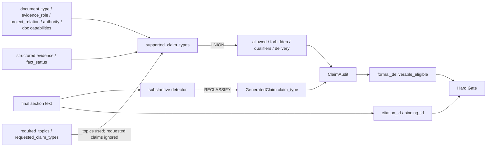

# 04 — 关键字段数据血缘

> 范围：当前 Scheme Generation E2E 中所有与 Gate 相关的核心业务字段。Transformation 标签统一使用：**COPY、DERIVE、FILTER、UNION、INTERSECTION、NORMALIZE、DEFAULT、DROP、RECLASSIFY**。

## 1. `document_id / doc_id`

```text
DocumentProfileSchema.document_id
  ↓ COPY + identity validation — project_source_record()
CleanedTextUnitSchema.doc_id
  ↓ COPY — TypeAwareParentChildChunkerPlugin + chunk builders
Parent/Child Chunk.doc_id
  ↓ COPY — retriever
retrieval result doc_id
  ↓ NORMALIZE + equality validation — build_retrieval_candidate_v2()
RetrievalCandidateV2Schema.document_id
  ↓ COPY — build_prompt_evidence_candidate_v1()
PromptEvidenceCandidateV1Schema.document_id
  ↓ COPY — EvidenceAssessmentV2
EvidenceAssessmentV2Schema.document_id
  ↓ 用于 DERIVE distinct_document_count / conflict grouping
EvidenceSetAssessmentSchema
  ↓ lineage 保留到 EvidenceBundle / CitationSchema
CitationSchema.doc_id/source_document_id
  ↓ COPY — CitationService.bind_citations()
CitationBindingSchema.source_document_id
```

**决策用途：** source identity、distinct-document/conflict logic、citation provenance、cross-document integrity。  
**DROP：** 最终 GateDecision 不保存 per-document IDs；item-level governance artifact 仍是 provenance 的权威来源。

---

## 2. `document_type`

```text
reviewed catalog classification
  ↓
DocumentProfileSchema.document_type
  ↓ COPY — project_source_record() → extra.document_profile.document_type
Chunk extra.document_profile.document_type
  ↓ COPY / validated mirror
RetrievalCandidateV2Schema.document_type
  ↓ COPY
EvidenceAssessmentV2Schema.document_type
  ↓ 作为 policy input，与 authority/project relation/FactStatus 一起使用
resolve_fact_claim_eligibility()
  ↓ FILTER supported_claim_types
EvidenceAssessmentV2.supported_claim_types / forbidden_claim_types
  ↓ UNION in _gate()
GateDecision.allowed_claim_types / forbidden_claim_types
```

**Invariant：** `DocumentType` 会约束 required `EvidenceRole`。  
**决策作用：** 影响 structured current-project fact 是否可被视为 authoritative / eligible。  
**DROP：** GateDecision 不再暴露 document_type；它的语义作用已经投影到 claim permission 与 reason codes。

---

## 3. `evidence_role`

```text
DocumentProfileSchema.evidence_role
  ↓ COPY
Chunk extra.document_profile.evidence_role
  ↓ COPY + equality validation
RetrievalCandidateV2Schema.evidence_role
  ↓ FILTER — _claim_structure_compatible()
EvidenceAssessmentV2.supported_claim_types
  ↓ UNION
GateDecision.allowed_claim_types
```

当前关键过滤规则：
- `HISTORICAL_CASE` 不能支持 current-project claims。
- `TEMPLATE_STYLE` 只能支持 template/style。
- `_claim_structure_compatible()` 要求 `TECHNICAL_SPECIFICATION` 必须来自 `TECHNICAL_REFERENCE`。

**与 Badcase 的关系：** 某个 historical content 即使包含大量技术细节，也会一路保留 `HISTORICAL_CASE` identity；真正丢失 `technical_specification` support 的位置，是 **role→claim-compatibility FILTER**，而不是 retrieval text copy。

---

## 4. `project_relation`

```text
DocumentProfileSchema.project_relation.relation
  ↓ COPY/flatten — project_source_record()
extra.document_profile.project_relation
  ↓ COPY
RetrievalCandidateV2Schema.project_relation
  ↓ FILTER — _item_assessment()
if != CURRENT_PROJECT:
    remove CURRENT_PROJECT_CLAIM_TYPES
  ↓
EvidenceAssessmentV2.supported_claim_types / forbidden_claim_types
  ↓ UNION
GateDecision claim boundary
```

**正确 Invariant：** historical/other-project evidence 不能证明 current-project facts。  
**决策作用：** 这是直接 eligibility boundary。  
**无信息丢失：** relation 一直保留到 item assessment；之后它的语义作用被投影到 supported/forbidden set 与 reason codes。

---

## 5. `project_id / current_project_id`

当前存在两个相关但不同的来源。

```text
ProjectInputSchema.current_project_id
  ↓ 当前 run 的业务项目身份 / retrieval authorization context
(mainline scope construction)
```

以及：

```text
DocumentProfileSchema.project_relation.project_id
  ↓ COPY/flatten
Chunk extra.document_profile.project_id
  ↓ COPY + equality validation
RetrievalCandidateV2Schema.project_id
```

**当前下游决策方式：** `_item_assessment()` 直接读取 `project_relation`，并不会再次拿 candidate `project_id` 与 `ProjectInput.current_project_id` 做比较；retrieval/access filtering 负责先选出允许检索的 document IDs。  
**Potential semantic boundary：** project-id identity 被保留，但 Stage-D claim eligibility 主要消费的是上游已经分类好的 relation。

---

## 6. `authority_level`

```text
DocumentProfileSchema.authority.level
  ↓ COPY/flatten
Chunk extra.document_profile.authority.level
  ↓ COPY + equality validation
RetrievalCandidateV2Schema.authority_level
  ↓ FILTER — resolve_fact_claim_eligibility()
EvidenceAssessment supported/removed claims + qualifiers/human_review
  ↓ DERIVE — _gate() authoritative flag
GateDecision.delivery_mode / required_qualifiers / human_review_required
```

**决策作用：** `CONFIRMED` structured current-project fact 需要 authoritative/official/confirmed source；reference/draft/unknown 可触发 qualification。

---

## 7. `allowed_claim_types`

```text
DocumentProfileSchema.content_capabilities.allowed_claim_types
  ↓ COPY verbatim — project_source_record()
Chunk extra.document_profile.content_capabilities.allowed_claim_types
  ↓ COPY verbatim + equality validation
RetrievalCandidateV2Schema.allowed_claim_types
  ↓ FILTER — _item_assessment()
  - subtract candidate.forbidden
  - remove wrong-project current claims
  - remove structure-incompatible claims
  - remove status/authority-ineligible fact claims
EvidenceAssessmentV2.supported_claim_types
  ↓ UNION across eligible evidence — _gate()
GateDecisionSchema.allowed_claim_types
  ↓ COPY — extract_writer_gate_binding()
WriterGateBindingSchema.gate_decision.allowed_claim_types
  ↓ render 到 Writer prompt + COPY 进 audit
ClaimAuditResultSchema.allowed_claim_types
  ↓ 与 GeneratedClaim.claim_type 做 SET comparison
claim_type_not_allowed if generated type ∉ allowed
```

**关键性质：**
- Document→Candidate 是 **COPY**，不是 chunk-local reclassification。
- Candidate→Assessment 是 **FILTER**。
- Assessment→Gate 是 **UNION**。
- **不会与 `requested_claim_types` 做 INTERSECTION。**

---

## 8. `forbidden_claim_types`

```text
DocumentProfile.content_capabilities.forbidden_claim_types
  ↓ COPY
RetrievalCandidateV2.forbidden_claim_types
  ↓ 与 item policy 移除的 claim 做 UNION
EvidenceAssessmentV2.forbidden_claim_types
  ↓ UNION across all assessments，再减去 final allowed
GateDecisionSchema.forbidden_claim_types
  ↓ COPY
WriterGateBinding → ClaimAuditResult
  ↓ SET comparison
forbidden_claim_type_generated if generated type ∈ forbidden
```

**Transformation：** item level 执行 `UNION(defined forbidden, policy-removed claims)`；section gate 执行 `UNION(all forbidden) - allowed`。  
**结果：** 如果一个 claim type 在某个 candidate 上被移除，但另一个 eligible candidate 能支持它，那么 final allowed union 会优先，最终该 claim type 仍可能成为 section-allowed。

---

## 9. `requested_claim_types`

```text
optional runtime_context.evidence_requirements.requested_claim_types
  ↓ NORMALIZE to ClaimType enum list
EvidenceRequirementsV2Schema.requested_claim_types
  ↓ 保留在 serialized requirements
metadata.requested_claim_types_ignored = True
  ↓ _item_assessment 的 support-set calculation 不读取
  ↓ _gate() 不做 INTERSECTION
GateDecision allowed types = candidate capability UNION
```

**当前 transformation 性质：** **COPY 后在决策语义中等价于 DROP**。  
**代码确认 Marker：** requirements、set assessment、gate metadata 都明确记录 `claim_resolution_mode = candidate_capability_union`、`requested_claim_types_ignored = True`。  
**审计状态：** 当前行为已被代码确认；是否构成 Root Gap 需要结合动态 badcase 证据判断。

---

## 10. `fact_status`

```text
Stage C structured child extra.fact_status
  ↓ NORMALIZE / enum parse — build_structured_evidence()
FactEvidenceSchema.fact_status
  ↓ COPY in RetrievalCandidate.structured_evidence
  ↓ COPY in PromptEvidenceCandidate.structured_evidence
  ↓ FILTER — resolve_fact_claim_eligibility()
UNKNOWN    → ineligible + qualifier + human review
ESTIMATED  → eligible qualified + human review
PROPOSED   → eligible qualified + human review
PLANNED    → eligible qualified + human review
CONFIRMED  → eligible only with sufficient authority
DECIDED    → handled by fact policy branch
  ↓
EvidenceAssessment.supported_claim_types / metadata.required_qualifiers
  ↓ DERIVE
GateDecision.allowed_claim_types / required_qualifiers / delivery_mode
```

**关键 DROP 边界：** generation 之后，`GeneratedClaimSchema` **没有 `fact_status` 字段**。因此 evidence-side certainty 没有一个同构的 generated-claim counterpart；generated epistemic modality 只能从文本中由 semantic classifier / substantive detector 解释。

---

## 11. `delivery_mode`

```text
EvidenceSetAssessment.status
+ UNIONed supported claim types / resolved risk
+ authority/reference flags
+ status qualifiers
+ prompt-contract validity
  ↓ DERIVE — _gate()
GateDecisionSchema.delivery_mode
  ↓ COPY + invariant
WriterGateBindingSchema.gate_decision.delivery_mode
  ↓ DERIVE generation_allowed consistency
Writer execution_status property
  ↓ prompt boundary / audit execution status
ClaimAuditResultSchema.execution_status
  ↓ section formal deliverability / document gate
```

Modes：grounded、qualified、framework_only、blocked、human_review。  
**不属于 Model ownership：** delivery mode 是 deterministic policy output。

---

## 12. `human_review_required`

```text
FactStatus policy / evidence conflict / risk policy
  ↓ DERIVE
GateDecision.human_review_required
  ↓ COPY
WriterGateBinding.gate_decision.human_review_required
  ↓ 与 ClaimAudit violations 做 OR
ClaimAuditResult.human_review_required
  ↓ section.need_human_review / workflow/document review state
  ↓ HardGate / rejected route
```

**Transformation：** DERIVE 后再 OR。  
即使 ClaimAudit 完全 clean，只要 Gate 本身要求人工复核，仍可能 `human_review_required=True`；任何 violation 也会强制 review。

---

## 13. `required_qualifiers`

```text
resolve_fact_claim_eligibility() required_qualifiers
  ↓ UNION/stable-unique across eligible item metadata
_gate() status/reference/evidence qualifiers
  ↓
GateDecision.required_qualifiers
  ↓ COPY
WriterGateBinding
  ↓ RENDER — writer_gate_prompt_contract()
  ↓ optional deterministic prefix — inject_required_qualifiers()
final SchemeSection.content
  ↓ presence CHECK
ClaimAuditResult.required_qualifiers / applied_qualifiers
```

**决策作用：** 缺失 required qualifier 会产生 `required_qualifier_missing`。  
**重要区别：** qualifier 约束的是 wording，不会修改 semantic classifier 的 ClaimType；classification 被明确设计为与 Gate 独立。

---

## 14. `claim_type`

Evidence capability lineage 与 generated-claim lineage 只在 Audit comparison 这一点汇合。

### Evidence side
```text
DocumentProfile ContentCapabilities ClaimType values
  ↓ COPY → FILTER → UNION
GateDecision.allowed_claim_types / forbidden_claim_types
```

### Generated-text side
```text
SchemeSection.content
  ↓ FILTER — SubstantiveSentenceDetector
substantive sentence row
  ↓ RECLASSIFY — SemanticClaimClassifier (production)
GeneratedClaimSchema.claim_type
  ↓ 与 GateDecision sets 做 SET comparison
ClaimAuditViolationSchema
```

**关键 Ownership：** `GeneratedClaim.claim_type` 不是从 evidence 复制来的，也不是从 Gate allowed types 中选择的。Semantic classifier 被明确要求独立于 Gate permission 做 classification。这个隔离是有意设计的，避免 Gate “教会” classifier 如何让自己通过。

---

## 15. `citation_id`

```text
selected prompt-visible evidence
  ↓ DERIVE — evidence/citation mapper
CitationSchema.citation_id
  ↓ COPY into EvidenceBundle.citations and evidence-item citation_ids
  ↓ rendered marker [citation_id] in generated section
  ↓ parsed by citation-integrity service
  ↓ COPY
CitationBindingSchema.citation_id
  ↓ aggregate
SchemeSection.citation_ids / citation_bindings
  ↓ aggregate
SchemeDraft.citation_bindings
  ↓ CHECK marker↔binding↔canonical citation reconciliation
HardGateResult citation checks
```

**Invariant：** dropped evidence 不得暴露 citation IDs；canonical bundle 与 document gate 中 citation IDs 必须唯一。

---

## 16. `binding_id`

```text
citation marker occurrence + section/claim location + citation_id
  ↓ DERIVE — CitationService.bind_citations()
CitationBindingSchema.binding_id
  ↓ COPY
SchemeSection.citation_bindings
  ↓ aggregate
SchemeDraft.citation_bindings
  ↓ uniqueness / orphan / ambiguity / marker reconciliation CHECK
HardGateResult
```

**决策作用：** duplicate/blank/orphan/ambiguous binding 都可能让 final citation integrity 失败。

---

## 17. `section_status`

```text
section model generation result
+ deterministic quality evaluator
+ semantic gate (conditional)
+ ClaimAuditResult.passed
  ↓ DERIVE — section_generation_service
SchemeSectionSchema.status
  ↓ coordinator 可 normalize/escalate failure/partial state
final SchemeSection.status
  ↓ COPY/aggregate — DocumentAssembler
SchemeDraft section states / final_section_statuses
  ↓ CHECK
HardGateResult
```

`section_generation_service.py` 已确认的生产行为：如果存在 `claim_audit` 且 `claim_audit.passed == False`，section status 会被设置为 `ExecutionStatus.FAILED`。  
因此即使 model call 与 GenerationChecker 都成功，final section status 仍可能是 failed。

---

## 18. `formal_deliverable_eligible`

```text
ClaimAuditResult exists
AND ClaimAuditResult.passed
AND WriterGateBinding.ordinary_generation_permitted
AND required identity/evidence lineage complete
  ↓ DERIVE in section_generation_service / failure paths
SchemeSection.extra.formal_deliverable_eligible
  ↓ 不直接信任
writer_artifact_integrity recomputation
  ↓ DERIVE
recomputed_formal_deliverable_eligible
  ↓ CHECK — document_gate.evaluate_scheme_draft()
HardGate.checks.writer_formal_deliverable_eligible
  ↓ release/rejected routing
```

**重要 Invariant：** 最终 Document Hard Gate 会重新计算 eligibility，不把上游 boolean 当权威。这可以防止 stale/tampered section metadata 绕过 Claim Audit integrity。

---

## 19. `profile_sha256`

```text
DocumentProfileSchema
  ↓ DERIVE canonical_profile_hash()
extra.document_profile.profile_sha256
  ↓ COPY
RetrievalCandidateV2.profile_sha256
  ↓ COPY + equality validation
PromptEvidenceCandidateV1.profile_sha256
  ↓ metadata / EvidenceAssessment
runtime governance artifact
```

**决策作用：** lineage integrity，不直接决定 claim permission。

---

## 20. `source_sha256`

```text
source record / DocumentProfile.metadata.source_sha256
  ↓ equality CHECK — project_source_record()
embedded document_profile.source_sha256
  ↓ COPY
RetrievalCandidateV2.source_sha256
  ↓ COPY
PromptEvidenceCandidateV1.source_sha256
  ↓ audit/trace lineage
```

**Invariant：** source record 与 profile source hash 在 index build 前必须一致。

---

## 21. `prompt_visible_text / fact_visible_in_prompt`

```text
Context Packer selected/truncated text
  ↓ COPY exact
PromptEvidenceCandidate.prompt_visible_text
  ↓ DERIVE `_fact_visible()`
PromptEvidenceCandidate.fact_visible_in_prompt
  ↓ FILTER — _claim_structure_compatible()
if structured fact exists and fact_visible_in_prompt == False:
    structured fact claims are removed
  ↓
EvidenceAssessment.supported_claim_types
```

**决策作用：** 防止 Governance 使用“存在于完整 retrieval metadata、但已经被截断出 Writer prompt”的 structured fact 去授权生成。

---

## 22. `supported_claim_types`

```text
RetrievalCandidate.allowed_claim_types - forbidden_claim_types
  ↓ FILTER project relation
  ↓ FILTER structured compatibility
  ↓ FILTER FactStatus/authority
  ↓ FILTER relevance/CRAG
EvidenceAssessmentV2.supported_claim_types
  ↓ UNION over eligible items
GateDecision.allowed_claim_types
```

**不会与 requested claims 做 intersection。**  
**Per-item lineage DROP：** GateDecision 只保留最终 union；原始 mapping 仍保存在 governance artifact 的 item assessments 中。

---

## 23. `covered_topics / missing_topics`

```text
EvidenceRequirements.required_topics
+ EvidenceAssessment.supported_topics
  ↓ SET coverage DERIVE — _set_assessment()
EvidenceSetAssessment.covered_topics / missing_topics
  ↓ COPY
GateDecision.covered_topics / missing_topics
  ↓ delivery-mode/human-review policy
```

**语义作用：** section topical coverage，与 claim-type permission 相互独立。

---

## 24. `claim_resolution_mode`

```text
resolve_evidence_requirements_v2()
  ↓ DEFAULT metadata = candidate_capability_union
EvidenceRequirements.metadata.claim_resolution_mode
  ↓ COPY/RESTATE
EvidenceSetAssessment.metadata.claim_resolution_mode
  ↓ COPY/RESTATE
GateDecision.metadata.claim_resolution_mode
```

**真实执行算法：** `_gate()` 实际执行 capability union。Metadata 只是对真实代码行为的描述，并不是当前路径里用于选择另一套算法的 independent switch。

---

## 25. `requested_claim_types_ignored`

```text
resolve_evidence_requirements_v2()
  ↓ DEFAULT True
EvidenceRequirements.metadata.requested_claim_types_ignored
  ↓ RESTATE True
EvidenceSetAssessment.metadata.requested_claim_types_ignored
  ↓ RESTATE True
GateDecision.metadata.requested_claim_types_ignored
```

**决策语义：** 这是对真实 omission 的描述性 marker：`requested_claim_types` 没有参与 `_item_assessment()` 或 `_gate()` 的 claim-set resolution。

---

# 字段级汇合关系图



# Step 5 结论

当前最关键的字段 transformation 已经可以明确描述：

1. `content_capabilities.allowed_claim_types`：**Document→Candidate 为 COPY，Candidate→Assessment 为 FILTER，Assessment→Gate 为 UNION**。
2. `requested_claim_types`：**Schema 中存在，但不参与实际决策**。
3. `fact_status`：在 Evidence 侧强力约束 current-project certainty，但进入 GeneratedClaim 后**没有同名/同构字段继续承载这一语义**。
4. `claim_type`：根据 final text 独立进行 semantic reclassification，随后才与 Gate sets 比较。
5. `formal_deliverable_eligible`：先由 ClaimAudit 与 binding integrity 派生，随后 Document Hard Gate 再次重新计算，而不是直接信任上游结果。

Step 6 必须沿着这些精确字段血缘，定位每一条 runtime violation **第一次**发生语义偏差的位置。
